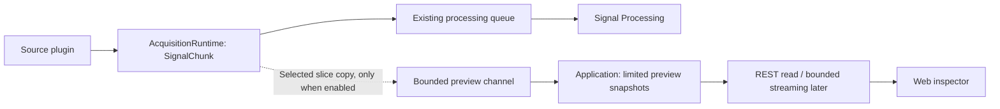

# Acquisition audit and proposed cleanup

Date: 2026-10-22. Branch: `refactor/acquisition`. Audited source commit: `e9154ad`.

Audit revision: the user subsequently requested retaining counters and useful information for a future Web view of selected data inside acquisition packets/chunks. The revised retention decisions below supersede the original A4/P4 deletion proposal and P9 formatter retirement. That analysis revision changed the report only; implementation was authorized subsequently, as recorded below.

Confirmed delivery scope: phase one inspects normalized acquisition output chunks. Native protocol headers/raw-byte inspection is deferred to a later phase. This supersedes the intervening raw-packet-first preference; it does not authorize implementation or pending deletion batches by itself.

Implementation authorization: the user approved the staged cleanup and normalized-chunk inspector on 2026-10-22, with a separate Git commit after each verified step. The inventory below records the pre-change audit at `e9154ad`. Approved cleanup covers A1, A2, A5, A6 and B1-B3. A3 and C1-C5 remain deferred; A4 remains withdrawn. The subsequent commits are the implementation record.

Delivery acceptance: inspect a finite, bounded selection of acquisition-output chunks by generation and sequence; preserve useful counters and capture-time identity; isolate diagnostics from processing and stop-and-drain; defer native protocol byte inspection.

## Follow-up: automatic rolling chunk inspection

The user subsequently requested one green dot per received data block and confirmed automatic collection while reading, retaining the latest 32 blocks. This supersedes the finite, manually started Web capture described in the original delivery record below.

- Each successful stream start creates a continuous preview before the first source read. The default selection includes all available signal rows up to 16, plus the original trigger row, and up to 512 sample columns within the 8,192-value budget. Small chunks are retained as complete matrices; larger chunks retain the explicitly bounded selection.
- Continuous capture has no 32-observation, 10-second or cumulative-byte stopping condition. Per-frame size, the eight-slot nonblocking channel and the 32-frame / 4 MiB retained-cache bounds still apply. Preview drops remain separate from source/processing failures. Only successfully cached blocks produce green dots.
- The inspector opens by default and refreshes its list every 250 ms while open. Dots follow reception order from oldest to newest; later blocks replace the oldest retained blocks. Each dot identifies its chunk sequence and sample count and supports keyboard activation.
- Clicking a dot loads that block's matrix. New blocks do not change the selected sequence. A loaded matrix stays visible if its block leaves the live window, with an explicit notice; only that one client-side snapshot is held. Temporary polling errors also preserve the loaded selection. A new capture or generation resets the selection.
- Stopping reading or reaching EOF retains the last window while the engine graph exists. Starting reading again creates a new capture. The optional **Matrix selection → Apply selection** control replaces the live window with a chosen bounded slice while reading. Existing finite REST captures remain supported with `continuous=false`; the Web selection control uses `continuous=true`.
- Native protocol packets, headers and raw bytes remain outside this phase. A green dot represents an acquisition-output chunk, not evidence of receipt of every native protocol packet.

Validation: the full non-hardware, non-GUI backend suite passed with 2,952 tests and one platform skip; all 215 frontend tests, the production frontend build, OpenAPI generation checks and all seven architecture contracts passed. A local File Playback run produced 739 chunks and retained the latest 32 (sequences 707–738); selecting dot 738 displayed its complete 10 × 100 matrix. One diagnostic delivery drop was reported separately from the 739 successfully read source chunks. Tests also cover rolling beyond 32 chunks, 10 seconds and 4 MiB of cumulative traffic, restarting reads, matrix selection changes, eviction and temporary polling errors.

### Search within the current block or retained window

The selected matrix supports an **Equals** search across all captured channels or a single channel, including Trigger. **Scope** selects **Current chunk** or **All retained chunks (latest 32)**. The current-chunk scope searches its loaded snapshot without extra requests. The all-chunks scope fixes the sequence list visible when Search is clicked and loads those chunks in batches of four using the existing generation- and capture-scoped endpoint. It searches only retained rows and samples, not evicted history or native protocol packets.

Matches are highlighted and counted; **Previous match** and **Next match** locate the chunk, source row and sample index, scrolling only the matrix and updating the selected green dot. Matching chunk snapshots remain available for result navigation even if the live window advances. The UI reports how many listed chunks were searched and explicitly lists chunks that could not be loaded or failed identity checks. New arrivals require another search. Editing a condition, clearing, selecting a chunk manually or leaving the capture cancels pending search publication; it does not keep starting further request batches. Manual selection resets the search, while result navigation reuses the fetched snapshot without another GET.

Comparison normalizes decimal text, including scientific notation, without rounding exact integer strings or nearby decimal values. It uses no floating-point tolerance. Displayed `NaN`, `Infinity`, `-Infinity`, `true` and `false` can also be found; boolean values are distinct from numeric zero and one. Empty, malformed and overlong queries are rejected. Validation: all 242 frontend tests and the production build passed. Browser checks against File Playback confirmed all-channel zero matches, single-channel filtering, scientific-notation equality, and navigation to the last sample column. The all-chunks search loaded all 32 retained blocks (sequences 1446–1477), found 3,200 zero values, and navigated from the first block to sample 99 of the last block while keeping the selected green dot and matrix synchronized.

## Implemented delivery

The sections after this delivery record retain the original audit and its historical line references. Implementation was delivered in this order:

| Step | Commit | Result |
| --- | --- | --- |
| 1 | `7f073c7` | Record the audit, approved cleanup scope and delivery acceptance. |
| 2 | `4d262df` | Remove approved unused plugin state, commands and commented fragments (A1/A2/A5/A6). |
| 3 | `6cfe174` | Inline thin forwarding wrappers and remove unused runtime protocol checks (B1-B3). |
| 4 | `03dc963` | Define bounded preview selection and per-stream chunk/sample counters. |
| 5 | `b5b865a` | Capture selected values on an independent diagnostic channel and retain bounded snapshots. |
| 6 | `9150e8a` | Expose capture control, status and sequence lookup through the application and REST API; regenerate API types. |
| 7 | `863c91c` | Add the Web acquisition chunk inspector and frontend regression tests. |
| 8 | Final verification commit | Replace the diagnostic pipe queue with a bounded shared-memory channel and guard incomplete lifecycle rollback. |

Open **Run Console → Acquisition → Inspect acquisition chunks** while the engine is running. Choose signal rows, a sample-column range and a finite chunk count before capture; optionally include the trigger row. Start reading data, start capture, then select a retained chunk or enter its sequence. Stopping capture does not stop acquisition. The view includes original row/sample indices, values, shape, dtype, host timestamp, capture-time identity and available metadata. Native protocol bytes are outside this delivery.

Limits are 32 observed chunks per capture, 16 signal rows, 512 samples per chunk and 8,192 values including trigger. The capture stops after 10 seconds even if the source is silent. Encoded frames are capped at 128 KiB; the independent channel has eight fixed slots and the retained cache is capped at 32 frames / 4 MiB. Full or contended slots drop preview frames without waiting. Preview drops and delivery counters are distinct from stream counters and do not imply source packet loss. Results remain available while the engine graph exists, but starting a new capture supersedes lookup of the previous capture.

Final lifecycle review reproduced a partial-message hang with `multiprocessing.Queue` when a producer exited after cancelling its feeder join. The replacement copies complete frames under a shared-memory lock with nonblocking writes and deadline-bound reads. If a producer dies while holding that lock, diagnostic delivery may stop until the graph is rebuilt; reads and shutdown still finish. Regression tests cover producer exit with eight maximum-size frames, death while holding the lock, consumer/event-loop shutdown, startup rollback, and prevention of restart after an incomplete rollback.

### Implementation verification

- Backend software regression: **2,926 tests verified passing; one Windows-only process-tree test skipped on macOS**. The full sweep produced 2,924 passes and two failures because the composition-root test fake lacked the new preview provider. The fake was updated to the engine-service contract, with an assertion that preview generation follows the current engine. Its five tests passed; the final `--lf` rerun also passed both previously failing tests. No other backend failures remained.
- Frontend: **208 tests passed**, including 31 new inspector cases. Type checking, production build and generated REST type consistency passed.
- Architecture: **all seven import-layer contracts passed**; `git diff --check` passed.
- Browser verification exercised chunk selection and exact value rendering using clearly identified fixture data. This was a UI verification, not a hardware acquisition run.
- Validation ran locally on macOS / Python 3.14. Physical-device and GUI-marked tests were excluded; Windows and Linux execution remains for their respective CI environments.

Backend commands:

```sh
MPLBACKEND=Agg venv/bin/python -m pytest -o addopts='' -q -m 'not hardware and not gui'
MPLBACKEND=Agg venv/bin/python -m pytest -o addopts='' -q -m 'not hardware and not gui' --lf
venv/bin/lint-imports
```

## Scope and success criteria

The user selected the complete acquisition chain: core runtime, acquisition plugins/resources, domain interfaces and signal models, acquisition application commands/queries/service, and REST router/schemas. The review covers **28 files and 179 explicit function/method definitions**, including abstract methods, properties and framework-invoked endpoints. Dataclass/Pydantic-generated methods are not counted. Files without functions are reviewed separately, including all three plugin manifests and five schemas.

Other services, bootstrap, plugin loading, IPC, frontend and tests were traced as evidence; this report does not claim an exhaustive audit of every function in those adjacent modules. Trigger plugins are included because they live under the acquisition plugin directory and appear in acquisition package manifests.

Success criteria: every in-scope file/function has a disposition and purpose; deletion candidates identify consumers, consequences and test impact; dynamic registrations and public compatibility contracts are distinguished from actual dead code; existing relevant tests establish a baseline; implementation remains untouched until confirmation.

| Area | Files | Explicit definitions |
| --- | ---: | ---: |
| Core acquisition runtime | 4 | 33 |
| Acquisition plugins and resources | 15 | 85 |
| Domain ports, descriptor compatibility, SignalInfo and SignalChunk | 4 | 33 |
| Application service, commands and queries | 3 | 20 |
| REST router and schemas | 2 | 8 |
| **Total** | **28** | **179** |

## Main conclusion

There is **no evidence supporting unconditional deletion of an entire in-scope file**. Most of the current runtime is live. The clearest cleanup opportunities are unused FileReader/parallel-port state, unused Scan45 command construction, an unfinished and disconnected Scan45 metadata-query path, and commented-out implementation fragments. Small forwarding wrappers can be inlined but are not uncalled functions.

Checkpoint/restore, revision updates, signal preparation, metadata caching, authoritative device-state projection and stop-and-drain remain current behavior. They should not be removed because session/raw-recording features were recently removed.

## Revised analysis for future Web acquisition debugging

### Define which data unit is being inspected

There are two useful inspection levels, with different information boundaries:

1. **Normalized acquisition chunk:** a `SignalChunk`, before downstream channel mapping/filtering. This is the smallest common starting point for selecting several blocks, channels and sample columns across all built-in sources.
2. **Native protocol packet:** plugin-specific header and body bytes, potentially including control, metadata or impedance messages. This requires observation inside the plugin before parsing/skipping/normalization; `SignalChunk.raw_data` cannot reconstruct it.

| Source | Relationship between packets and chunks | Existing diagnostic information to retain |
| --- | --- | --- |
| Scan45 | `read_chunk` reads one frame and accepts an EEG data frame (`scan45.py:235-244`). Its decoding removes repeated trigger values (`:289-301`), so normalized values are not the original packet bytes. | Header `ID/code/request/size_body`, `_pending_header`, configured dimensions, `_previous_event`, header formatting and the counter field pending a real counting definition. |
| Curry8 | `read_chunk` can consume several CTRL/INFO/EVENTS/IMPEDANCES messages before returning one EEG matrix (`curry8.py:290-321`). | Header `identifier/code/request/start_sample/body_size/uncompressed_body_size`, protocol version, sample representation, metadata and channel labels. `start_sample` exists in the header but is not currently attached to the returned chunk. |
| FileReader | Reads a configured sample slice, not a network packet; the final chunk may be shorter (`file/reader.py:76-90`). | File identity, `file_pointer`, `_chunk_size`, actual returned sample count, checkpoint `next_sample`, adapter sample length, channel information and event/annotation provenance. |

The user confirmed normalized acquisition-chunk inspection for phase one, with original protocol bytes supported separately later. Phase one uses `SignalChunk.sequence_id`, scoped by runtime generation, to locate captured chunks and display selected channel rows/sample columns, associated values, event data and interpretation metadata. The UI should call these units **chunks**, not native packets. Only captured chunks within the bounded retention window can be looked up; older or uncaptured IDs must be reported as unavailable. Continuous waveform transport is not a prerequisite for this finite inspector.

Phase one does not add raw packet capture, change native protocol framing, populate a protocol-packet history, or replace `SignalSource.read_chunk`'s array return contract. Retain the existing Scan45 counter placeholder and header helpers for later work without treating them as implemented statistics. The useful counters for the first phase are the existing normalized-chunk sequence and per-fetch chunk count.

### Counter semantics and retained information

| Existing value | Current behavior | Revised decision |
| --- | --- | --- |
| Scan45 `_packets_counter` (`scan45.py:160`) | Initialized to zero, never incremented or read in production. It is not working telemetry. | **Keep; A4/P4 withdrawn.** Preserve it for the requested diagnostic work. Define its increment/reset semantics when implementing real statistics, or replace it with an explicitly named equivalent without losing the requested information. |
| Runtime local `packets_counter` (`acquisition.py:415,422,433`) | Counts chunks accepted by `put_data` during one `fetch` invocation; resets at the next invocation; currently used only in EOF logging. | Keep the information. A future status projection may expose this as per-stream chunk count. It does not count all native packets and does not prove downstream consumption. |
| `_last_sequence` / `SignalChunk.sequence_id` (`acquisition.py:102,425-432`) | Zero-based chunk sequence, advanced after the main queue accepts the chunk. Continues across stop/start and reconnect within the same runtime; resets when the runtime is rebuilt. Required for drain barriers. | Keep. Use `(generation, sequence_id)` to identify normalized chunks; attach source/connection/configuration context to a preview at capture time. Never repurpose this sequence as a native protocol packet counter. |
| `SignalChunk.timestamp` (`acquisition.py:426`) | Acquisition-host wall-clock nanoseconds assigned after `read_chunk` returns, before queueing. Not a device sample timestamp. | Keep with explicit units and origin. If sent to JavaScript, preserve exact nanoseconds as a decimal string or an explicitly defined split representation, rather than a floating-point JSON number. |
| Shape, dtype, values and trigger row (`domain/signal.py`) | Already available in the normalized NumPy matrix. | Keep. Copy only the selected bounded slice for preview, retaining its original indices and interpretation. Do not mutate processing data or mistake a sampled display for a complete recording. |
| Source/connection/generation/revision; channel IDs/names/types/units; sample rate/provenance | Available in runtime context and `SignalInfo`, but not all are fields of each `SignalChunk`. Some streams can run without an observed descriptor. | Keep and associate with captured data. Do not label user-declared dimensions as device-observed. If metadata is unavailable, show row indices/unknown units instead of querying device metadata concurrently with streaming. |
| `FileReader.file_pointer`, checkpoint and adapter length | Actual next-sample position and source identity exist; adapter `data.shape[1]` gives real file length. | Keep. Empty fields `_data_length=0` / `FileReader.data=None` are not an additional useful source of truth; A1 remains a separate cleanup candidate. |
| Queue dwell logging (`ipc/data_manager.py:36-48`) | Same-host monotonic enqueue-to-dequeue time is logged; no Web projection exists. | Keep. This is queue residence time, not total acquisition/device-to-screen latency. |
| CNT event mapping (`file/adapter.py:44`) | `events_from_annotations` returns an event dictionary, currently an unused local; it is not retained or exposed after adapter initialization. | **Defer P11 binding removal.** The event-code/annotation relationship may explain the event row during debugging. Retaining a local variable alone does not provide Web access; decide whether to include the mapping in future diagnostic metadata. |

For the later native-protocol phase only: if native packet statistics are added, increment a received-frame count only after the complete frame body has been read, not when a possibly partial header is first cached. Distinguish complete received frames, accepted EEG chunks, accumulated sample columns and preview drops. A suggested native-frame counter scope is one connection: preserve it across stop/start on that connection and reset it on a new connection. This is a proposed definition, not current implemented behavior. Use existing source-native sample positions only where the source provides them; do not fabricate a device packet sequence or infer loss from the host chunk counter.

### Smallest future data path



The acquisition process is the appropriate capture point for a source-output preview. It can select the next limited number of chunks, or every Nth chunk, and select channel rows/sample-column ranges. Selection affects only the preview copy. It must not change acquisition source configuration or the processing channel plan. Keep the actual captured values exact for a data-table view; any later display reduction must be labeled as such. Freezing the Web view must not silently stop the acquisition source.

Important implementation constraints, when this feature is approved:

- **Do not add a second consumer to the main `DataManager` queue.** `SignalProcessor.next_chunk` consumes both data and barriers (`signal_processor.py:133-157`); a debug consumer would steal them. Capture a separate copy after successful main-queue acceptance, while preserving main-path error handling.
- Use a dedicated bounded preview channel with explicit payload, frequency and memory limits. Copy only selected small slices; a view may retain a much larger backing array. Queue-full or preview serialization failures must not become `_fetch_failure` or change stop/drain results. Track preview drops separately from actual source/processing failure. Turning preview off should avoid copying/serializing sample arrays.
- The parent process should hold only the configured finite capture or a bounded recent window. A request for a past block outside that window must report that it is unavailable. Current acquisition does not retain arbitrary historical blocks; counters alone do not enable retrospective lookup.
- Low-rate finite snapshots can use REST with existing frontend polling patterns (`frontend/src/hooks/usePoll.ts:11`). A new control request can enable/select capture, and a read endpoint can retrieve it; method names and DTO shapes are deferred. Do not add a command round trip for every acquired chunk.
- The current results WebSocket accepts TrialCompleted/StimulationAck/Ping, not sample arrays. Its per-event scheduling and sequential broadcast (`presentation/websockets/results.py:118-125`) have no bounded sample backlog. Do not simply forward every chunk through the unchanged EventBus/results path. Continuous waveforms, if chosen, need a bounded sender and slow-client policy.
- Preserve clean architecture: domain signal values remain independent of JSON, WebSocket and UI state; infrastructure owns acquisition/IPC capture, application owns selection and snapshot access, presentation owns request/response transport. Inject dependencies only when implementing the concrete feature; this audit does not add speculative port hierarchies.

Preview identity, chosen rows/sample indices, capture time, available metadata and truncation/drop status should travel with the captured values. Bind metadata to the capture-time connection/configuration, rather than decorating old samples with whichever configuration is current when the UI fetches them. Restart/reconnect must make old previews visibly distinct or clear them. A historical sample gap in a sparse preview is not itself evidence of acquisition packet loss.

### Changes to the cleanup recommendation

- Withdraw A4/P4: retain the Scan45 counter pending real diagnostic semantics. Preserve the actual runtime count, chunk sequence, timestamps, source identity, framing state and channel metadata.
- Retain P9 / `Scan45Message.Header.__str__` and all header fields for diagnostic work. The current concatenated string is only a formatting aid, not a structured Web payload.
- Narrow A6 to commented-out implementation fragments; defer removal of the event dictionary binding (P11) while trigger inspection is considered. Keep useful protocol explanations and executable diagnostics.
- Keep GET cached metadata and metadata availability/provenance fields. Their information is useful for interpreting a live preview; they are no longer listed as potential API-pruning work for this refactor.
- A1, A2 and A5 remain candidates: dummy storage fields, unused outgoing commands and a write-only parallel-port status do not provide the requested received-data inspection. A3 remains a separate interface-retirement decision; the incomplete EDF request does not inspect the normal acquisition stream.
- B1-B3 remain optional small simplifications. The new requirement does not justify deleting or retaining unrelated compatibility paths automatically. No cleanup has been approved or executed.

Phase-one verification should check exact selected values and indices, chunk-sequence lookup within the retained window, unavailable/expired IDs, block-count reset/continuation, FileReader short final chunks/checkpoints, immutable main data, disabled-preview overhead, bounded memory, slow/disconnected UI behavior, preview-drop reporting, and unchanged stream/drain semantics. Fragmented native frames and Curry8 control-vs-EEG packet counting belong to the later raw-protocol phase. No new tests were run for this analysis-only revision; the 419-pass baseline below belongs to the earlier source audit and is not evidence that a preview feature exists.

## Proposed approval batches

### A. Repository-evidenced obsolete or unused implementation

All entries below are recommendations for confirmation, not implemented changes. Evidence is bounded to the repository; direct imports by unknown external scripts cannot be ruled out.

| ID | Proposed change | Evidence and expected impact |
| --- | --- | --- |
| A1 | Delete `FileReader._data_length` and `FileReader.data` initialization (`file/reader.py:26,35`). | Neither value is read in the current code. Actual signal storage is `reader_adapter.data`; cursor and checkpoint state remain. No source behavior changes expected. |
| A2 | Delete Scan45's unused acquisition-start/stop command fields (`scan45.py:69-70`) and their two builders (`:76,86`). | The fields are created but never consumed. Streaming uses the distinct sending-data builders (`:96,106`) and commands at `:216-225`; those remain. Do not infer that all protocol constants should be deleted. |
| A3 | **Conditional retirement:** remove unfinished `Scan45DataReader.request_basic_info` (`scan45.py:209`), its exclusive `getEDFHeaderInfoCommand` field (`:73`) and `_build_get_EDF_header` (`:116`). | No production call exists; current `get_metadata` explicitly reports query support unavailable. The stub does not await `drain`, does not parse the body and writes an unused `info` value. The public helper could have direct external callers; approve its retirement explicitly, separately from unused fields. Preserve current metadata/descriptor behavior. Review the test asserting that this old method is not called, so removal does not leave a misleading mock of a deleted method. |
| A4 | **Withdrawn: retain** Scan45 `_packets_counter` (`scan45.py:160`) for the requested diagnostics. | No real statistics are implemented yet. Define native-packet counting when the debug feature is built; preserve the active runtime chunk count and sequence separately. Do not delete the field/test setup in this cleanup. |
| A5 | Delete `PParallelInpOut.status` initialization (`scan45/_inpout.py:51`). | Assigned once and never read. Retain driver loading and `setData`. |
| A6 | Delete clearly commented-out old Scan45 implementation/debug fragments only. | Keep real packet/event conversion, diagnostic behavior and all author headers. Defer removal of `event_dict` in `file/adapter.py:44` while event-row inspection is considered. Do not remove executable logging/prints as part of comment cleanup. |

Retain `Scan45Message.Header.__str__` (`scan45.py:47`) for the newly requested diagnostic work, even if A3 is later approved. Its string representation is not a substitute for preserving structured header fields.

### B. Behavior-preserving simplifications, optional

| ID | Proposed change | Boundary |
| --- | --- | --- |
| B1 | Inline `AcquisitionRuntime.startup`'s single log statement into `serve`, then remove the wrapper (`acquisition.py:117`). | Preserve logging and the enclosing `try/finally` cleanup. No repository subclass overrides it. |
| B2 | Inline `AcquisitionAppService._put_event` at its three callsites (`acquisition_service.py:255`). | It forwards synchronously to `CommandExecutor.request`. Keep the request payload and exception behavior; the current name misleadingly suggests asynchronous enqueueing. |
| B3 | Remove the two unused `@runtime_checkable` decorators and import (`acquisition.py:7,24,33`), retaining `CommandQueue` and `DataSink`. | No repository runtime checks use these protocols. This removes an introspection capability for hypothetical direct external users, although no supported SDK export is affected. |

Do not flatten every short method. In particular, stop-and-join, metadata response construction, Worker source loading and finalization have meaningful boundaries or shared callers. Avoid inventing new classes/modules merely to split a 503-line runtime.

### C. Explicit compatibility or product decisions required

| ID | Question before changing code | Affected contract / recommendation |
| --- | --- | --- |
| C1 | Is the old stop-only internal command still supported for direct callers? | `AcquisitionCommand.stop_stream`, result-name entry and engine route have no current repository production sender; the REST stop action uses `StopAndDrain`. If retired, keep `_on_stop_stream`, the REST route and application `StopStreamCommand`. Preserve `EventType.StopStream = 112` as a reserved compatibility value unless a wire-protocol break is explicitly accepted. |
| C2 | Must old plugin names/imports remain supported? | Scan45 still uses `metadata.acquisition_descriptor` and `domain.acquisition_descriptor.AcquisitionDescriptor`; the SDK also exports `AcquisitionDescriptor`. Migrate Scan45 to current names first. Deleting old aliases/module is a separate compatibility decision, not automatic cleanup. |
| C3 | Are plugins allowed to be used directly outside the host lifecycle? | `FileReader.set_file_path` has only a test caller; parallel-port `setPin/readData/readPin` have no repository production callers. They are callable interfaces outside the narrow host port contract. Keep unless direct-use compatibility is explicitly dropped. |
| C4 | Must Workers always receive explicit host dependencies and a pinned snapshot? | Builder always supplies snapshot, data manager, event bus and reporter, but Worker fallback/None paths are tested. Making constructor inputs mandatory would permit removing `_settings_snapshot` fallback and some optional branches. Preserve child snapshot installation, source identity guarantees and spawn behavior. |
| C5 | Should the unimplemented `dlportio` option be removed or implemented? | Scan45 advertises/imports `_dlportio` (`scan45.py:340`), but that module is absent. A mocked Windows fallback reproduces `ModuleNotFoundError`; current tests mock the working driver path. This is a missing implementation/behavior decision, not a safe silent deletion. |

Public GET metadata and the status fields `metadata_available` / `metadata_provenance` remain published and tested REST contracts. Their cached inspection and provenance information also fit the new Web debugging requirement. **Keep them out of the deletion list.**

## Inconsistencies to resolve separately

- `CommandQueue.get` declares a bare enum return while the production queue also carries correlated tuples. Correct the type without changing the command contract.
- `AcquisitionWorker` documentation uses the old `DataSource` name and attributes runtime dispatch to the process wrapper.
- The application projection `reset` docstring says the worker is killed without a final event; ordinary shutdown actually requests graceful stop. Reset remains necessary for replacement and abnormal shutdown.
- `SignalChunk.timestamp` is annotated as `float`; the built-in runtime produces integer nanoseconds. Preserve units while deciding whether the annotation should become more precise.
- Scan45 metadata-query stub and missing driver support are recorded above. No implementation choice has been made on the user's behalf.

## Verification and limits

The review uses Python AST inventories, repository-wide reference searches, tracing of manifest/framework/process/event entrypoints, relevant source history and existing tests. A lack of textual callers is not treated as proof that a framework hook, plugin contract, property or special method is unused.

Core/runtime/application/API baseline: **213 passed in 17.34 seconds** using the repository's `venv/bin/python` (Python 3.14.2, pytest 9.0.3):

```sh
venv/bin/python -m pytest tests/acquisition tests/infrastructure/test_acquisition.py tests/infrastructure/test_acquisition_fetch_failure.py tests/infrastructure/test_acquisition_restart.py tests/infrastructure/test_acquisition_resume_capability.py tests/infrastructure/test_source_metadata.py tests/infrastructure/test_stream_drain.py tests/infrastructure/test_command_confirmation_integration.py tests/infrastructure/test_child_runtime_snapshot.py tests/neuroengine/test_worker_readiness.py tests/application/test_acquisition_service.py tests/presentation/test_acquisition_router.py
```

An additional, non-overlapping plugin/domain selection passed **206 tests**, for **419 passed across both selections**. Its exact command and the mocked missing-driver check appear at the end of this report. Passing tests establish the current baseline; they do not establish that unimplemented deletions are safe, nor do they validate real EEG hardware, Windows drivers, or every operating system. After approval, run affected tests again and preserve meaningful regressions when updating tests for intentionally retired interfaces.

## Supporting contracts traced outside the 28-file inventory

| Contract | Location | Assessment |
| --- | --- | --- |
| `AcquisitionSnapshot` | `application/events.py:19` | Keep: source-state projection payload; emitted by runtime and consumed by the application callback. |
| `StreamBarrier` | `application/events.py:27` | Keep: in-band ordering marker emitted after the producer joins; the processor alone acknowledges downstream consumption. |
| `StreamDrainReceipt.to_dict` / `StreamDrainReceipt.from_value` | `application/events.py:47,51` | Keep: serialize/validate processing completion evidence for stop, restart, shutdown and runtime apply. |
| `CommandRequest.from_value` | `application/events.py:84` | Keep: correlation-envelope parsing used by runtime command dispatch. |
| `CommandResult.from_value` | `application/events.py:115` | Keep: broker/result boundary parsing, also used by subsystems outside acquisition. |
| Acquisition-related `EventType` members | `shared/events.py` | Keep active events; old StopStream retirement is C1, with its numeric protocol value handled separately. |
| SDK `SignalSource`, `TriggerEmitter`, `SignalChunk`, `SignalInfo`, `AcquisitionDescriptor` exports | `sdk/__init__.py:18,29-36,90-94` | Keep public contracts; old descriptor-name removal is C2. Unused constructor `context` parameters are also part of the plugin calling convention, not ordinary dead arguments. |


## Core acquisition runtime: complete inventory

### `omnibci/infrastructure/acquisition/__init__.py` — 7 lines, 0 definitions

**Keep.** Package marker and module documentation. There is no runtime implementation to delete. Its overview omits `metadata.py`; updating that overview is documentation work only. Preserve the module header.

### `omnibci/infrastructure/acquisition/acquisition.py` — 503 lines, 27 definitions

| Definition | Line | Decision | Responsibility and actual use |
| --- | ---: | --- | --- |
| `CommandQueue.empty` | 28 | Keep contract | Called by `AcquisitionRuntime.main_loop:130`; describes an injected queue, not an unimplemented feature. |
| `CommandQueue.get` | 30 | Keep; correct annotation | Called by `main_loop:131`. Its annotation currently promises only `AcquisitionCommand`, although production routes also enqueue `(command, request)` tuples. Align the type with actual messages in a later refactor; do not remove tuple handling. |
| `DataSink.put_data` | 37 | Keep contract | Used by `execute:179` for barriers and `fetch:431` for signal chunks. |
| `AcquisitionCommandRejected.__init__` | 56 | Keep | Associates a stable error code with expected control rejection; caught separately in `execute:192`. |
| `AcquisitionRuntime.__init__` | 80 | Keep | Initializes source, IPC, identity, metadata cache and continuity state. Constructed by `worker.py:67`. Preconnected sources and optional event buses have explicit tests. |
| `AcquisitionRuntime.run` | 107 | Keep | Synchronous subprocess entry into `asyncio.run(self.serve())`; invoked by `worker.py:81`. |
| `AcquisitionRuntime.serve` | 110 | Keep | Ensures `shutdown()` runs through `finally`, even if startup or dispatch fails. |
| `AcquisitionRuntime.startup` | 117 | Simplify, optional | Contains only one log statement; sole repository caller is `serve:112`, and no runtime subclass override exists. Move the log into `serve`, then remove the wrapper if approved. This is live but thin code, not dead code. |
| `AcquisitionRuntime.shutdown` | 120 | Keep | Disconnects or joins an orphan fetch task and emits authoritative state. Called from `serve` regardless of exit cause. |
| `AcquisitionRuntime.main_loop` | 128 | Keep | Receives subprocess commands and yields to async reads. Polling redesign is outside a deletion-only pass. |
| `AcquisitionRuntime.execute` | 134 | Keep; possible dispatch simplification | Actual queue consumer. Handles bare shutdown commands, correlated commands, rejection/failure responses and drain barriers. Removing compatibility branches requires a message-contract decision, not a text-search result. |
| `AcquisitionRuntime._configuration_command` | 221 | Keep | Checkpoint capture/restore and revision acknowledgements. Production callers remain in `runtime_apply_service.py:122,178,275,308,321`; these are not removed session-recording features. |
| `AcquisitionRuntime._on_connect` | 258 | Keep | Source connection, per-connection identity and cache lifetime; registered in `execute`. |
| `AcquisitionRuntime._on_disconnect` | 274 | Keep | Stops and joins reading before disconnecting, then updates device state; used by dispatch and shutdown. |
| `AcquisitionRuntime._on_start_stream` | 293 | Keep | Checks connection, continuity and preparation receipt, starts source and fetch task; dispatched from `execute:174`. |
| `AcquisitionRuntime._on_stop_stream` | 319 | Keep | Shared stop-and-join implementation used by both stop commands and disconnect. Retiring the old stop-only command must not delete this method. |
| `AcquisitionRuntime._cancel_fetch_task` | 337 | Keep | Cancels and joins the producer while preserving cancellation of its caller; used by stop, disconnect and shutdown. |
| `AcquisitionRuntime._on_stop_acquisition` | 354 | Keep | Sets loop-exit state via the same command-handler mechanism. Production shutdown queues this bare command in `neuroengine/engine.py:308-313`. Its one-line body is not evidence of obsolescence. |
| `AcquisitionRuntime._on_get_metadata` | 357 | Keep | Reads native metadata with timeout, builds a normalized descriptor, controls refresh/cache behavior and streaming restrictions. Descriptor errors intentionally leave native text visible. |
| `AcquisitionRuntime._clear_metadata` | 388 | Keep | Shared reset used by initialization, new connection, disconnect and metadata refresh. |
| `AcquisitionRuntime._metadata_response` | 393 | Keep | Shared response representation for cached and freshly observed metadata (`:364,386`). |
| `AcquisitionRuntime._validate_signal_receipt` | 402 | Keep | Rejects preparation from another generation, revision, connection or source. This is an active acquisition/processing safety boundary. |
| `AcquisitionRuntime.fetch` | 414 | Keep | Reads plugin arrays, stamps time/sequence, sends chunks and handles EOF/failure. Started with `asyncio.create_task` at `:315`. |
| `AcquisitionRuntime._require_healthy_stream` | 441 | Keep | Prevents restart, successful drain or checkpoint after data continuity was lost. Used by three distinct paths and tested against dropped/malformed/read-failed chunks. |
| `AcquisitionRuntime._finish_stream` | 448 | Keep | EOF/fatal-error teardown from inside `fetch`. Do not merge blindly into `_on_stop_stream`, whose cancellation/join behavior would target the current fetch task. |
| `AcquisitionRuntime._emit_state` | 458 | Keep | Publishes authoritative source state for application/API projection. Bootstrap registers the consumer; this is not duplicate manually tracked runtime state. |
| `AcquisitionRuntime._emit_command_result` | 475 | Keep | Correlated terminal command results consumed by the command broker, API and runtime apply orchestration. |

Additional elements:

- `AcquisitionCommand` (`:40`) has 10 members. Nine have current production origins, including the separate bare process-stop command. The stop-only `stop_stream` member (`:45`) remains routable and tested but has no repository production sender; see conditional decision C1 in the summary.
- `_COMMAND_RESULT_NAMES` (`:61`) preserves application event names in broker results; retain it. Its stop-only entry is part of C1.
- The two `@runtime_checkable` decorators (`:24,33`) have no repository `isinstance`/`issubclass` consumer. Removing those decorators and their import is a low-impact simplification, while keeping both protocols. It does narrow a runtime introspection capability for direct external consumers.
- Both `get_metadata` and `start_stream` appear in the handler map and receive special treatment later (`:146-174`). Their map entries currently serve as recognized-command checks. Simply deleting entries would reject valid commands; any dispatch simplification must preserve this behavior.
- `packets_counter` (`:415`) counts chunks for each fetch invocation; `_last_sequence` persists across stream runs and orders barriers. They have different lifetimes, so they are not duplicate counters.
- `_fetch_failure` deliberately survives disconnect/reconnect. It requires a fresh graph before resuming after loss; clearing it would undermine the continuity contract.
- The shape-validation TODO (`:430`) is not implemented functionality and is not proof that existing shape/descriptor validation is redundant.
- The current `e9154ad` commit already removed recording/session commands, writer state and recording hooks. No remaining session-recording function was found in these four core files.

### `omnibci/infrastructure/acquisition/metadata.py` — 58 lines, 1 definition

| Definition | Line | Decision | Responsibility and actual use |
| --- | ---: | --- | --- |
| `signal_info` | 7 | Keep | Normalizes explicit source dimensions/channel details into `SignalInfo`; used by FileReader's adapter (`file/adapter.py:58`), Curry8 (`curry8.py:261`) and Scan45 through the compatibility alias. Validates inputs before constructing domain values. |

`acquisition_descriptor = signal_info` (`:58`) is an active compatibility alias, imported and called by Scan45 (`scan45.py:15,202`). It can be removed only after migrating that caller and deciding whether old third-party imports remain supported. `docs/channel-mapping.md:9-11` explicitly documents compatibility.

The validation here is not wholly duplicated by domain constructors. In particular, the builder accepts integral floats for sample rates, generates optional channel labels, and rejects explicit empty channel IDs that `ChannelDescriptor` itself would otherwise replace with generated IDs. Do not delete validation wholesale.

### `omnibci/infrastructure/acquisition/worker.py` — 93 lines, 5 definitions

| Definition | Line | Decision | Responsibility and actual use |
| --- | ---: | --- | --- |
| `AcquisitionWorker.__init__` | 30 | Keep; optional contract tightening | Stores IPC objects, deep-copies the snapshot and keeps startup reporting context. Production construction is `neuroengine/builder.py:125-131`. Snapshot isolation is explicitly tested. |
| `AcquisitionWorker.run` | 49 | Keep | `multiprocessing.Process` entry reached through `.start()`. Installs the child snapshot, loads the plugin, starts runtime, reports failure and closes startup reporting. `BaseException` intentionally includes `SystemExit`. |
| `AcquisitionWorker._run` | 65 | Keep | Builds runtime with explicit source/preparation/version context; signals readiness only after construction, before entering runtime. Tests verify both successful and failed construction ordering. |
| `AcquisitionWorker._settings_snapshot` | 83 | Conditional simplification | Used by `run`, `_run` and `_load_data_source`; pins global settings once only when no snapshot was supplied. Production Builder requires and supplies a snapshot, but direct construction fallback is explicitly tested. Remove only after making an explicit snapshot mandatory. |
| `AcquisitionWorker._load_data_source` | 89 | Keep | Loads the selected `acquisition.source` binding through the plugin runtime configuration boundary; the short wrapper is a clear initialization stage. |

Do not remove `settings.use_snapshot`, `deepcopy`, startup reporting, or source construction in the child process. They protect spawn behavior and configuration consistency across platforms. `self.runtime` is used internally and inspected by tests; changing it to a local variable is optional, not a dead-code fix.

The `_startup_stage = "run"` assignment (`:80`) follows `StartupReporter.ready()`. The built-in reporter is single-shot (`process_lifecycle.py:134-139`), so it cannot publish a subsequent run-stage failure. The assignment is low-value redundancy for the built-in reporter, but custom reporters could observe it. Keep this as optional housekeeping rather than expanding the refactor into lifecycle reporting.

Documentation drift: the class docstring says `DataSource` (`:25`) instead of `SignalSource` and assigns command forwarding to the Worker (`:27`), although the runtime's `main_loop` does that. Correct the text while preserving headers; no functional deletion is warranted.

## Signal domain models: complete inventory

The acquisition ports and old descriptor compatibility module are covered in the plugin/port inventory below. The two shared signal models are included here because the acquisition output and metadata contracts depend directly on them.

### `omnibci/domain/signal_info.py` — 147 lines, 14 definitions

| Definition | Line | Decision | Responsibility and actual use |
| --- | ---: | --- | --- |
| `fingerprint` | 8 | Keep | Deterministic hash used by `SignalInfo.fingerprint` and processing input plans in `domain/channel_mapping.py`. |
| `integer` | 13 | Keep | Shared strict integer validation in the model and imported domain contracts. |
| `name` | 18 | Keep | Rejects empty or non-string identifiers/names in model constructors and deserializers. |
| `record` | 23 | Keep | Checks mapping shape and rejects unknown fields during deserialization. |
| `sequence` | 32 | Keep | Validates/normalizes lists and tuples before constructing immutable domain values. |
| `ChannelDescriptor.__post_init__` | 47 | Keep | Enforces channel invariants and normalizes IDs/type spelling. Invoked automatically by the dataclass constructor. |
| `ChannelDescriptor.to_dict` | 60 | Keep | Serializes channel metadata for `SignalInfo.to_dict` and downstream contracts. |
| `ChannelDescriptor.from_dict` | 70 | Keep | Validates wire channel objects; called by `SignalInfo.from_dict`. |
| `SignalInfo.__post_init__` | 88 | Keep | Validates channel order, unique IDs, trigger-row position, sampling and provenance. Automatic dataclass hook. |
| `SignalInfo.signal_channel_count` | 110 | Keep | Derived metadata used by serialization, plugins/processing and source expectation validation. |
| `SignalInfo.output_row_count` | 114 | Keep | Includes the event row; used by serialized descriptors and processing input shape validation. |
| `SignalInfo.fingerprint` | 118 | Keep | Connection-independent output identity checked by acquisition preparation receipts and signal setup. |
| `SignalInfo.to_dict` | 123 | Keep | Acquisition metadata response, SDK context and application/API serialization. |
| `SignalInfo.from_dict` | 133 | Keep | Reconstructs/validates descriptors in `acquisition_service.py:207`, signal setup and channel mapping. |

No function-level deletion candidate was found. The separation between normalized `SignalInfo` and native metadata text is active behavior, not duplicated storage of the same representation.

### `omnibci/domain/signal.py` — 58 lines, 3 definitions

| Definition | Line | Decision | Responsibility and actual use |
| --- | ---: | --- | --- |
| `SignalChunk.__post_init__` | 38 | Keep | Enforces a 2D array with at least one signal and one event row when acquisition constructs each chunk; failed shape tests cover this boundary. |
| `SignalChunk.data` | 51 | Keep | Zero-copy signal-row view, consumed by epoch processing and pretrigger buffers. |
| `SignalChunk.triggers` | 56 | Keep | Event-row view used by `plugins/algorithms/epoch/detector.py:21`, as well as plugin/integration tests. Public through the SDK-exported `SignalChunk`. |

The `timestamp: float` annotation (`:34`) differs from the built-in producer's integer nanosecond stamp (`acquisition.py:426`). This is a type/documentation alignment question, not an obsolete field; do not silently change timestamp units or remove it in a cleanup.


## Acquisition plugins and domain-port audit

Read-only repository audit. This section covers all 15 files under `omnibci/infrastructure/plugins/acquisition`, plus `omnibci/domain/ports/acquisition.py` and `omnibci/domain/acquisition_descriptor.py`: 17 files and 101 explicitly defined functions/methods. The Python AST contains no nested callback functions in these files. Dataclass-generated methods are not counted as source definitions. No production files were changed.

Disposition vocabulary: **Keep** means there is a current runtime, plugin-contract, or compatibility purpose; **Delete** is a concrete removal proposal awaiting the user's approval; **Conditional** requires the stated compatibility/support decision before removal; **Simplify** preserves the behavior and does not remove the function. A method reachable through a manifest or domain interface is not dead merely because it lacks a direct call using its concrete class name. Absence of repository references cannot establish absence of external users.

### Shared caller and contract evidence

- **E1 — selected plugin construction:** [worker.py:90](/Users/lincker/workspace/OmniBCI/omnibci/infrastructure/acquisition/worker.py:90) loads the selected acquisition source. [runtime_configuration.py:60](/Users/lincker/workspace/OmniBCI/omnibci/infrastructure/plugins/runtime_configuration.py:60) passes API 2 parameters/context; [loader.py:257](/Users/lincker/workspace/OmniBCI/omnibci/infrastructure/plugins/loader.py:257) loads the class and invokes it at line 259. [stimulator.py:67](/Users/lincker/workspace/OmniBCI/omnibci/infrastructure/stimulation/stimulator.py:67) loads the selected trigger. Constructors accepting an unused `context` still implement this shared constructor contract.
- **E2 — source lifecycle:** [acquisition.py:264](/Users/lincker/workspace/OmniBCI/omnibci/infrastructure/acquisition/acquisition.py:264) calls `connect`; lines 285, 308, 325, and 418 call `disconnect`, `start_stream`, `stop_stream`, and `read_chunk`. Lines 259/265 and 469/470 read source status. These calls dispatch to every selected source implementation.
- **E3 — source inspection:** [acquisition.py:369](/Users/lincker/workspace/OmniBCI/omnibci/infrastructure/acquisition/acquisition.py:369) calls `get_metadata`; line 376 calls `describe_output`. The former is display text, the latter typed stream dimensions; both are needed.
- **E4 — safe resume:** [acquisition.py:240](/Users/lincker/workspace/OmniBCI/omnibci/infrastructure/acquisition/acquisition.py:240) checks checkpoint capability; lines 242, 243, and 249 capture state, check explicit live-resume safety, and restore state. [runtime_apply_service.py:285](/Users/lincker/workspace/OmniBCI/omnibci/application/services/runtime_apply_service.py:285) rejects unsafe implicit resume. [plugin-manifest.md:164](/Users/lincker/workspace/OmniBCI/docs/plugin-manifest.md:164) documents both capabilities.
- **E5 — trigger consumers:** [ssvep.py:166](/Users/lincker/workspace/OmniBCI/omnibci/infrastructure/plugins/paradigms/classic40SSVEP/ssvep.py:166) clears and sends the selected trigger at lines 166–167, with another send path at 216–217; [stimulator.py:134](/Users/lincker/workspace/OmniBCI/omnibci/infrastructure/stimulation/stimulator.py:134) clears it on reset.
- **E6 — discovery/platform tests:** [test_builtin_contributions.py:19](/Users/lincker/workspace/OmniBCI/tests/infrastructure/test_builtin_contributions.py:19) lists all five acquisition/trigger contributions, loads their declared domain ports at 41–50, and checks Windows-only trigger constraints at 53–65. [test_neuroscan_plugins.py:20](/Users/lincker/workspace/OmniBCI/tests/infrastructure/test_neuroscan_plugins.py:20) tests dynamic discovery and construction.
- **E7 — file replay tests:** [test_file_reader.py:43](/Users/lincker/workspace/OmniBCI/tests/infrastructure/test_file_reader.py:43) covers lifecycle. [test_file_reader_checkpoint.py:46](/Users/lincker/workspace/OmniBCI/tests/infrastructure/test_file_reader_checkpoint.py:46) covers no-repeat/no-skip resume; lines 78, 108, 124, 138, 167, and 194 cover cancellation, stopped-state requirements, different/aliased/changed files, and malformed cursors.
- **E8 — protocol tests:** [test_scan45_channels.py:13](/Users/lincker/workspace/OmniBCI/tests/infrastructure/test_scan45_channels.py:13) covers configured metadata, frame width, events, invalid framing, and formats. [test_neuroscan_curry8.py:215](/Users/lincker/workspace/OmniBCI/tests/infrastructure/test_neuroscan_curry8.py:215) covers header layout; lines 230, 259, 299, 325, 337, 362, 373, and 397 exercise native event rows, metadata refresh, cached inspection, queued packets, invalid/missing replies, lifecycle, and rejected compression.
- **E9 — trigger tests:** [test_neuroscan_plugins.py:47](/Users/lincker/workspace/OmniBCI/tests/infrastructure/test_neuroscan_plugins.py:47) checks Scan45 driver loading and send/clear sequencing. [test_neuroscan_curry8_trigger.py:28](/Users/lincker/workspace/OmniBCI/tests/infrastructure/test_neuroscan_curry8_trigger.py:28) covers bitness, event/address validation, unsupported platforms, unavailable drivers, write errors, and actual selected-trigger integration with mocked hardware.
- **E10 — expected dimensions are used by the host:** [source_expectations.py:5](/Users/lincker/workspace/OmniBCI/omnibci/application/source_expectations.py:5) compares saved `sample_rate` and `channel_count` to observed output; lines 23–36 reject mismatches. [signal_setup_service.py:172](/Users/lincker/workspace/OmniBCI/omnibci/application/services/signal_setup_service.py:172) invokes validation. [test_plugin_schemas.py:47](/Users/lincker/workspace/OmniBCI/tests/infrastructure/test_plugin_schemas.py:47) preserves optional expectations for FileReader/Curry8, and lines 58–64 preserve required Scan45 dimensions.

### Proposed deletions and conditional decisions

These P identifiers are local to the plugin audit section.

| ID | Proposal and exact locations | Classification and evidence | Consequence / verification |
|---|---|---|---|
| P1 | Remove `FileReader._data_length` at `file/reader.py:26` and `FileReader.data` at line 35. | **Delete.** Both are assigned once and never read by repository production code or tests. Actual recording data belongs to `reader_adapter.data`, used at line 148. | Removes misleading state only. Preserve the adapter data and file pointer. Re-run E7. |
| P2 | Remove `Scan45Message.startAcquistionCommand`/`stopAcquistionCommand` at `scan45.py:69–70` and `_build_start_acquisition_header`/`_build_stop_acquisition_header` at 76/86. | **Delete.** Builders only populate these attributes; neither attribute has any repository consumer. Current streaming uses `startSendingDataCommand`/`stopSendingDataCommand` at 217/223. | Delete the unused initialization and builders together. Do not remove live sending-data commands. The associated `Request.StartAcquisition`/`StopAcquisition` enum names are conditional protocol-symbol cleanup, not automatically part of this proposal. |
| P3 | Retire unfinished `Scan45DataReader.request_basic_info` at `scan45.py:209`, its `getEDFHeaderInfoCommand` initialization at 73, and `_build_get_EDF_header` at 116. | **Conditional.** There is no production caller; `test_source_metadata.py:353–365` explicitly asserts the metadata path does not call it. The body is incomplete: `drain()` is not awaited at 211, body is discarded at 212, and `self.info` is write-only at 214. The method is publicly callable, so confirm retirement rather than claiming external callers do not exist. | Once retirement is approved, remove the three pieces together. Preserve `get_metadata`'s truthful unsupported response and configured `describe_output`. Update the test to assert observable behavior without preserving a retired symbol. |
| P4 | Retain `Scan45DataReader._packets_counter` at `scan45.py:160`. | **Keep; deletion withdrawn after the Web debugging requirement.** It is currently never advanced or read in production; the existing test injects a value and checks it is untouched. | Define meaningful native-frame statistics later. Keep it separate from the runtime's per-fetch accepted-chunk count and runtime-wide chunk sequence. |
| P5 | Remove commented-out old implementation fragments at `scan45.py:153–155,228–233,268–269,272,292–293,322–323`. | **Delete.** Non-executable remnants duplicate current lifecycle/parsing or abandoned debug paths. | Preserve author headers, useful protocol explanations, and tests. No behavior test needs to be invented for comment deletion. |
| P6 | Remove `PParallelInpOut.status` at `_inpout.py:51`. | **Delete.** Assigned `None` and never read in repository code. | Preserve the driver, base address, byte/output-mode initialization, and `setData`. Run the existing mocked trigger suite. |
| P7 | Remove `FileReader.set_file_path` at `file/reader.py:37` only if direct mutation is no longer supported. | **Conditional.** The only repository caller is `test_file_reader.py:66`, which redundantly sets the same path supplied to the constructor. Production source selection uses explicit parameters/new instances (E1). It is not part of `SignalSource`, but remains a public concrete-class method. | If approved, delete the method and redundant test call. If external direct callers are supported, retain or deprecate it. |
| P8 | Remove `PParallelInpOut.setPin/readData/readPin` at `_inpout.py:72,88,93` only if the helper is an internal write-only adapter. | **Conditional.** No repository caller exists. `Scan45Trigger._send` only uses `setData` at `scan45.py:328`; these methods are not required by `TriggerEmitter`. Public helper APIs may have external users. | Confirm the helper's supported surface before shrinking it. Do not delete the whole `_inpout.py`, which is dynamically loaded and tested. |
| P9 | Retain `Scan45Message.Header.__str__` at `scan45.py:47`. | **Keep for diagnostic work.** Only one explicit production conversion exists; the new data-debugging requirement makes preserving diagnostic formatting useful. | Keep structured header fields too; the current concatenated display is not a structured preview contract. |
| P10 | Remove the `dlportio` driver choice at `scan45.py:340` if that backend is not supported. | **Conditional.** It references `_dlportio`/`PParallelDLPortIO`, but no such module/class exists in this repository. This is a dangling support path, not proof that all parallel-port functionality is obsolete. | Decide whether to retire the advertised backend or implement it. If retiring, adjust the warning at 362–364 and tests. Hardware behavior is not established by this audit. |
| P11 | Defer removal of `event_dict` at `file/adapter.py:44`. | **Keep pending event-inspection design.** The local mapping is unused today but can explain annotation-to-trigger encoding. It is not currently retained or exposed through the API. | Preserve event conversion and the final event row. Decide later whether to expose the mapping as diagnostic metadata; retaining the local binding alone does not implement that feature. |
| P12 | Merge the identical acquisition-start/stop branches in `Curry8DataReader._handle_control` at `curry8.py:405–411`. | **Simplify.** Both recognized server control requests invalidate `_metadata`. The helper is used at 297/357 and must remain. | Optional small readability change; preserve server-code check and handling of other requests. |

No whole plugin file is proposed for deletion. Dates, old spelling, and support for an older device protocol alone do not establish that a driver is obsolete. No vendor-document currency claim is made.

### File 1 — `file/__init__.py`

[Source](/Users/lincker/workspace/OmniBCI/omnibci/infrastructure/plugins/acquisition/file/__init__.py:1). **Keep.** No functions or runtime statements beyond comments. It preserves the package marker and author header; deleting it yields no meaningful simplification and changes package form.

### File 2 — `file/adapter.py`

[Source](/Users/lincker/workspace/OmniBCI/omnibci/infrastructure/plugins/acquisition/file/adapter.py:1). **Keep file.** The concrete adapter loads CNT recordings and normalizes event output. The abstract base has only one current implementation, but its removal would be an optional structural redesign rather than dead-code cleanup; no deletion is justified solely by the implementation count.

| Function / method | Line | Decision | Purpose and caller evidence |
|---|---:|---|---|
| `ReaderAdapter.__init__` | 17 | Keep | Stores the resolved file path; invoked by `CNTReaderAdapter.__init__` at 34. |
| `ReaderAdapter.read_chunk` | 22 | Keep | Defines the slicing contract implemented at 69 and used by `FileReader.read_chunk` at `reader.py:82`. Abstract body is a contract, not an unreachable obsolete implementation. Error text still names old `read_data()`; correct the text if editing this area. |
| `ReaderAdapter.close` | 26 | Keep | Defines resource cleanup implemented at 78 and called by `FileReader.connect/disconnect` at `reader.py:54,162`. |
| `CNTReaderAdapter.__init__` | 33 | Keep | Opens CNT, captures native metadata, selects output channels and builds events. Constructed by `FileReader.connect` at `reader.py:50`. |
| `CNTReaderAdapter._set_event` | 42 | Keep | Builds the appended event channel; invoked at 40. Retain the event mapping binding pending diagnostic design (P11); it is not currently exposed. |
| `CNTReaderAdapter.get_metadata` | 53 | Keep | Returns original file information; delegated by `FileReader.get_metadata` at `reader.py:170`, then E3. |
| `CNTReaderAdapter.describe_output` | 57 | Keep | Reports selected channels, units, sample rate and file provenance; delegated at `reader.py:176`, then E3. |
| `CNTReaderAdapter.read_chunk` | 69 | Keep | Slices samples and signals clean EOF; called at `reader.py:82`. EOF semantics are consumed by E2 and tested in file suites. |
| `CNTReaderAdapter.close` | 78 | Keep | Closes the MNE file resource; called at `reader.py:54,162`. |

### File 3 — `file/reader.py`

[Source](/Users/lincker/workspace/OmniBCI/omnibci/infrastructure/plugins/acquisition/file/reader.py:1). **Keep file.** Manifest entrypoint at `file/manifest.toml:15`. P1 and P7 are the only proposed API/state removals.

| Function / method | Line | Decision | Purpose and caller evidence |
|---|---:|---|---|
| `FileReader.__init__` | 19 | Keep | API 2 source constructor; validates explicit file path and initializes replay cursor/capability state. Constructed via E1 and tested by `test_explicit_acquisition_parameters.py:25`. Remove only P1 fields. |
| `FileReader.set_file_path` | 37 | Conditional | Direct path setter; only repository caller is `test_file_reader.py:66`. P7 requires public-API retirement decision. |
| `FileReader.connect` | 42 | Keep | Opens a supported recording and rejects a file that changes during opening; E2 and E7. |
| `FileReader.start_stream` | 61 | Keep | Starts at zero unless a validated one-use checkpoint is staged; E2, E7. |
| `FileReader.read_chunk` | 76 | Keep | Paces reading, advances only delivered samples, and signals EOF. E2 and cancellation/resume tests E7. |
| `FileReader.supports_checkpoint` | 95 | Keep | Opts into the checkpoint contract used by E4; `test_acquisition_resume_capability.py:16` distinguishes it from live-source safety. |
| `FileReader.checkpoint` | 98 | Keep | Captures next undelivered sample and file identity after stop; E4, E7. |
| `FileReader.restore_checkpoint` | 115 | Keep | Validates and stages replay state; E4, E7. |
| `FileReader._require_stopped` | 121 | Keep | Prevents cursor capture/restore while streaming or reading; called at 100/117. |
| `FileReader._current_file_identity` | 125 | Keep | Resolves recording identity from path, size and timestamp; called at 47/53/131. |
| `FileReader._validate_file_identity` | 130 | Keep | Rejects mismatched/changed recording; called at 66/103/145. |
| `FileReader._validate_checkpoint` | 134 | Keep | Validates format, source, cursor, file identity and bounds; called at 70/118. |
| `FileReader.stop_stream` | 152 | Keep | Marks the file source stopped; E2. Runtime separately cancels/joins the fetch coroutine before checkpoint use. |
| `FileReader.disconnect` | 159 | Keep | Closes the adapter and clears connected state; E2 and E7. |
| `FileReader.get_metadata` | 166 | Keep | Forwards native file metadata; E3. |
| `FileReader.describe_output` | 172 | Keep | Forwards the adapter's normalized signal description; E3. |

### File 4 — `file/manifest.toml`

[Source](/Users/lincker/workspace/OmniBCI/omnibci/infrastructure/plugins/acquisition/file/manifest.toml:1). **Keep.** No functions. Lines 3–9 declare manifest/API/package identity; lines 11–17 expose the `file_reader` contribution and `reader:FileReader` entrypoint; lines 19–21 bind its schema. E1/E6 depend on this metadata. Its absence would remove discovery, not merely unused documentation.

### File 5 — `file/default.schema.json`

[Source](/Users/lincker/workspace/OmniBCI/omnibci/infrastructure/plugins/acquisition/file/default.schema.json:1). **Keep.** No functions. Every declared property has a current consumer:

| Property / block | Line | Decision | Consumer |
|---|---:|---|---|
| Object shape / `additionalProperties` | 2 | Keep | Loader validates schema-backed API 2 parameters at `loader.py:247–250`. |
| `data_file_path` | 5 | Keep | `FileReader.__init__` at `reader.py:31–34`; machine-scoped file-picker metadata is configuration UI data. Empty saved defaults permit an unconfigured profile; execution rejects an empty path. |
| `file_reader_chunk_size` | 14 | Keep | `reader.py:30,83` controls sample slicing. |
| `sample_rate` | 22 | Keep | Optional saved expectation consumed by host validation E10, not a device-reported override. |
| `channel_count` | 29 | Keep | Optional expected output row count consumed by E10, including event row. |
| `required` | 37 | Keep | Ensures the explicit path/chunk-size parameter shape; validated through the loader and `test_plugin_schemas.py:34`. |

### File 6 — `neuroscan/scan45/scan45.py`

[Source](/Users/lincker/workspace/OmniBCI/omnibci/infrastructure/plugins/acquisition/neuroscan/scan45/scan45.py:1). **Keep file.** Contains two manifest entrypoints plus the packet codec. Review P2–P5, P9–P10 before cleanup.

| Function / method | Line | Decision | Purpose and caller evidence |
|---|---:|---|---|
| `Scan45Message.Header.__init__` | 41 | Keep | Holds packet fields; called by header builders, `create_from_bytes` at 58, and protocol tests E8. |
| `Scan45Message.Header.__str__` | 47 | Keep | Retained for the requested packet diagnostics (P9). Concatenated display is useful for inspection but does not expose a structured Web representation. |
| `Scan45Message.Header.create_from_bytes` | 51 | Keep | Decodes 12-byte network header; used by `_load_package` at 251. Its print-only invalid-size handling is a separate robustness concern, not evidence of dead code. |
| `Scan45Message.Header.to_bytes` | 60 | Keep | Encodes protocol commands; used by all live command builders at 104/114/134. |
| `Scan45Message.__init__` | 68 | Keep | Prebuilds command bytes for module singleton at 137; live consumers are source start/stop/disconnect at 217/223/184. P2/P3 trim unused fields only. |
| `Scan45Message._build_start_acquisition_header` | 76 | Delete | Builds a command whose only destination is unused `startAcquistionCommand` at 69. P2. |
| `Scan45Message._build_stop_acquisition_header` | 86 | Delete | Builds a command whose only destination is unused `stopAcquistionCommand` at 70. P2. |
| `Scan45Message._build_start_send_data_header` | 96 | Keep | Built at 71, consumed by `Scan45DataReader.start_stream` at 217; restart command sequence tested at `test_acquisition_resume_capability.py:45`. |
| `Scan45Message._build_stop_send_data_header` | 106 | Keep | Built at 72, consumed by `stop_stream` at 223; same restart test. |
| `Scan45Message._build_get_EDF_header` | 116 | Conditional | Built at 73 and consumed solely by unfinished `request_basic_info` at 210. Delete with P3 only after that public method is retired. |
| `Scan45Message._build_closing_up_connection_header` | 126 | Keep | Built at 74, consumed by `disconnect` at 184. |
| `Scan45DataReader.__init__` | 142 | Keep | Configures TCP endpoint and required frame dimensions, initializes state. Manifest entrypoint at `scan45/manifest.toml:15`, E1/E6. P4 now retains the counter for diagnostic work. |
| `Scan45DataReader.resume_without_checkpoint_safe` | 163 | Keep | Declares live streaming rather than replay; E4 and `test_acquisition_resume_capability.py:16`. |
| `Scan45DataReader.connect` | 167 | Keep | Public source connection lifecycle and state; E2. |
| `Scan45DataReader._connect` | 175 | Keep | Opens the asyncio socket and resets packet framing; called at 170. Returning reader/writer is unused by that caller, but the function's socket work is live. Optional return-signature simplification is not a deletion. |
| `Scan45DataReader.disconnect` | 182 | Keep | Sends closing command and closes the transport; E2. |
| `Scan45DataReader._disconnect` | 191 | Keep | Clears framing state and waits for socket close; called at 187. |
| `Scan45DataReader.get_metadata` | 196 | Keep | Reports that native device querying is unsupported; E3 and `test_source_metadata.py:353`. Do not replace with fabricated configured metadata. |
| `Scan45DataReader.describe_output` | 200 | Keep | Provides configured stream dimensions with `user-declared` provenance; E3/E8. Uses live compatibility aliases. |
| `Scan45DataReader.request_basic_info` | 209 | Conditional | Unfinished/public unused method, explicitly bypassed by metadata tests. P3. |
| `Scan45DataReader.start_stream` | 216 | Keep | Requests current live data and marks streaming; E2 and restart test at `test_acquisition_resume_capability.py:45`. |
| `Scan45DataReader.stop_stream` | 222 | Keep | Stops live data delivery and updates state; E2 and same restart test. |
| `Scan45DataReader.read_chunk` | 235 | Keep | Loads a packet and dispatches EEG parsing; E2. |
| `Scan45DataReader._load_package` | 246 | Keep | Reads header/body while retaining framing across cancellation; called at 237 and the conditional method at 212. Removing P3 does not make this helper dead. |
| `Scan45DataReader._parse_body_data` | 263 | Keep | Validates packet size/format then parses 32-bit samples; called at 239 and directly tested in E8. |
| `Scan45DataReader._unpack_int32_eeg` | 278 | Keep | Reshapes configured channel frames and removes repeated event values across packets; called at 271 and tested by E8. `_previous_event` is necessary state. |
| `Scan45Trigger.__init__` | 307 | Keep | Resolves the configured/explicit port, initializes the hardware adapter, and clears output. Trigger manifest at `scan45/manifest.toml:26`, E1/E9. |
| `Scan45Trigger.send` | 321 | Keep | Public TTL event output; E5/E9. It currently returns `None` although `TriggerEmitter.send` declares `bool`; contract mismatch should be handled separately, not by deleting the method. |
| `Scan45Trigger._send` | 326 | Keep | Performs `port.setData` on Windows; called at 324/333. The non-Windows print fallback is not the normal manifest-selected path because the contribution is Windows-only (E6). |
| `Scan45Trigger.clear` | 332 | Keep | Resets TTL baseline and holds it for 20 ms; called during construction at 319 and through E5/E9. |
| `Scan45Trigger._set_parallel_port` | 336 | Keep | Resolves the Windows adapter and constructs it; called at 318. P10 is confined to the missing backend option, not this live loader. |

Non-function definitions: keep `Scan45Message`, nested `Header`, `ControlCode`, `Request`, and `scan45_message_manager` because the live protocol path depends on them. `RequestVersion` (27) and `RequestASTSetupFile` (34) have no repository consumers, and `StartAcquisition`/`StopAcquisition` (30/31) would lose their last consumers under P2. These named protocol constants may be retained as protocol vocabulary; deleting publicly visible enum members is **Conditional** and should not be bundled silently with private-builder deletion. Do not remove `CTRL_FromServer` only because P2 removes its current builder use without deciding the intended protocol surface.

### File 7 — `neuroscan/scan45/_inpout.py`

[Source](/Users/lincker/workspace/OmniBCI/omnibci/infrastructure/plugins/acquisition/neuroscan/scan45/_inpout.py:1). **Keep file.** Dynamic import is explicit at `scan45.py:338–349`; E9 imports and mocks this exact helper. No conclusion about installed DLL/hardware availability is drawn from repository tests.

| Function / method | Line | Decision | Purpose and caller evidence |
|---|---:|---|---|
| `PParallelInpOut.__init__` | 13 | Keep | Opens the architecture-specific InpOut driver and configures byte/output mode; dynamically constructed by `Scan45Trigger._set_parallel_port` at `scan45.py:356`. P6 removes only unused `status`. |
| `PParallelInpOut.setData` | 53 | Keep | Writes the output byte; called by `Scan45Trigger._send` at `scan45.py:328`. |
| `PParallelInpOut.setPin` | 72 | Conditional | Read/modify/write of a single pin; no repository caller. P8 requires an internal-only write-byte API decision. |
| `PParallelInpOut.readData` | 88 | Conditional | Reads the data register; no repository caller. P8. |
| `PParallelInpOut.readPin` | 93 | Conditional | Reads individual data/status pins; no repository caller. P8. |

### File 8 — `neuroscan/scan45/manifest.toml`

[Source](/Users/lincker/workspace/OmniBCI/omnibci/infrastructure/plugins/acquisition/neuroscan/scan45/manifest.toml:1). **Keep.** No functions. Lines 11–21 register the source and `default.schema.json`. Lines 22–33 independently register the trigger, its entrypoint, Windows platform restriction (29), and `trigger.schema.json`. E6 verifies that the acquisition source remains available on macOS/Linux while this trigger is rejected there. Do not delete the trigger block merely because it is packaged alongside acquisition code.

### File 9 — `neuroscan/scan45/default.schema.json`

[Source](/Users/lincker/workspace/OmniBCI/omnibci/infrastructure/plugins/acquisition/neuroscan/scan45/default.schema.json:1). **Keep.** No functions.

| Property / block | Line | Decision | Consumer |
|---|---:|---|---|
| Object shape / `additionalProperties` | 2 | Keep | Selected-plugin parameter validation at `loader.py:247–250`. |
| `DATA_PROVIDER_IP` | 5 | Keep | `Scan45DataReader.__init__` at `scan45.py:147`; network connection at 178. |
| `DATA_PROVIDER_PORT` | 13 | Keep | Constructor at 148; network connection at 178. |
| `sample_rate` | 22 | Keep | Configured output description at `scan45.py:150,205`; native metadata is unavailable. |
| `channel_count` | 30 | Keep | Framing at `scan45.py:149,279` and output description at 204; includes the event channel. |
| `required` | 40 | Keep | All four required fields have valid defaults; E10 specifically protects required dimensions for this source. |

### File 10 — `neuroscan/scan45/trigger.schema.json`

[Source](/Users/lincker/workspace/OmniBCI/omnibci/infrastructure/plugins/acquisition/neuroscan/scan45/trigger.schema.json:1). **Keep.** No functions. Object/unknown-property rules at 2–3, `parallel_port_address` at 5, and required field at 14 are consumed by loader validation and `Scan45Trigger.__init__` at `scan45.py:316–317`. E9 tests configured addresses and invalid values. Similarity to the Curry8 schema is not redundancy: each independently installable/selectable contribution owns its schema.

### File 11 — `neuroscan/curry8/curry8.py`

[Source](/Users/lincker/workspace/OmniBCI/omnibci/infrastructure/plugins/acquisition/neuroscan/curry8/curry8.py:1). **Keep file.** Manifest entrypoint at `curry8/manifest.toml:15`. No complete function is a deletion candidate.

| Function / method | Line | Decision | Purpose and caller evidence |
|---|---:|---|---|
| `Curry8Header.to_bytes` | 82 | Keep | Encodes NetStreaming command packets; called by `_send_request` at 382 and validated by E8. |
| `Curry8Header.from_bytes` | 95 | Keep | Validates/decodes header size, identifier and codes; `_read_packet` at 392. |
| `Curry8BasicInfo.from_bytes` | 121 | Keep | Validates and decodes device dimensions/control permissions; `_load_metadata` at 328. |
| `Curry8DataReader.__init__` | 170 | Keep | Configures endpoint, timeout and connection/metadata state. E1/E6; positional host/port/timeout remain explicitly tested in `test_explicit_acquisition_parameters.py:64`. |
| `Curry8DataReader.resume_without_checkpoint_safe` | 195 | Keep | Declares current network delivery without replay; E4 and `test_acquisition_resume_capability.py:16`. |
| `Curry8DataReader.connect` | 199 | Keep | Opens TCP, negotiates/validates protocol, closes on failure; E2/E8. |
| `Curry8DataReader.disconnect` | 233 | Keep | Stops live streaming, closes transport, clears metadata/state; E2/E8. |
| `Curry8DataReader.get_metadata` | 245 | Keep | Queries stopped device facts or renders cached streaming metadata; E3/E8. |
| `Curry8DataReader.describe_output` | 256 | Keep | Describes normalized signal channels and final event row using successful query results; E3/E8. |
| `Curry8DataReader.start_stream` | 269 | Keep | Ensures connection/metadata and requests streaming; E2/E8. |
| `Curry8DataReader.stop_stream` | 280 | Keep | Sends stop request and clears streaming state even on teardown failure; E2/E8. |
| `Curry8DataReader.read_chunk` | 290 | Keep | Skips protocol/control side packets and parses supported EEG blocks; E2/E8. |
| `Curry8DataReader._load_metadata` | 323 | Keep | Requests basic/channel info and stores parsed metadata; callers at 250/275. |
| `Curry8DataReader._request_info` | 346 | Keep | Sends an info request and waits with timeout while handling control/queued stream packets; callers at 213/324/329. |
| `Curry8DataReader._send_request` | 374 | Keep | Writes an encoded client request to the transport; callers at 276/285/351. |
| `Curry8DataReader._read_packet` | 385 | Keep | Validates framing/body limits and retains a partially read packet across cancellation; callers at 295/355. |
| `Curry8DataReader._handle_control` | 405 | Simplify | Invalidates metadata on recognized acquisition changes; callers at 297/357. P12 permits merging identical branches, not removing the function. |
| `Curry8DataReader._handle_info` | 414 | Keep | Validates that an otherwise unconsumed packet is an information packet; callers at 301/368. |
| `Curry8DataReader._parse_channel_labels` | 422 | Keep | Validates channel-info size and decodes UTF-16 labels; `_load_metadata` at 333. |
| `Curry8DataReader._parse_eeg` | 440 | Keep | Selects supported dtype, checks complete frames and returns channel-major data; `read_chunk` at 321. |
| `Curry8DataReader._close_writer` | 459 | Keep | Clears transport/framing references and closes the socket; `connect/disconnect` at 228/238. |

Non-function definitions: keep the protocol error, enum classes, struct layouts, header/basic-info/metadata dataclasses, and current constants. Metadata fields such as amplifier/recording permissions are rendered by `get_metadata` at 254 even when the host does not use them for control; they are not unused fields. `BlockType.EVENT_LIST` is used by protocol fixtures at `test_neuroscan_curry8.py:140,345`; the runtime intentionally ignores side event packets because the EEG block already carries the native event row. The native event row and optional side event packet are not two duplicate host event sources to delete casually.

### File 12 — `neuroscan/curry8/trigger.py`

[Source](/Users/lincker/workspace/OmniBCI/omnibci/infrastructure/plugins/acquisition/neuroscan/curry8/trigger.py:1). **Keep file.** Manifest entrypoint at `curry8/manifest.toml:27`. Replacing the older Scan45 trigger with this implementation may be a future unification, but differing validation/return/error semantics require an explicit behavior decision; it is not a safe duplicate-file deletion.

| Function / method | Line | Decision | Purpose and caller evidence |
|---|---:|---|---|
| `Curry8Trigger.__init__` | 22 | Keep | Validates I/O address/platform, loads the correctly sized DLL, checks kernel driver, configures the port and clears it; E1/E6/E9. |
| `Curry8Trigger.send` | 66 | Keep | Validates an integer byte event and writes it, returning success; E5/E9. |
| `Curry8Trigger.clear` | 73 | Keep | Resets event lines and maintains a 20 ms baseline; called at 64 and E5/E9. |

### File 13 — `neuroscan/curry8/manifest.toml`

[Source](/Users/lincker/workspace/OmniBCI/omnibci/infrastructure/plugins/acquisition/neuroscan/curry8/manifest.toml:1). **Keep.** No functions. Lines 11–21 register `Curry8DataReader` and `default.schema.json`; lines 23–34 independently register `Curry8Trigger`, Windows-only availability at 30, and `trigger.schema.json`. E1/E6 exercise both entries. Removing this manifest removes live catalog contributions.

### File 14 — `neuroscan/curry8/default.schema.json`

[Source](/Users/lincker/workspace/OmniBCI/omnibci/infrastructure/plugins/acquisition/neuroscan/curry8/default.schema.json:1). **Keep.** No functions.

| Property / block | Line | Decision | Consumer |
|---|---:|---|---|
| Object shape / `additionalProperties` | 2 | Keep | Selected-plugin parameter validation at `loader.py:247–250`. |
| `DATA_PROVIDER_IP` | 5 | Keep | Constructor at `curry8.py:180`, connection at 208. |
| `DATA_PROVIDER_PORT` | 13 | Keep | Constructor at `curry8.py:181–184`, connection at 209. |
| `sample_rate` | 22 | Keep | Optional experiment expectation checked against device observation by E10. |
| `channel_count` | 29 | Keep | Optional experiment output-row expectation checked by E10. |
| `required` | 37 | Keep | Endpoint fields have defaults; expected dimensions deliberately have no invented defaults, tested by `test_plugin_schemas.py:47`. |

### File 15 — `neuroscan/curry8/trigger.schema.json`

[Source](/Users/lincker/workspace/OmniBCI/omnibci/infrastructure/plugins/acquisition/neuroscan/curry8/trigger.schema.json:1). **Keep.** No functions. Object shape at 2–3, `parallel_port_address` at 5, and `required` at 15 feed loader validation and `Curry8Trigger.__init__` at `trigger.py:25–35`. E9 verifies that invalid addresses fail before hardware loading. This remains separate package-owned configuration even though Scan45 has a similar property.

### File 16 — `omnibci/domain/ports/acquisition.py`

[Source](/Users/lincker/workspace/OmniBCI/omnibci/domain/ports/acquisition.py:1). **Keep file.** `SignalSource` and `TriggerEmitter` are exported by `omnibci.sdk` at line 18. Abstract and default capability methods are extension contracts, not obsolete implementations.

| Function / method | Line | Decision | Purpose and caller evidence |
|---|---:|---|---|
| `SignalSource.__init__` | 22 | Keep | Initializes authoritative connected/streaming flags; each built-in source calls `super().__init__` (`reader.py:23`, `scan45.py:146`, `curry8.py:179`). |
| `SignalSource.is_connected` | 28 | Keep | Public source state consumed by E2 and runtime state snapshots at `acquisition.py:469`. |
| `SignalSource.is_streaming` | 32 | Keep | Public streaming state consumed throughout lifecycle/checkpoint logic and snapshot at `acquisition.py:470`. |
| `SignalSource.supports_checkpoint` | 36 | Keep | Defaults capability off for existing/live sources; E4. Default compatibility tested by `test_file_reader_checkpoint.py:206`. |
| `SignalSource.resume_without_checkpoint_safe` | 41 | Keep | Defaults live-resume guarantee off; E4. Unknown sources must not acquire safe-resume behavior implicitly. |
| `SignalSource.checkpoint` | 50 | Keep | Optional stopped-source capture contract; E4; unsupported default tested at `test_file_reader_checkpoint.py:217`. |
| `SignalSource.restore_checkpoint` | 59 | Keep | Optional checkpoint restore contract; E4; unsupported default tested at `test_file_reader_checkpoint.py:219`. |
| `SignalSource.get_metadata` | 64 | Keep | Abstract display-text query contract implemented by every source and invoked by E3. |
| `SignalSource.describe_output` | 71 | Keep | Optional typed output-description contract consumed by E3; metadata-only sources can raise its default error. |
| `SignalSource.connect` | 81 | Keep | Abstract connection contract used by E2 and dynamically checked subclass loading E6. |
| `SignalSource.start_stream` | 85 | Keep | Abstract stream-start contract used by E2. |
| `SignalSource.read_chunk` | 89 | Keep | Abstract fixed-layout chunk/EOF contract used by E2 and the runtime's `fetch` at `acquisition.py:418`. |
| `SignalSource.stop_stream` | 100 | Keep | Abstract stream-stop contract used by E2 and runtime teardown at `acquisition.py:452`. |
| `SignalSource.disconnect` | 104 | Keep | Abstract disconnection contract used by E2. |
| `TriggerEmitter.send` | 110 | Keep | Abstract selected-trigger output contract used by E5 and both trigger contributions. |
| `TriggerEmitter.clear` | 114 | Keep | Abstract baseline/reset contract used by E5 and both trigger contributions. |

### File 17 — `omnibci/domain/acquisition_descriptor.py`

[Source](/Users/lincker/workspace/OmniBCI/omnibci/domain/acquisition_descriptor.py:1). **Keep compatibility file.** No functions. `AcquisitionDescriptor = SignalInfo` at 5 and the `ChannelDescriptor` re-export at 2/7 form the former public import surface. Scan45 imports `AcquisitionDescriptor` at `scan45.py:14` and uses it in its output signature at 200. The matching metadata builder alias is called at `scan45.py:202`. [channel-mapping.md:9](/Users/lincker/workspace/OmniBCI/docs/channel-mapping.md:9) explicitly preserves the old names for existing plugins, and [sdk/__init__.py:35](/Users/lincker/workspace/OmniBCI/omnibci/sdk/__init__.py:35) preserves the public SDK alias. Migrating Scan45 to `SignalInfo` would remove one repository dependency but would not by itself authorize removing the external compatibility surface. The `ChannelDescriptor` re-export has no current internal consumer through this old module; keep under the same compatibility decision rather than treating its explicit export as a stray unused import.

### Verification boundary and follow-up requirements

This section is based on complete source reads, AST enumeration of every explicitly defined function/method, manifest/schema inspection, and repository-wide reference searches. Tests cited above were inspected as evidence; separate aggregate test results belong to the main audit and must not be inferred from citation alone. No real CNT recording, TCP amplifier, Windows DLL, or physical TTL hardware was exercised by this section.

After approval, a deletion patch should preserve all live lifecycle, metadata, descriptor, replay, manifest, and schema contracts. Update tests that currently retain obsolete symbols only where that symbol's removal is approved. Run existing file, Scan45, Curry8, checkpoint, explicit-configuration, schema, discovery, trigger, and source-metadata suites. Hardware-relevant behavioral refactoring requires appropriate hardware verification; comment/unused-binding cleanup alone does not.


## Acquisition application and presentation audit

Read-only audit. Repository root: `/Users/lincker/workspace/OmniBCI`. Line references describe the current checkout. This section covers every declared class and function in the five acquisition application/presentation files; bootstrap, other services, frontend and engine are traced as consumers. No implementation or test files were edited.

Disposition: **KEEP** means live behavior or an exposed contract; **INLINE CANDIDATE** means remove only the helper and preserve its behavior at callers; **CONDITIONAL** means a contract/architecture decision is required. No entire file in this section is proven dead.

### Application service: `omnibci/application/services/acquisition_service.py`

Class `AcquisitionAppService` (33): KEEP. Instantiated at `omnibci/bootstrap.py:108`, injected into the API at `omnibci/presentation/main.py:97`, runtime configuration at `omnibci/bootstrap.py:206`, and signal setup at `omnibci/bootstrap.py:193`.

| Definition | Disposition | Responsibility and concrete evidence |
|---|---|---|
| `AcquisitionAppService.__init__` (41) | KEEP | Initializes command executor, configuration admission, lifecycle lock, worker state projection and metadata cache; bootstrap constructs it at `bootstrap.py:108`. The lifecycle lock is also acquired by `application/services/signal_setup_service.py:151`. |
| `AcquisitionAppService.set_signal_preparer` (62) | KEEP | Composition callback installed by `bootstrap.py:202`; consumed before StartStream at service line 110. Callback prepares Processing and actuation (`bootstrap.py:197`). |
| `AcquisitionAppService.set_metadata_binding` (66) | KEEP | Installed by `bootstrap.py:191`; read at service line 191 to bind metadata to the active source and compare source expectations. |
| `AcquisitionAppService.cached_descriptor` property (71) | KEEP | Used by `cached_descriptor_for` (85) and `get_descriptor` (188); returns a detached serialized SignalInfo. This small helper has two meaningful callers and is not dead. |
| `AcquisitionAppService.is_streaming` property (76) | KEEP | `application/services/shutdown_service.py:65` uses it to decide whether to request a processing drain before engine shutdown. |
| `AcquisitionAppService.cached_descriptor_for` (80) | KEEP | `application/services/signal_setup_service.py:64` requests metadata only for the matching selected/active binding. Owner comparison prevents metadata from a previous source from being presented for a new selection. |
| `AcquisitionAppService.handle_connect` (92) | KEEP | REST route at `presentation/routers/acquisition.py:40`; rebuild/resume at `application/services/runtime_apply_service.py:306`. |
| `AcquisitionAppService.handle_disconnect` (98) | KEEP | REST route at `presentation/routers/acquisition.py:58`; invalidates metadata and requests confirmed disconnect. Frontend consumers: `frontend/src/RunConsole.tsx:46`, `frontend/src/PluginProfiles.tsx:277`. |
| `AcquisitionAppService.handle_start_stream` (105) | KEEP | REST route at `presentation/routers/acquisition.py:76`, runtime resume at `runtime_apply_service.py:335`. Existing stopped stream is drained before preparation/start; already-streaming calls avoid destroying the active epoch. Tests: `tests/application/test_acquisition_service.py:78`, `:90`, `:97`, `:108`. |
| `AcquisitionAppService.handle_stop_stream` (115) | KEEP | REST route at `presentation/routers/acquisition.py:94`; sends StopAndDrain through line 116, not the old StopStream event. User-visible Stop behavior must retain processing completion evidence. Test: `tests/application/test_acquisition_service.py:63`. |
| `AcquisitionAppService.handle_stop_and_drain` (120) | KEEP | Used internally at lines 109/116, by configuration transitions (`runtime_apply_service.py:267`), and shutdown (`shutdown_service.py:64`). Validates `StreamDrainReceipt`; cannot be reduced to stopping the producer. |
| `AcquisitionAppService.reset` (134) | KEEP; documentation stale | Called after engine stop at `presentation/routers/engine.py:41`, and during configuration rebuild/rollback at `runtime_apply_service.py:354`, `:398`. The docstring at lines 137-140 says the worker is killed and emits no final event, but engine shutdown first enqueues graceful stop (`infrastructure/neuroengine/engine.py:308`) and runtime shutdown emits state (`infrastructure/acquisition/acquisition.py:120`). Update that explanation; retain explicit projection/cache reset for lifecycle replacement and abnormal stop. |
| `AcquisitionAppService.on_acquisition_state` (152) | KEEP | Registered as an EventBus callback at `bootstrap.py:286`. Its absence from direct calls would not indicate dead code. Processes authoritative worker state and invalidates cache when connection identity changes. Tests: `tests/application/test_acquisition_service.py:126`, `:134`, `:146`, `:327`. |
| `AcquisitionAppService.get_metadata` (171) | KEEP | Called by router helper at `presentation/routers/acquisition.py:127`. Returns opaque plugin text plus optional normalized descriptor and comparison; preserving raw metadata when descriptor normalization fails is tested at `tests/application/test_acquisition_service.py:277`. |
| `AcquisitionAppService.get_descriptor` (178) | KEEP | `application/services/signal_setup_service.py:162` requires normalized SignalInfo for processing preparation. Unlike get_metadata, rejects missing/invalid descriptor. These methods intentionally provide different contracts and are not duplicates. |
| `AcquisitionAppService._read_metadata` (190) | KEEP | Called by both public metadata getters at 174/181. Requests correlated worker metadata, validates envelope and connection identity, constructs descriptor, computes expectation comparison and binds cache ownership. Invalid-worker-data tests at `tests/application/test_acquisition_service.py:349`, `:358`; comparison tests at `:375`, `:392`. |
| `AcquisitionAppService.handle_get_status` (222) | KEEP | Router at `presentation/routers/acquisition.py:110`, signal preparation at `signal_setup_service.py:161`, runtime apply at `runtime_apply_service.py:187`, `:341`. |
| `AcquisitionAppService._device_metadata` (236) | KEEP | Used by status handler at 223; deliberately avoids presenting configured/user-declared dimensions as observed device facts. Tests: `tests/application/test_acquisition_service.py:184`, `:297`, `:310`. |
| `AcquisitionAppService._clear_metadata` (250) | KEEP | Shared invalidation at constructor 60, disconnect 100, reset 146, state callback 163 and metadata read 192. Clears descriptor, raw metadata and binding owner together. |
| `AcquisitionAppService._put_event` (255) | INLINE CANDIDATE | Only forwards to `self._command_executor.request(event_type, data)` at 256; callers at 94,101,111. Name suggests fire-and-forget enqueue even though it synchronously waits for a terminal result. Safest simplification is replacing all three calls with `.request(...)` and deleting only this wrapper; preserve return/exception semantics and both arguments where relevant. It is a redundant forwarding helper, not an uncalled function. |

#### State fields and unused-looking status metadata

`metadata_available` and `metadata_provenance` are produced at service lines 231-232, copied at router lines 118-119, and declared in both result and response DTOs. No current frontend behavior reads these two status fields, but they are exported in `docs/openapi.json` and generated `frontend/src/api/rest-types.ts`; `tests/presentation/test_openapi_contract.py:177` protects them. **Keep both fields for the newly requested diagnostic view**; they describe availability and whether dimensions came from observation or configuration. Connection ID must remain: `frontend/src/PluginProfiles.tsx:125`, `:138`, `:295` uses it for stale-metadata protection.

### Application commands: `omnibci/application/commands/acquisition_commands.py`

There are four frozen, fieldless dataclasses and no explicitly declared methods.

| Class | Disposition | Evidence |
|---|---|---|
| `ConnectDataProviderCommand` (9) | KEEP | Constructed by acquisition router line 40 and runtime apply line 306; service handler line 92 accepts it. |
| `DisconnectDataProviderCommand` (14) | KEEP | Constructed by acquisition router line 58; service handler line 98 accepts it. |
| `StartStreamCommand` (19) | KEEP | Constructed by acquisition router line 76 and runtime apply line 335; service handler line 105 accepts it. |
| `StopStreamCommand` (24) | KEEP | Constructed by acquisition router line 94; service line 115 accepts it and deliberately requests StopAndDrain. This DTO is distinct from the obsolete-looking internal `AcquisitionCommand.stop_stream` enum member. |

These objects carry no data, and the service does not inspect `cmd`; removing them and using parameterless methods would be an architecture/style simplification across all callers, not dead-code cleanup. The project uses the same command/query convention elsewhere, so do not single out acquisition DTOs for deletion without an explicit decision.

### Application queries: `omnibci/application/queries/acquisition_queries.py`

There are two dataclasses and no explicitly declared methods.

| Class | Disposition | Evidence |
|---|---|---|
| `GetAcquisitionStatusQuery` (9) | KEEP | Constructed by acquisition router line 110, signal setup line 161 and runtime apply lines 187/341. Fieldless query-object simplification has the same architectural caveat as commands. |
| `AcquisitionStatusResult` (14) | KEEP | Constructed by service line 225; fields projected into REST response at router lines 113-120. Used by signal preparation and runtime transition state decisions. Separate application and Pydantic response models preserve the application/presentation boundary. |

`AcquisitionStatusResult` fields: connected, streaming, source, sample_rate, channel_count, metadata_available, metadata_provenance, connection_id. Keep all fields, including metadata availability/provenance for live diagnostic interpretation.

### REST router: `omnibci/presentation/routers/acquisition.py`

Registered by `omnibci/presentation/main.py:178`. The seven decorated endpoints are framework-invoked functions; lack of Python direct-call references is not evidence of dead code.

| Function | Disposition | Endpoint and evidence |
|---|---|---|
| `connect` (38) | KEEP | POST `/acquisition/connect`; frontend wrapper at `frontend/src/api/client.ts:81`, calls from RunConsole 45 and PluginProfiles 265. |
| `disconnect` (56) | KEEP | POST `/acquisition/disconnect`; frontend wrapper client 82, RunConsole 46, PluginProfiles 277. |
| `start_stream` (74) | KEEP | POST `/acquisition/stream/start`; frontend wrapper client 91, RunConsole 47. |
| `stop_stream` (92) | KEEP | POST `/acquisition/stream/stop`; frontend wrapper client 92, RunConsole 48; must preserve StopAndDrain semantics. |
| `get_status` (109) | KEEP | GET `/acquisition/status`; frontend wrapper client 72; polled by application and read in source configuration at PluginProfiles 240/266/278. |
| `_metadata_response` (125) | KEEP | Shared error translation and response helper used by the two metadata endpoints at 141/149; genuine reuse. |
| `get_metadata` (140) | KEEP for cached diagnostic metadata | GET `/acquisition/metadata`; current frontend only invokes POST refresh, but GET allows non-refresh reads of cached metadata while streaming. Registered OpenAPI endpoint and tested at `tests/presentation/test_acquisition_router.py:175`, `:186`. Keep this distinct cached-read behavior for the future in-stream inspector. |
| `refresh_metadata` (148) | KEEP | POST `/acquisition/metadata/refresh`; frontend wrapper at client 83 and PluginProfiles metadata read flow; refresh=True is meaningfully different from GET, and source refresh is rejected while streaming by runtime. |

The repeated `except ProfileRevisionConflict: raise` clauses are not dead: `ProfileRevisionConflict` inherits RuntimeError (`application/plugin_profiles.py:22`) and admission raises it during transitions (`application/runtime_admission.py:29`, `:31`). Without the explicit rethrow, the later RuntimeError handler would incorrectly convert a configuration conflict to 503. Global conflict handling is registered at `presentation/errors.py:132`. Consolidating repeated exception handling is possible but is not a reason to delete these branches in isolation.

### REST schema: `omnibci/presentation/schemas/acquisition.py`

Six Pydantic models, no explicitly declared methods. KEEP all six; these participate in validation, serialization, OpenAPI generation and TypeScript client generation even without explicit construction calls.

| Model | Disposition | Evidence and fields |
|---|---|---|
| `ChannelDescriptorModel` (5) | KEEP | Nested in SignalInfoModel channels at 21. Fields: channel_id, index, name, signal_type, unit, name_provenance. Mirrors per-channel identity/type/unit and generated-name provenance. |
| `SignalInfoModel` (16) | KEEP | Nested in AcquisitionMetadataResponse at 45; reused outside acquisition by `presentation/schemas/signal_setup.py:8`, `:57`. Fields: source_id, sample_rate, channels, trigger_row_index, connection_id, native_event, provenance, signal_channel_count, output_row_count. Although counts are derived, frontend explicitly displays both (`frontend/src/AcquisitionMetadata.tsx:24`, `:25`) and uses output_row_count for confirmed source parameters (`frontend/src/PluginProfiles.tsx:298`, `:312`). |
| `SourceParameterComparisonModel` (30) | KEEP | Nested twice in SourceExpectationsModel at 37/38. expected and actual distinguish profile expectations from source observation; comparison table at `frontend/src/AcquisitionMetadata.tsx:40`. |
| `SourceExpectationsModel` (35) | KEEP | Nested in AcquisitionMetadataResponse at 46; fields status, sample_rate, channel_count. UI uses comparison status at AcquisitionMetadata 39 and PluginProfiles 124. |
| `AcquisitionMetadataResponse` (41) | KEEP | Response type on GET/POST metadata routes at router 137/145; frontend DataSourceMetadata alias at `frontend/src/api/client.ts:14`. Raw metadata and normalized descriptor are intentionally both exposed. |
| `AcquisitionStatusResponse` (49) | KEEP | GET status route response at router 106/112; frontend AcquisitionStatus alias at client 13. Keep metadata_available/metadata_provenance for interpreting the requested diagnostic view. |

### Cross-layer conditional candidate: the old stop-only event

**Candidate:** retire the internal standalone `AcquisitionCommand.stop_stream` dispatch path, preserving `_on_stop_stream` and the public REST stop route.

Evidence:

1. `AcquisitionAppService.handle_stop_stream` (`application/services/acquisition_service.py:115`) delegates to `handle_stop_and_drain` at 116; that requests `EventType.StopAndDrain` at 126. Frontend stop therefore already uses the drain contract.
2. Repository-wide production search finds no producer of `EventType.StopStream`; remaining production references are the enum, routing and result-name table. Tests intentionally exercise the older path.
3. Candidate internal pieces: enum member at `infrastructure/acquisition/acquisition.py:45`, `_COMMAND_RESULT_NAMES` entry at 65, dispatch mapping entry at 150, and engine event route at `infrastructure/neuroengine/engine.py:429`.
4. Keep `_on_stop_stream` (`infrastructure/acquisition/acquisition.py:319`): StopAndDrain maps to it at 151 and disconnect calls it at 282. Keep `StopStreamCommand`, `handle_stop_stream`, `/stream/stop`, and frontend wrapper: these represent active user behavior.
5. `omnibci/sdk/__init__.py:90` exports neither EventType nor AcquisitionCommand. Current socket peers do not admit StopStream: whitelist sets are `infrastructure/neuroengine/gateway/peers.py:56` and `:106`.
6. There is nevertheless a **wire compatibility contract**: `shared/events.py:19` assigns StopStream=112; `tests/infrastructure/test_ipc_contracts.py:40` explicitly asserts value 112 and successful encode/decode. `infrastructure/ipc/contracts.py:97` resolves incoming integers through EventType; deleting this member changes accepted v1 frame values. Prefer retaining the numeric enum value as reserved/deprecated even if internal dispatch is removed, unless the user explicitly accepts this protocol break. Do not reuse 112 for a different event.
7. Bare-command support is separately live: engine shutdown enqueues bare `AcquisitionCommand.stop_acquisition` at `infrastructure/neuroengine/engine.py:311`. Removing all uncorrelated/bare handling would break shutdown.

Suggested verification if approved: existing acquisition service/router tests (stop waits for valid drain), runtime/stream-drain tests (barrier ordering), engine routing tests adjusted only for retired path, and IPC contract test retained for numeric 112 compatibility. Direct-stop runtime tests should be reviewed and migrated to the supported drain/stop helper contract, not deleted indiscriminately.

### Findings suitable for the confirmation list

- **Low-risk simplification:** inline service `_put_event` at 255 into three live callsites; delete the wrapper only.
- **Conditional compatibility removal:** retire internal stop-only command route and mappings after accepting loss of direct in-process callers; retain reserved wire ID112 unless a wire-contract change is separately accepted.
- **Keep cached metadata and provenance:** GET `/acquisition/metadata` and metadata_available/metadata_provenance remain public contracts and provide useful information for the requested in-stream diagnostic view. Do not prune them in this refactor.
- **Documentation correction:** reset docstring and engine router comment claim normal stop kills workers; implementation first requests graceful stop. Keep reset itself.
- **Retain:** all five files, all six Pydantic schemas, all command/query/result classes under the current architecture; preparation, metadata identity validation, StopAndDrain, source checkpoint/revision paths and authoritative state projection are active behavior.

No additional tests were run in this read-only consumer audit; the parent task reported 213 selected acquisition baseline tests passed. Findings are based on source, production consumer tracing, declared REST/IPC contracts and existing test inspection.


## Test coverage and limitations

- File playback tests verify lifecycle, EOF, cursor advancement, exact resume position, cancellation, file identity, and malformed checkpoint rejection. `FileReader.data` is not used to implement any of these behaviors.
- The `_packets_counter` test is not evidence of live counter behavior: Python permits a test to attach the attribute itself. A4/P4 deletion is now withdrawn. When real counting is implemented, add meaningful increment/reset/resume assertions instead of interpreting this existing test as proof of implemented telemetry.
- `tests/infrastructure/test_source_metadata.py:353-365` replaces `request_basic_info` with an `AsyncMock` and asserts that it is never awaited. This protects the unsupported-query boundary, but does not validate the stub. The test can attach this attribute even after the method is deleted; consider asserting no network request instead when cleaning up the stub.
- Scan45 trigger tests at `test_neuroscan_plugins.py:47-69` and `test_explicit_acquisition_parameters.py:76-90` replace the entire `PParallelInpOut` class and mock successful `windll` access. They verify address parsing and emitted values but do not exercise real DLL initialization, the three unused pin/read helpers, or a dlportio-only installation.
- The Scan45 frame tests cover channel counts, event de-duplication, malformed widths, and unsupported formats. The integration test explicitly uses positive ADC counts (`test_scan45_runtime_integration.py:100-105`), so passing tests do not establish signed-amplitude correctness. The signed ADC interpretation remains a separate protocol question, not a cleanup justification.
- `metadata.acquisition_descriptor` is a live compatibility name: Scan45 imports it at `scan45.py:15` and calls it at line 202. Do not delete it merely because it forwards to a newer representation.

## Verification performed

The parent's 213-test core baseline was not repeated. This additional command ran successfully with exit code 0 and **206 tests passed**. A separate collection-only run confirmed the exact test counts below.

```sh
venv/bin/python -m pytest -q -m 'not hardware and not gui' \
  tests/infrastructure/test_file_reader.py \
  tests/infrastructure/test_file_reader_checkpoint.py \
  tests/infrastructure/test_neuroscan_plugins.py \
  tests/infrastructure/test_neuroscan_curry8.py \
  tests/infrastructure/test_neuroscan_curry8_trigger.py \
  tests/infrastructure/test_scan45_channels.py \
  tests/infrastructure/test_scan45_runtime_integration.py \
  tests/infrastructure/test_curry8_runtime_integration.py \
  tests/infrastructure/test_explicit_acquisition_parameters.py \
  tests/infrastructure/test_plugin_schemas.py \
  tests/infrastructure/test_plugin_sdk.py \
  tests/domain/test_channel_mapping_domain.py
```

| Test file | Cases |
| --- | ---: |
| `test_file_reader.py` | 11 |
| `test_file_reader_checkpoint.py` | 16 |
| `test_neuroscan_plugins.py` | 10 |
| `test_neuroscan_curry8.py` | 11 |
| `test_neuroscan_curry8_trigger.py` | 31 |
| `test_scan45_channels.py` | 27 |
| `test_scan45_runtime_integration.py` | 1 |
| `test_curry8_runtime_integration.py` | 1 |
| `test_explicit_acquisition_parameters.py` | 13 |
| `test_plugin_schemas.py` | 16 |
| `test_plugin_sdk.py` | 25 |
| `test_channel_mapping_domain.py` | 44 |
| Total | 206 |

A separate read-only, mocked reproduction patched `sys.platform` to `win32` and `ctypes.windll` so that both inpout drivers raised `OSError` while `dlportio` was available. Calling `_set_parallel_port` on an uninitialized trigger object produced:

```text
Confirmed mocked dlportio fallback failure: No module named 'omnibci.infrastructure.plugins.acquisition.neuroscan.scan45._dlportio'
```

No DLL was loaded, no hardware was accessed, and no source changes were made for that reproduction. Passing mocked/software tests does not validate physical Windows hardware behavior.
