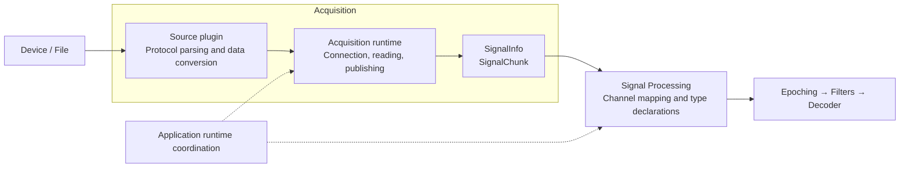

# Signal information and Signal Processing channel mapping

Acquisition adapts external data sources into a common signal stream and a
`SignalInfo`. Its `descriptor` describes the adapter output; source
`metadata` is inspection text. The descriptor and full metadata payload are not
editable Plugin Profile parameters.

The domain type is `SignalInfo` in `omnibci.domain.signal_info`, also exported by
`omnibci.sdk`. The former `AcquisitionDescriptor` import and
`acquisition_descriptor()` builder remain aliases for existing plugins, including
the unchanged Scan45 implementation. REST payload keys `descriptor` and
`acquisition_descriptor` retain their existing names and structure.

## Architecture overview



`SignalInfo` describes the normalized output; `SignalChunk` carries the sampled
data. Dashed arrows represent application-level runtime coordination. Runtime
data-matrix validation is reserved for future consideration.

## Acquisition workflow

First choose **Plugin and version**, then select one of that plugin's Profiles
or click **New profile**. Fill its address and port or file path, then Connect.
New connection drafts can be applied without creating a Profile. Get Metadata
reads the connected source and displays `SignalInfo` alongside the source text on
the same page. For a new Curry8/File draft, it automatically fills the observed
sample rate and total output rows; the user then chooses **Save profile**. For a
saved Profile, it preserves and compares the applied experiment expectations,
showing conflicting provided parameters in red. The response is:

```json
{
  "source_id": "neuroscan_curry8_reader",
  "connection_id": "connection-token",
  "metadata": "Channel count: 3\nSample rate: 1000 Hz\n",
  "descriptor": {
    "source_id": "neuroscan_curry8_reader",
    "connection_id": "connection-token",
    "sample_rate": 1000,
    "channels": [
      {"channel_id": "channel-0", "index": 0, "name": "O1", "signal_type": "unknown"},
      {"channel_id": "channel-1", "index": 1, "name": "O2", "signal_type": "unknown"}
    ],
    "trigger_row_index": 2
  },
  "comparison": {
    "status": "matched",
    "sample_rate": {"expected": 1000, "actual": 1000},
    "channel_count": {"expected": 3, "actual": 3}
  }
}
```

This abbreviated example omits optional provenance and native-event details.
`signal_channel_count` counts signal rows only. `output_row_count` includes the
final normalized event row. Plugins pass only `signal_channel_count` to the
descriptor builder; the descriptor derives `output_row_count` by adding one
for the event row. Curry8 and File Reader derive actual dimensions
from their source instead of treating configured defaults as observed facts.
Curry8's source channel count and labels already include the final event row.
Its adapter preserves that row without appending another one, and excludes it
from the descriptor's signal channels. Separate event packets do not overwrite
the native event row.
Scan45 returns text explaining that device metadata querying is not implemented.
Its separate output descriptor uses configuration and is marked `user-declared`.

`SignalSource.get_metadata() -> str` queries source information for inspection.
Native text is passed through unchanged. Curry8 renders its decoded protocol
fields as readable JSON text; File Reader displays file information captured
before output channel selection. Acquisition-derived fields such as the extra
event row are not inserted into that source text.

`SignalSource.describe_output(...) -> SignalInfo` describes the
adapter's normalized output from the same observation, without querying again.
The backend runtime, application and Signal Processing never parse the display
text. The Acquisition UI reads Curry8's native JSON `channel_labels` to fill an
optional Profile parameter with every native row label in order, including the
final `Trigger` row. New drafts receive these labels with Get Metadata; saved
Profiles require explicit adoption into the draft or a new Profile and saving.
Saved labels do not replace the live descriptor's signal-only channel list.
Plugins without a valid descriptor can still show metadata, but cannot prepare
channel mapping.

The shared `signal_info()` builder accepts explicit keyword arguments:
`source_id`, `connection_id`, `sample_rate`, and `signal_channel_count` are
required. Channel labels, types, units, and IDs are optional; `native_event`
defaults to `final-row` and `provenance` to `protocol-defined`. Each plugin passes
only the fields describing its output. Native metadata stays separate display
text, and Scan45 explicitly retains `user-declared` provenance.

Each `ChannelDescriptor` has a unique `channel_id`, source row `index`, display
`name`, `signal_type`, and optional `unit` and `name_provenance`. Names may repeat.
Adapters use source-provided string IDs when available, or deterministic
`channel-{index}` IDs within that source. A descriptor fingerprint and connection
identity protect mapping preparation from changed or stale sources.

Missing source information is not guessed. Curry8 currently supplies labels
without channel types, so its descriptor reports `unknown`. A failed descriptor
construction does not prevent inspection of the source text. Cached descriptors
belong to the exact source binding and connection; reconnect, source changes and
metadata refresh invalidate readiness. Saved observations never substitute for
current source metadata.

### Experiment expectations

The source Profile retains `sample_rate` and `channel_count` as expected
experiment parameters. `channel_count` includes the event row and is compared
with `SignalInfo.output_row_count`, not `signal_channel_count`. For Curry8 and
File Reader, new drafts have neither value until Get Metadata fills them from the
source; their schemas retain both fields without defaults. Saving remains an
explicit action. Existing saved values are preserved.

Get Metadata returns `comparison` with expected and actual values and one status:

- `unconfirmed`: at least one expected value is missing and every provided value matches.
- `matched`: both expected values match independently observed values.
- `mismatched`: at least one provided expectation differs, even if another is missing.
- `unverified`: the source cannot independently report these values, as with
  Scan45's unchanged `user-declared` output information.

A missing or invalid `SignalInfo` produces no comparison. Metadata reads never
save or overwrite Profiles. New drafts display the source information without a
comparison to an absent baseline. Their unsaved connection binding omits the
expected dimensions; saving and applying the filled Profile establishes that
baseline. For independently observed sources, omitted expectations use the
current device/file values and do not block preparation or streaming. The
prepared plan records those actual values without changing the saved Profile.
Only mismatched provided expectations block preparation while keeping source
information visible. The user can adjust the device/file and read again,
or choose **Save observed values as new profile**, name it, and save the current
connection parameters with the observed dimensions. This creates a separate
Profile and preserves the original Profile and applied configuration. Connect
then applies the new Profile. **Use observed values** remains available to
update the current draft before saving and applying it. The applied revision
is compared again after connection. Scan45's
configured declarations remain editable and are never labeled device-verified.

## Acquisition runtime boundary

`AcquisitionWorker` owns configuration and plugin construction. It pins one
settings snapshot, loads the source, and passes only the required context to
`AcquisitionRuntime`: `source_id`, `generation`, `config_revision`, and
`preparation_required`.

`source_id` identifies the configured source. `generation` identifies the current
engine instance, while `config_revision` identifies its applied configuration.
`preparation_required` determines whether starting a stream requires a valid
Signal Processing preparation receipt. Every selected decoder requires preparation,
including when its input defaults to all source channels. The Worker derives
the requirement from the Signal Processing input;
the runtime does not read configuration or interpret decoder bindings. Changes
to Signal Processing input rebuild the runtime with a new preparation requirement.

The runtime owns connection and stream lifecycle, source metadata inspection,
and delivery of `SignalChunk` objects. Stopping still waits for the read task,
and stream draining still sends a barrier after the final chunk. Channel mapping
and signal processing remain downstream.

## Signal Processing mapping

A decoder profile owns an ordered `ProcessingInput` with schema version 2:

```json
{
  "schema_version": 2,
  "outputs": [
    {"source_channel_id": "channel-1", "name": "Right occipital", "signal_type": "eeg"},
    {"source_channel_id": "channel-0", "name": "Left occipital", "signal_type": "eeg"}
  ]
}
```

Bindings identify Acquisition channels by ID, never by label. Explicit output
names and selected source IDs must be unique. Missing IDs block preparation.
An empty `outputs` list selects all source signal rows in their original order;
it does not mean zero channels. Decoder `default_names` are suggestions that the
user can match to unique source labels after a descriptor is available.

A binding may declare `eeg`, `eog`, `ecg`, `emg`, or `misc` for an unknown source
type. Without a declaration, it inherits the source type. A declaration cannot
override a conflicting known source type and never mutates Acquisition metadata.
Decoder requirements validate the resulting types, names and channel count.

Compilation produces ordered `source_indices`, output descriptors, and a derived
`requires_data_mapping` flag. Signal Processing reuses the incoming `SignalChunk` when
all signal channels remain in their physical order, including when only names
or type declarations change. Selecting a subset or changing the order requires
mapping, which copies the selected rows and the original event row. It preserves
sample values and dtype; there is no reference subtraction, bipolar derivation,
position template, interpolation, scaling or other channel arithmetic.
The mapped signal then enters Epoching, optional Filters and Decoder.

The flag is computed when constructing a plan, including after IPC
deserialization. It is not configurable, is omitted from serialized plan
dictionaries, and does not change plan fingerprints. This avoids the mapping
copy within Signal Processing; cross-process queue transport retains its existing
behavior.

Saving a profile does not change a running experiment. Review and Apply pins
its mapping, rebuilds when necessary, and prepares Signal Processing against the
connected descriptor. Generation, configuration revision, connection identity,
source fingerprint and plan fingerprint must match before streaming.

Signal Processing starts in standby without constructing EpochDetector, Filter or Decoder
plugins. Preparation supplies the actual sample rate and mapped channels from
`SignalInfo`, including the sample rate used for pre-trigger buffering. Later
trial-boundary updates reuse that prepared context. Updates received before
preparation retain validated configuration and defer plugin construction until
source information is available. Profile expectations are never a fallback
Signal Processing sample rate.

## API and compatibility

Source plugins must return a string from `get_metadata()` and implement
`describe_output()` to support Signal Processing mapping. The REST metadata response
keeps its connection envelope, with `metadata` now a string and `descriptor`
separate. Third-party sources returning the previous metadata dictionary must
update this contract; the host does not guess a descriptor by parsing text.

`GET /api/v1/config/signal` exposes `acquisition_descriptor`, source identity,
`processing_input`, `accepted_input`, `active_input`, and preparation readiness.
Preview accepts a draft mapping with the expected source revision and decoder
selection. The server resolves the descriptor; callers cannot supply manual
source metadata. The former setup/template/reference API fields are removed.

Old montage domain code, templates and UI are removed. Historical profile and
activation fields remain opaque storage data solely to preserve existing
revision hashes. Version 1 processing inputs are exposed as review-required,
not executed. The backend and profile editor remain available, but old montage
configuration blocks engine start until the user saves and applies a version 2
mapping. No existing configuration file is silently rewritten.
