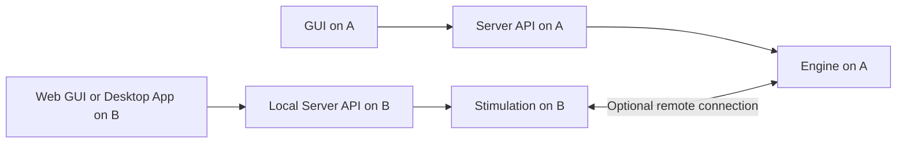

# Stimulation startup investigation and proposed changes

Initial investigation: 2026-11-25, source baseline `4a97457`.
First review: 2026-11-26, commit `b99ba69`, compared with `dev`.
Latest review: 2026-11-26, commit `62c1720`, compared with `b99ba69`, on `fix/stimulation`.

Status: investigation, code review, and proposed fixes. Sections 1–5 retain the
original findings and proposal against `4a97457`. Section 6 reviews the subsequent
VSync rollback in `b99ba69`, which removed the native clock implementation.
Section 7 records the subsequent fixes and remaining findings in `62c1720`;
its status assessment supersedes Section 6 for the current reviewed code.
The Section 7 recommendations and independent-operation proposal remain
unimplemented. The Windows incident and independent Stimulation operation have
separate causes and acceptance criteria.

## 1. Reported Windows failure

After pulling `dev` on another Windows computer, starting Stimulation from the
GUI failed with:

```text
Error: Stimulation cleanup was not confirmed (pid=12484, exitcode=1); replacement is blocked
```

The user confirmed one active display and a 60 Hz display setting. The exact
failing commit, selected paradigm, original child-process traceback, and native
timing samples from that computer have not been obtained.

This message reports a failed cleanup confirmation after a child exited with
code 1. It does not identify the exception that caused that exit. A native clock
failure is a credible candidate, not a confirmed diagnosis of this machine.

### Native timing dependency

At the original baseline, both OpenGL adapters use
[FrameClock](https://github.com/lincker/OmniBCI/blob/4a974577474c957b1fadb252ff85df801f72ad46/omnibci/infrastructure/stimulation/frame_clock.py)
and [native_display_clock.py](https://github.com/lincker/OmniBCI/blob/4a974577474c957b1fadb252ff85df801f72ad46/omnibci/infrastructure/stimulation/native_display_clock.py).
On Windows, `_DwmClock` calls `DwmGetCompositionTimingInfo` and uses:

| Input | Current use |
| --- | --- |
| `QueryPerformanceFrequency` | Convert QPC ticks to seconds. |
| `qpcVBlank` | Base timestamp for the next display opportunity. |
| `qpcRefreshPeriod` | Compute the opportunity's period and target time. |
| `cRefresh` | Compute the refresh index, preserving missed refreshes. |

The conversion is:

```text
refresh_index  = cRefresh - first_cRefresh
target_time    = (qpcVBlank + qpcRefreshPeriod - QPC_origin) / QPC_frequency
refresh_period = qpcRefreshPeriod / QPC_frequency
```

Microsoft documents these as DWM composition timing fields. They are not proof
that a particular stimulus image was physically presented. See
[DWM_TIMING_INFO](https://learn.microsoft.com/en-us/windows/win32/api/dwmapi/ns-dwmapi-dwm_timing_info).

The current failure conditions include:

| Condition | Behavior |
| --- | --- |
| QPC query or DWM timing query fails | Raise an exception. |
| DWM timestamp/period is initially unavailable | Return no frame; continued lack of progress reaches the clock timeout. |
| Refresh counter regresses | Reject the sample. |
| Target time fails to increase when the counter advances | Raise `Display clock or refresh mode changed`. |
| Consecutive periods differ beyond `math.isclose(..., rel_tol=1e-4)` | Raise the same mode-change error. |
| No refresh progress for one second | Raise `Display clock stopped advancing`. |
| The selected monitor or display mode changes | Raise a restart-required error. |

Clock exceptions escape the render loop. Stimulation supervises that task,
performs cleanup, and propagates the failure; the subprocess can consequently
exit with code 1. There is no synthetic timer fallback.

The bundled [Classic40](https://github.com/lincker/OmniBCI/blob/4a974577474c957b1fadb252ff85df801f72ad46/omnibci/infrastructure/plugins/paradigms/classic40SSVEP/ssvep.py)
and [Command10](https://github.com/lincker/OmniBCI/blob/4a974577474c957b1fadb252ff85df801f72ad46/omnibci/infrastructure/plugins/paradigms/command10SSVEP/paradigm.py)
paradigms also require a measured refresh rate within 0.01 Hz of 60 Hz. Their
check occurs during rendering, including idle rendering. A nominal 60 Hz display
setting alone does not establish that all native samples pass these checks.

### Reproduced sensitivity to period variation

An in-memory probe of the current `_DwmClock` and `FrameClock` reproduced the
following behavior without opening a window or calling Windows APIs:

| Simulated input | First sample | Second sample |
| --- | --- | --- |
| DWM `rateRefresh` | 60/1 Hz | 60/1 Hz |
| QPC frequency | 10,000,000 ticks/s | 10,000,000 ticks/s |
| `qpcRefreshPeriod` | 166,667 ticks | 166,687 ticks |
| Converted frequency | 59.99988000 Hz | 59.99268089 Hz |
| Refresh counter / timestamp | Initial valid sample | Both advance |

The period difference is 2 microseconds, approximately 0.012%. Both converted
frequencies satisfy the paradigms' 0.01 Hz tolerance, but the consecutive-period
comparison rejects the second sample with:

```text
Display clock or refresh mode changed
```

Chromium's Windows vsync implementation explicitly accounts for noise in
`qpcRefreshPeriod` and distinguishes it from the refresh-rate ratio. This
supports investigating the current comparison; it does not show that the
reported computer produced these samples. See
[Chromium VSyncProviderWin](https://chromium.googlesource.com/chromium/src/+/refs/heads/main/ui/gl/vsync_provider_win.cc).

### Why the GUI can show only the cleanup error

[Stimulation.serve()](../omnibci/infrastructure/stimulation/application.py)
starts the render coroutine and waits for the Engine link before reporting
managed startup readiness. Rendering may yield while awaiting its first usable
native frame. Thus, readiness can precede the first frame's clock/paradigm
validation. The startup reporter sends only one terminal report; a later failure
cannot replace an already-sent READY report.

[ManagedOutputProcessManager](../omnibci/infrastructure/process_lifecycle.py)
treats a nonzero exit code as unconfirmed cleanup and retains `_cleanup_error`.
A subsequent stop/start or replacement can expose this guard instead of the
original rendering error. A nonzero exit also does not establish that cleanup
actually failed: the original exception can propagate after successful cleanup.

The relevant failure chain is therefore:

```text
Original child failure, possibly native timing validation
  -> render/application exception and cleanup attempt
  -> subprocess exits with code 1
  -> manager cannot confirm cleanup from its available evidence
  -> replacement remains blocked
```

Retain the protection against duplicate renderers and unresolved trigger cleanup.
Removing the guard would not fix the initial failure.

### Relevant development history

| Commit | Date | Relevance |
| --- | --- | --- |
| `0bdd1dd` | 2026-11-17 | Earlier comparison baseline, before the changes below; not a confirmed working commit on the reported computer. |
| `854ba37` | 2026-11-20 | Unified Stimulation resource ownership and settlement, including blocking replacement after unconfirmed cleanup. |
| `b8152c0` | 2026-11-21 | Aligned SSVEP rendering with native display refreshes, introducing the timing path under investigation. |
| `474b7cf` | 2026-11-22 | Merged Command10 work after the native-clock and cleanup changes. |
| `5711b60` | 2026-11-23 | Merged plugin management changes; the clock behavior was already present. |
| `4a97457` | 2026-11-25 | Current inspected baseline; cleanup logic now lives in the shared process lifecycle implementation. |

Changing between the two renderers does not bypass their shared native clock.
The separate single-active-display restriction on Windows/Linux is recorded in
[TODO.md](TODO.md). It does not explain this confirmed single-display incident.

## 2. Proposed Windows timing and error-reporting changes

1. Preserve the first failure through the GUI. Report the phase, original error,
   process exit, and cleanup result separately. Log enough bounded context to
   diagnose timing failures: renderer, display identity/mode, QPC frequency,
   relevant DWM fields, and the previous/current sample. Avoid per-frame log I/O
   in the rendering path.
2. Establish renderer readiness after a usable native frame has passed timing
   and paradigm validation. Preserve a bounded startup deadline and cooperative
   stop while waiting. Initialization and the first idle frame must succeed
   before advertising readiness; readiness does not imply physical presentation.
3. Distinguish period measurement noise from a real display-mode change. Evaluate
   the display mode and validated refresh-rate ratio as stability evidence,
   alongside native timestamps and counters. Select the tolerance or filtering
   policy using recorded Windows samples and regression tests. Simply widening
   the threshold, hardcoding 60 Hz, or counting timer callbacks is insufficient.
4. Keep explicit failure for counter resets, invalid/nonmonotonic timestamps,
   sustained clock loss, real mode changes, and unsupported paradigm rates.
   Do not silently map 59.94 Hz or 144 Hz to 60 Hz or fabricate missed frames.
5. Report resource cleanup independently of execution success. A child that
   fails rendering should still report whether renderer, trigger, and IPC
   cleanup completed. Permit replacement only after process exit and valid
   cleanup confirmation. Missing confirmation, forced termination, or cleanup
   failure must continue to block replacement.

Collect the original traceback and timing samples on the affected Windows
computer before declaring the incident fixed. Unit probes establish a possible
failure mechanism; they do not validate that computer's GPU/display behavior.

## 3. Confirmed independent-operation requirements

The requested workflow is:

- **Server A:** open the GUI and start Engine, preserving the operator's flow.
- **Server B:** open the same GUI and attempt to connect to A. Clicking
  Stimulation Start launches Stimulation on B even if the connection fails.
- B runs no Engine. B can configure and start Stimulation and initiate stimulation
  trials from its own GUI while offline; an idle window alone is insufficient.
- Both the browser GUI and Electron desktop App must support this behavior.
- The optional connection to A must not determine whether B's local start,
  trial, or stop controls are available.

These are new target behaviors. The current GUI/backend does not support the
complete workflow.

### Current dependencies that prevent it

| Layer | Current coupling |
| --- | --- |
| [Runtime controls](../frontend/src/hooks/useRuntimeControls.ts) | Stimulation Start requires Engine running; runtime status also depends on Engine state. |
| [RuntimeConfigurationService](../omnibci/application/services/runtime_configuration_service.py) | Rejects Stimulation startup when Engine is not ready. |
| [RuntimeApplyCoordinator](../omnibci/application/services/runtime_apply_service.py) | Builds/applies runtime identity and prepares output through Engine. Merely removing the earlier rejection could start a local Engine implicitly. |
| [StimulationAppService](../omnibci/application/services/stimulation_service.py) | Requires `engine.is_engine_ready`; active state and trial dispatch depend on Engine. |
| [Stimulation application](../omnibci/infrastructure/stimulation/application.py) | Managed startup waits for the Engine connection. External mode shuts down its current application lifetime on disconnect. |
| [External node client](../omnibci/infrastructure/node_client.py) | Waits for A's running, prepared configuration before constructing Stimulation; cannot provide first-use offline startup. |
| [Desktop connection](../desktop/src/connection.ts) / [DesktopApp](../frontend/src/DesktopApp.tsx) | Select one API server. Using A as the sole API target does not provide B with local process/configuration control when A is unavailable. |

The core Stimulator/paradigm/render-loop composition can run locally; the hard
Engine dependencies are in orchestration, configuration identity, readiness,
command delivery, and status reporting. Removing only `is_engine_ready` checks
does not establish independent operation.

## 4. Proposed architecture and behavior

### Keep B's local control available

Use a local OmniBCI Server on B to own its configuration, plugin catalog,
Stimulation process, command delivery, and status. Running this service does not
mean starting NeuroEngine. Both GUI variants use the same application services.



For the browser, serve/use B's local API; a browser page backed only by A cannot
launch a process on B. For the desktop, reuse its owned local Server to provide
the same local API. A's address belongs to the optional Engine connection for
this workflow. Connecting to A must preserve B's local workspace and control
path, rather than replace the whole workspace's API target with A.

The existing desktop mode that controls an existing remote Server can remain a
separate workflow. It must not be presented as local Stimulation ownership.

### Local lifecycle and trial commands

- Start from B's validated local Stimulation configuration and installed plugins.
  First-use offline startup must not require a cached configuration from A.
- Give the local Stimulation runtime its own identity/readiness, independent of
  a running local or remote Engine generation. Preserve pinned plugin execution
  evidence and module revision checks.
- Deliver B's trial commands directly to its owned Stimulation process through
  an application port and local IPC adapter. Reuse existing command validation,
  correlation, and result semantics. A success response must mean the requested
  trial began execution, not merely that it entered a queue.
- Serialize locally and remotely originated commands through the Stimulation
  owner. Avoid parallel trial execution or duplicate command replay on reconnect.
- Stop locally and confirm renderer/trigger/process cleanup even when A is
  unreachable. Failed remote delivery must not prevent a local stop.
- Keep connection failure separate from local runtime failure. A native clock,
  renderer, paradigm, or trigger failure still fails Stimulation and surfaces its
  original cause, including during offline operation.

### Optional connection to A

Attempt connection asynchronously without blocking local startup or trial
commands. Report connection/retry failures separately. Offline trials do not
imply that A received events, recorded data, or supplied decoding feedback.
Do not replay old trials automatically when A becomes reachable.

Remote attachment needs more than a successful TCP connection. The current
Engine builder leaves output transports unprepared until a module action, and
the existing external-node handshake validates A's generation, operation, module
revision, and plugin bindings. A compatible registration/preparation step must
run automatically as part of attachment so A's operator need not click another
Stimulation preparation button. Keep this step independent of B's local startup.

Preserve authentication and runtime/configuration agreement when adapting the
existing node protocol. Do not forge A's generation, bypass execution evidence,
or load a stale remote configuration to make a connection appear successful.
Configuration mismatch should prevent remote attachment while leaving a healthy
local Stimulation runtime available.

### Status and design decisions

Expose local runtime state (`stopped`, `starting`, `ready`, `failed`, `stopping`)
separately from Engine connection state (`disconnected`, `connecting`,
`connected`, `error`). Display cleanup uncertainty explicitly. Enable offline
trials based on local readiness and valid trial parameters.

The following proposed defaults need to be resolved in implementation design;
they are not additional user-confirmed requirements:

- B remains authoritative for its Stimulation configuration; A owns Engine
  configuration. Define the compatible remote registration contract without
  silently overwriting either server's selections.
- Define command arbitration and the fate of remotely queued/in-progress trials
  after disconnect. Preserve local control and avoid automatically replaying
  commands with uncertain execution results.
- Keep local Server shutdown responsible for its owned Stimulation process.
  Define how stopping/restarting A's Engine ends the remote session while
  preserving B's independent operation and allowing later reattachment.

## 5. Implementation sequence and verification

| Step | Scope | Verification |
| --- | --- | --- |
| 1 | Capture timing failures and improve readiness/error/cleanup evidence. | Inject first-frame failure, post-READY failure, successful cleanup, cleanup failure, and lost confirmation; verify accurate errors and replacement rules. |
| 2 | Correct Windows clock stability handling based on native samples. | Reproduce the 2 microsecond case; test normal jitter, sustained drift, counter reset, timestamp regression, no progress, mode change, and unsupported rates. |
| 3 | Give Stimulation local lifecycle and trial-command ownership without Engine. | Start, run a trial, and stop with no local Engine and no reachable A; verify no implicit Engine startup and correct execution receipts. |
| 4 | Connect both GUI variants to the local control path and show separate status. | Exercise configuration, start, trial, error, and stop flows in Web and desktop with A unavailable from the first launch. |
| 5 | Add optional remote attachment, preparation, and reconnection. | Start A through its existing GUI flow, attach B, exchange commands/results, disconnect/restart A, and verify local availability and no duplicate trials. |
| 6 | Validate actual display and process behavior. | Test both renderers on the affected single-display 60 Hz Windows machine, then regress supported macOS/Linux behavior and desktop shutdown. |

Relevant existing test locations include
[display clocks at the original baseline](https://github.com/lincker/OmniBCI/blob/4a974577474c957b1fadb252ff85df801f72ad46/tests/stimulation/test_display_clock.py),
[application lifecycle](../tests/stimulation/test_application_lifecycle.py),
[process management](../tests/stimulation/test_process_manager.py),
[Stimulation service](../tests/application/test_stimulation_service.py),
[runtime configuration](../tests/application/test_runtime_configuration_service.py),
and [Stimulation API](../tests/presentation/test_stimulation_router.py).
Update tests that intentionally encode the old mandatory-Engine behavior as
part of the implementation; do not relax unrelated lifecycle guarantees.

Acceptance requires both tracks to pass: reliable native timing with actionable
failure reporting, and independent Stimulation control on B in both GUI forms.
Multi-display support remains the separate item in [TODO.md](TODO.md).

## 6. Review of the VSync rollback (`b99ba69`)

The reviewed commit removes `FrameTiming`, `FrameClock`, and the native display
clock, restores `render_frame(elapsed_seconds) -> None` and `end_frame()`, and
changes both bundled SSVEP paradigms to advance by callback counts. It removes
the investigated DWM dependency, but introduces the three issues below. It does
not implement B's independent startup or offline trials; the Engine readiness
dependencies described earlier remain.

### 6.1 [P1] Fixed-60-Hz stimuli run at incorrect rates without validation

**Affected code:**
[Command10.render_frame](../omnibci/infrastructure/plugins/paradigms/command10SSVEP/paradigm.py),
[Classic40.render_frame](../omnibci/infrastructure/plugins/paradigms/classic40SSVEP/ssvep.py),
and the renderer initialization/submission path.

Both paradigms still assume 60 frames per second, but the commit removes their
refresh-rate checks. `swap_interval(1)` requests synchronization to the display's
refresh rate; it does not select a 60 Hz display mode. Command10 still computes
brightness using `frame_index / 60`, and its decoder still uses the fixed target
frequencies and a time-based analysis window.

**Reproduction:** calling the real Command10 implementation with simulated
60 Hz and 120 Hz callbacks produced:

| Callback rate | Target 1 frequency | Time when stimulation ends |
| --- | --- | --- |
| 60 Hz | 8 Hz | 4 seconds |
| 120 Hz | 16 Hz | 2 seconds |

The 120 Hz run proceeds without an error. Classic40's precomputed 60 Hz frame
pack has the same playback-rate dependency. These are simulated callback
results, not measurements of physical display output.

**Recommended solution:**

1. Preserve an explicit fixed-60-Hz admission check for these paradigms using
   validated display-mode information, independently of the removed per-sample
   DWM comparison. Keep platform display queries in renderer infrastructure and
   the paradigm's supported-rate requirement explicit at the host boundary.
2. Reject an unsupported or unverifiable mode before starting a trial or sending
   its start marker. Report the requested and observed rates in the GUI. Detect
   relevant display/mode changes during operation and invalidate affected trials.
3. Treat arbitrary-refresh support as a separate protocol change: it requires
   correct stimulus sampling/frame-pack handling and decoder compatibility.
   Do not achieve it by removing checks or labeling every callback stream 60 Hz.

**Acceptance:** restore tests covering 60 Hz and unsupported modes such as
59.94, 75, 120, and 144 Hz. Unsupported modes must not silently run the 60 Hz
protocol. Verify both renderers on actual hardware; mock callback tests cannot
establish VSync or optical presentation timing.

### 6.2 [P1] Callback counting extends trials and shifts phase after missed frames

**Affected code:** the cue/stimulus/result counters in
[Command10](../omnibci/infrastructure/plugins/paradigms/command10SSVEP/paradigm.py)
and [Classic40](../omnibci/infrastructure/plugins/paradigms/classic40SSVEP/ssvep.py),
called by [RenderLoop](../omnibci/infrastructure/stimulation/render_loop.py).

Each callback advances one image regardless of elapsed time. The supplied
`elapsed_seconds` is ignored by both paradigms. A rendering or scheduling stall
therefore resumes old stimulus content and extends the trial instead of
accounting for the elapsed interval. This also affects a correctly configured
60 Hz display, so resolving the refresh-rate admission issue alone is insufficient.

**Reproduction:** for a free-choice Command10 trial, simulate 60 Hz callbacks
while omitting callbacks during seconds 1–2. At `t = 4.0` seconds, the paradigm
is still in `STIM`, its frame index is only 181, and the trigger has only received
the initial baseline clear. The nominal four-second stimulus has not ended.
Its resumed phase is delayed relative to the decoder's time-based references.

**Recommended solution:**

1. Give each trial a stable cue/stimulus/result timeline. Derive content and
   phase deadlines from that timeline rather than the number of serviced
   callbacks; do not move the stimulus origin when a callback is late.
2. Define an explicit missed-frame policy. Skip expired content when the timing
   evidence supports continuing, or abort the trial and report timing failure
   when the gap invalidates the protocol. Do not replay a backlog or silently
   stretch the stimulus interval.
3. Keep start markers single-shot. If execution resumes after the entire
   stimulus interval has elapsed, do not emit an expired start marker. Clear
   trigger state and complete or fail the trial through the existing cleanup
   and result paths. Report timing-invalid trials so their data are distinguishable.
4. A monotonic elapsed-time implementation can account for scheduling gaps, but
   is not proof that a frame appeared at the intended refresh. Validate its
   pacing policy on hardware without restoring the original noisy-period
   equality check as a substitute for that validation.

**Acceptance:** cover short gaps, a one-second gap, gaps across cue/stimulus and
stimulus/result boundaries, and a gap spanning the entire stimulus. Assert the
selected content, phase deadlines, marker count, trigger clearing, and explicit
success/failure outcome. Test both paradigms; never accept an unreported trial
extension merely because all 240 callbacks eventually ran.

### 6.3 [P2] The incompatible rendering contract still declares Plugin API v1

**Affected code:** [public SDK exports](../omnibci/sdk/__init__.py), the
[Paradigm contract](../omnibci/domain/ports/paradigm.py), and API compatibility
validation in the plugin manifest/loader.

The SDK no longer exports `FrameTiming`, and `render_frame` now receives a float
instead of that object. The supported plugin API remains `"1"`, and the host
version remains `1.0.0`. Existing plugin manifests therefore cannot distinguish
these incompatible rendering contracts. Updating the bundled source and tests
does not migrate an already installed plugin or a third-party package.

**Reproduction:** copy the previous `dev` Command10 package into a temporary
directory and load it through the current manifest parser and plugin loader.
Manifest validation accepts `OmniBCI.command10SSVEP@0.1.0`, `api_version = "1"`,
but entry-point loading fails because `FrameTiming` cannot be imported. Plugins
that avoid that import can still fail when accessing fields on the received
float. This can make Stimulation fail at startup again.

**Recommended solution:**

1. If retaining the float-based interface, give the incompatible contract a
   distinct API version. Update supported-version checks, bundled manifests,
   documentation, and applicable host/package release versions together. Reject
   incompatible packages with an actionable message before executing plugin code
   or acquiring rendering/trigger resources.
2. Provide a migration path for installed/custom paradigms: update imports,
   callback parameter/return handling, and timing logic, then publish a new
   package version. Preserve immutable installed artifacts and explicit profile
   selection; do not overwrite an old version with incompatible code.
3. If backward compatibility is required, retain an explicit adapter for the
   old contract only if its timing semantics can be honored. Restoring the
   `FrameTiming` name alone cannot fix the float argument or the lost refresh
   semantics. Do not fabricate native refresh evidence to satisfy old plugins.

**Acceptance:** retain a fixture using the previous API-1 rendering contract.
It must either run through a supported compatibility path or be rejected with a
clear compatibility error before runtime startup. Also validate a migrated
package through manifest loading, instantiation, first-frame rendering, and
cleanup; test packages both with and without an explicit `FrameTiming` import.

### Review validation and follow-up order

The review ran the Stimulation tests, output-contract tests, and related
Command10/plugin/node lifecycle tests: **629 passed; 4 GUI tests deselected**.
The frequency, missed-callback, and previous-plugin probes above were additional
checks. The updated suite had removed the non-60-Hz and missed-refresh cases, so
its passing result does not cover those regressions. Windows display behavior
was not tested on the reported computer.

Address 6.1 and 6.2 together before accepting the fixed SSVEP timing behavior,
and resolve 6.3 before distributing the changed SDK. These fixes should retain
the original-error reporting and confirmed-cleanup requirements from Section 2.
The independent B workflow remains a separate implementation track from
Sections 3–5. This update records recommendations only; it changes no runtime
code.

## 7. Review of display validation and monotonic timelines (`62c1720`)

The commit adds `required_refresh_rate_hz`, checks the display rate at setup,
trial admission, and during rendering, and advances both SSVEP paradigms using
monotonic elapsed time. The previous findings now have the following status:

| Previous finding | Status after review |
| --- | --- |
| Section 6.1: non-60-Hz stimulation | Partially addressed: host validation rejects unsupported reported rates, but the actual query loses fractional precision; see 7.2. |
| Section 6.2: missed callbacks extend trials | The original one-second-gap reproduction is fixed: stimulation ends at four seconds and clears the trigger. A new buffer-submission regression remains; see 7.1. |
| Section 6.3: incompatible API v1 | Unresolved: the previous plugin still passes manifest validation and fails to load; see 7.3. |

The following three issues require follow-up. The commit does not implement
B's independent Stimulation startup or offline trials.

### 7.1 [P1] A skipped redraw still causes a buffer swap

**Affected code:** duplicate-slot early returns in
[Command10.render_frame](../omnibci/infrastructure/plugins/paradigms/command10SSVEP/paradigm.py)
and [Classic40.render_frame](../omnibci/infrastructure/plugins/paradigms/classic40SSVEP/ssvep.py),
combined with unconditional `end_frame()` in
[RenderLoop.run_async](../omnibci/infrastructure/stimulation/render_loop.py).

When two callbacks map to the same 60 Hz slot, the paradigm returns without
drawing. The host still swaps the buffers. Skipping drawing does not mean that
the current front-buffer image is retained: the submitted back buffer can
contain older or undefined content. Thus, suppressing duplicate state advancement
can inadvertently replay an older stimulus image.

**Reproduction:** run the real Command10 and RenderLoop against a two-buffer
renderer model, with the following elapsed times:

| Elapsed seconds | Computed slot | Presented target-1 brightness |
| --- | --- | --- |
| 0 | 0 | 0.500000 |
| 1/60 | 1 | 0.871572 |
| 0.020 | 1, no redraw | 0.500000: the old buffer is presented again |

The third submission should retain slot 1's intended content. This probe
demonstrates the buffer-handling error without opening a graphics window; it
does not claim a measurement of a particular driver's presentation behavior.

**Recommended solution:**

1. Prefer retaining the current void callback contract and redrawing the intended
   image on duplicate-slot callbacks, while leaving phase advancement, missed-slot
   accounting, and marker emission unchanged. Separate the selected image from
   state transitions so a duplicate callback cannot accidentally draw the next
   phase or emit another trigger.
2. Alternatively, introduce an explicit submission decision and make the host
   skip the swap when no new image was prepared. Coordinate any public contract
   change with the API-version work in 7.3. Preserve event handling, cooperative
   stopping, and pacing when a swap is skipped.
3. Apply the same policy to both bundled paradigms. Do not rely on a previous
   swap leaving useful content in the back buffer.

**Acceptance:** add a RenderLoop-plus-paradigm test using distinct front/back
buffers, not only a mock that counts draw calls. Cover duplicate slots, the
first frame, cue-to-stimulus and stimulus-to-result boundaries, and regressed
timestamps. Assert that stale or uninitialized content is never submitted and
that markers remain single-shot. Keep the one-second-gap deadline test passing.

### 7.2 [P2] Integer GLFW rates cannot establish a +/-0.01-Hz match

**Affected code:**
[window_refresh_rate_hz](../omnibci/infrastructure/stimulation/ui/window.py)
and [validate_display_refresh_rate](../omnibci/infrastructure/stimulation/render_loop.py).

The new validation uses `abs_tol=0.01`, but its source is GLFW's integer
`refresh_rate`. Converting that integer to `float` does not recover fractional
precision. A concrete example is GLFW 3.4's macOS backend, which rounds the
Core Graphics rate before returning it; see the
[official conversion implementation](https://github.com/glfw/glfw/blob/3.4/src/cocoa_monitor.m#L143-L152).
Consequently, a fractional mode can pass as exactly 60 Hz even though it is
outside the declared tolerance.

**Reproduction:** model that documented conversion using `60000 / 1001`
(approximately 59.94005994 Hz). GLFW's rounded value becomes 60; the real
`window_refresh_rate_hz` and host validator then accept 60.0 Hz. The test that
directly supplies 59.94 to the validator does not exercise this information loss
in the actual query path. The concrete native rounding example above is macOS;
the affected Windows computer's reported and actual mode still require capture.

**Recommended solution (revised):**

1. Verify the system-reported nominal (integer-Hz) GLFW display refresh rate
   against the paradigm's `required_refresh_rate_hz` once at startup. If the
   reported nominal rate is missing or does not match (for example 59, 75, 120,
   or 144 Hz for a 60 Hz paradigm), clean up resources and fail startup
   immediately. Do not claim a strict `+/-0.01 Hz` check from integer GLFW
   rates or reintroduce fragile platform-native display queries.
2. After startup verification passes, run the paradigm strictly according to
   its declared refresh rate without repeating display-mode queries on
   `present_trial()` or every render frame.
3. Log the system-reported refresh rate at startup, and log the actual measured
   refresh rate computed from monotonic frame timestamps in `RenderLoop`
   (periodically during long sessions and on loop exit) so fractional physical
   rates such as `59.94 Hz` remain observable in experiment logs.

**Acceptance:** test startup rejection for missing/invalid/mismatched nominal
rates (such as `None`, `0`, `59`, `75`, `120`, `144`), startup acceptance and
logging for matching nominal rates (including `60.0` and `59.94` against a
`60 Hz` paradigm), absence of per-trial and per-frame display-mode re-queries,
and periodic plus exit logging of the measured monotonic frame rate (such as
`59.94 Hz`).

### 7.3 [P2] Previous API-v1 plugins still fail after successful validation

**Affected code:** [SDK exports](../omnibci/sdk/__init__.py), the
[Paradigm contract](../omnibci/domain/ports/paradigm.py),
[manifest compatibility checks](../omnibci/infrastructure/plugin_management/manifest.py),
and [plugin loading](../omnibci/infrastructure/plugin_management/loader.py).

This is the still-open finding from Section 6.3. `62c1720` does not restore
`FrameTiming`, change the API/host version, or provide a compatibility adapter.

**Reproduction:** the Command10 package from `4a97457` is still accepted as
`OmniBCI.command10SSVEP@0.1.0`, `api_version = "1"`, by the current manifest
parser. Loading its entry point then fails with an import error for
`FrameTiming`. The new refresh-rate and timeline tests do not cover this
installed-plugin compatibility path.

**Recommended solution (revised — pre-release API v1):**

1. Because OmniBCI Plugin API v1 has not been externally released yet, retain
   `api_version = "1"` as the single canonical contract with
   `render_frame(elapsed_seconds: float) -> None`, and keep all bundled and
   starter plugins aligned on `api_version = "1"` and `version = "0.1.0"`.
2. Do not restore `FrameTiming` or introduce an unused backward-compatibility
   adapter for unreleased commits. Remove every remaining stale reference to
   `FrameTiming` and the old 19-export SDK count (specifically in
   [check_installed_wheel.py](../.github/scripts/check_installed_wheel.py) and
   [validation.md](validation.md)).

**Acceptance:** verify that no `FrameTiming` references remain anywhere in the
codebase or CI scripts, that `omnibci.sdk.__all__` exposes the 18 canonical API
v1 symbols, that all bundled and example plugin manifests declare
`api_version = "1"` and `version = "0.1.0"`, and that `command10SSVEP` passes
manifest loading, instantiation, first-frame rendering (`render_frame(0.0) is
None`), and cleanup.

### Latest review validation and next steps

The relevant Stimulation, output-contract, Command10, plugin-runtime, and node
lifecycle suites reported **652 passed; 4 GUI tests deselected**. Additional
probes verified the corrected one-second-gap deadline, unsupported-rate
validation, duplicate-slot buffer replay, fractional-rate rounding, and the
remaining API-v1 load failure. Windows native display behavior was not tested
on the reported computer.

Fix duplicate-slot submission before accepting the new rendering timeline,
enforce startup nominal refresh-rate matching with reported/measured rate
logging, and keep unreleased Plugin API v1 aligned across manifests, SDK
exports, and wheel checks. Continue to retain original failure details and
confirmed cleanup.
This section records review results and proposed remedies only; it changes no
runtime code.

## 8. Managed Stimulation logging follow-up (`c75c8e8`)

The review of `c75c8e8` confirmed the duplicate-slot redraw fix and the unreleased
API-v1 alignment from Section 7. Startup nominal-rate validation also meets the
revised requirements, but its INFO diagnostics were missing when the GUI
launched Stimulation through the managed child-process entry point.

**Root cause:** `spawn` starts a fresh Python interpreter without inheriting the
Server's logging configuration. Neither `_run_stimulation()` nor
`run_managed_child()` initialized child logging, leaving INFO records filtered
by the default WARNING threshold. The render-loop tests enabled INFO through
`caplog`, so they did not exercise this startup-path gap.

**Implemented solution:**

- Initialize logging in
  [`_run_stimulation()`](../omnibci/infrastructure/stimulation/process_manager.py)
  before creating the application, using INFO and the same timestamp, level,
  and logger-name format as `scripts/run_stimulation.py`.
- Send records to standard error. For a desktop-owned Server, the existing
  desktop capture writes these records to
  `userData/desktop/logs/desktop-YYYY-MM-DD.log`. Web-server deployments expose
  them through the Server process's standard-error console or output capture.
- Use `logging.basicConfig()` without `force` so an existing child logging
  configuration, including a WARNING threshold and its handlers, takes
  precedence. The Server-only `LOGGING.level` setting remains scoped to the
  Server; the managed child defaults to INFO just like the standalone script.
- Keep the current rendering contract and Plugin API version `1`.

**Verification:**
[`test_process_logging.py`](../tests/stimulation/test_process_logging.py) starts
a real `spawn` child through the production entry point, substitutes the
display application with a headless render-loop probe, and captures standard
error without enabling INFO in the default test case. Simulated 59.94 Hz frame
timestamps cover the startup report, the actual 30-second periodic logging
threshold, and the exit summary. Each record must appear once; a preconfigured
WARNING case must filter all three INFO records while retaining warnings.

Before the fix, the default case failed with only the warning captured. After
the fix, both cases and the related process-manager, render-loop, and shared
process-lifecycle tests passed: **67 passed**. Windows display hardware was not
exercised by these headless tests.
