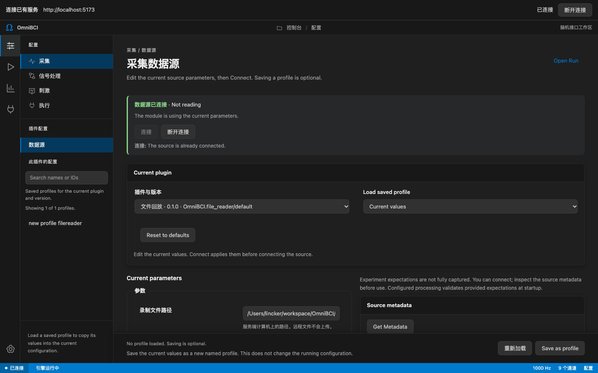
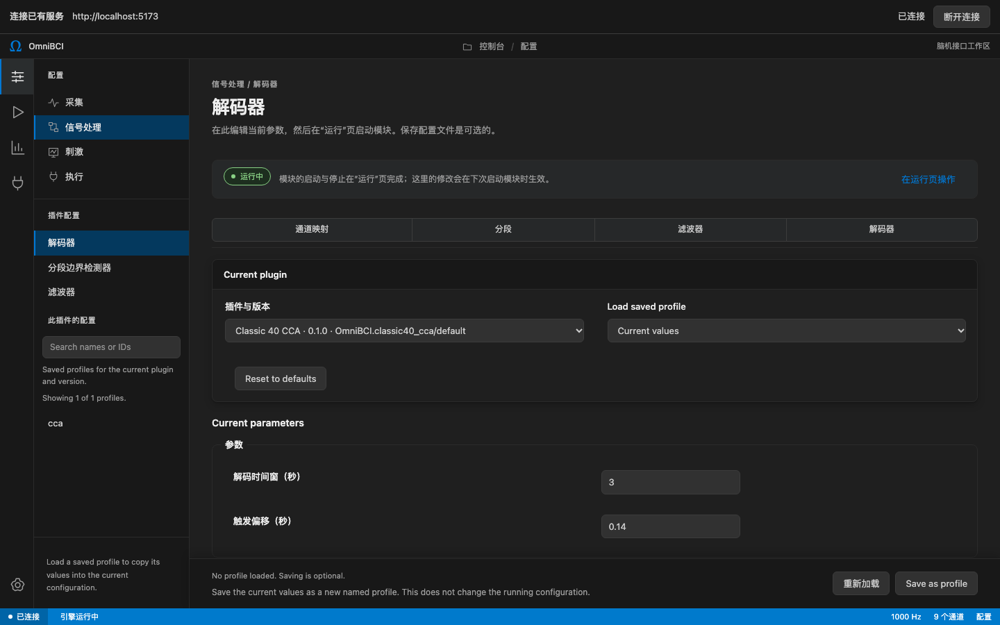
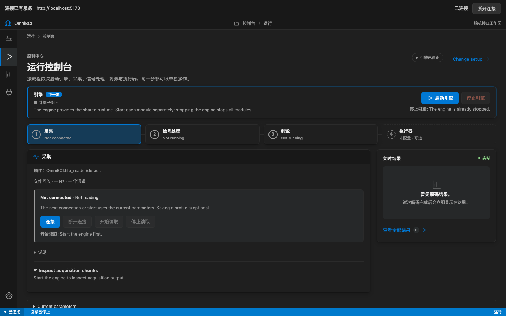
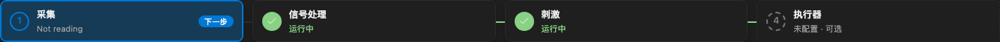
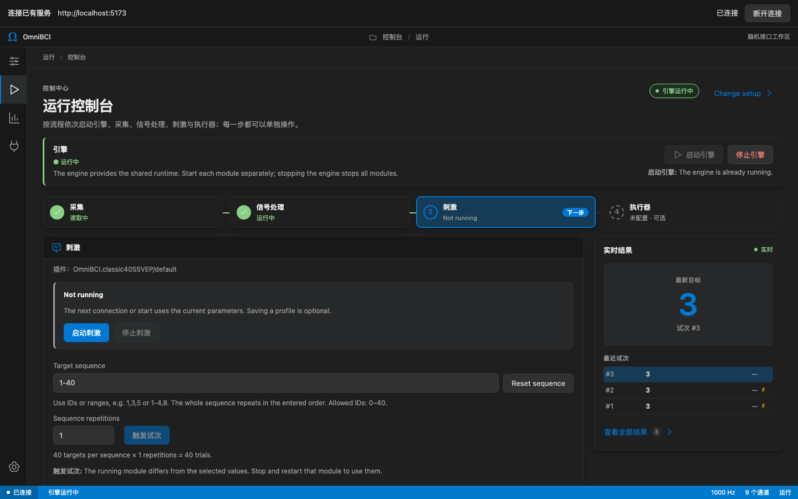
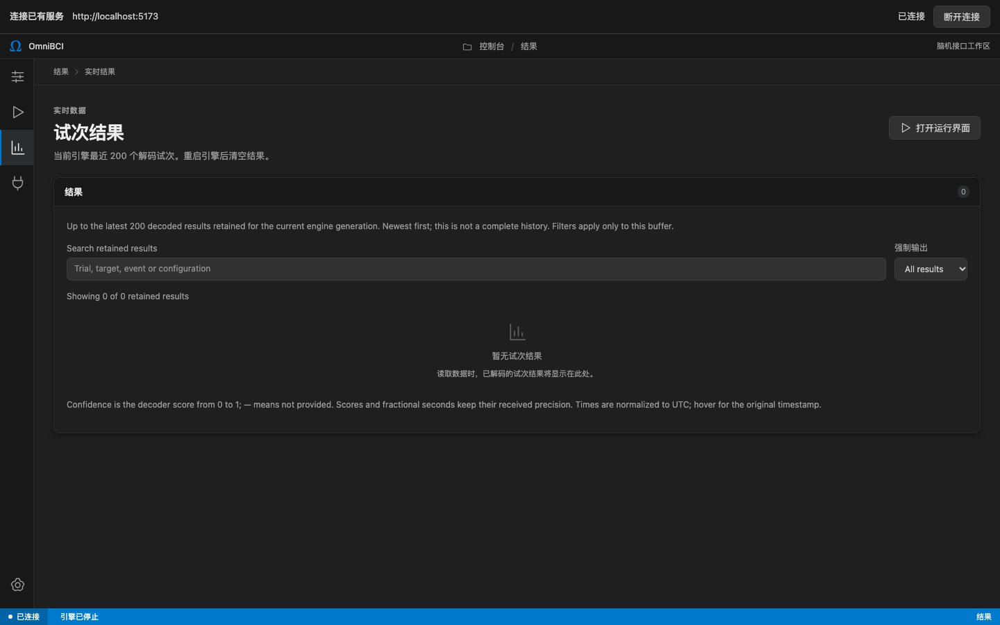
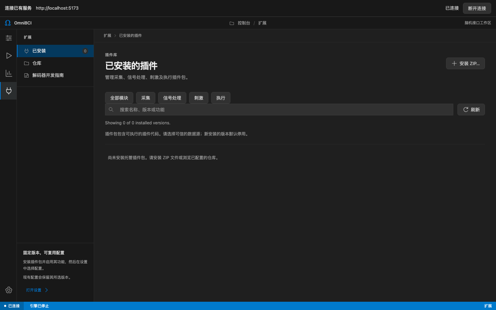
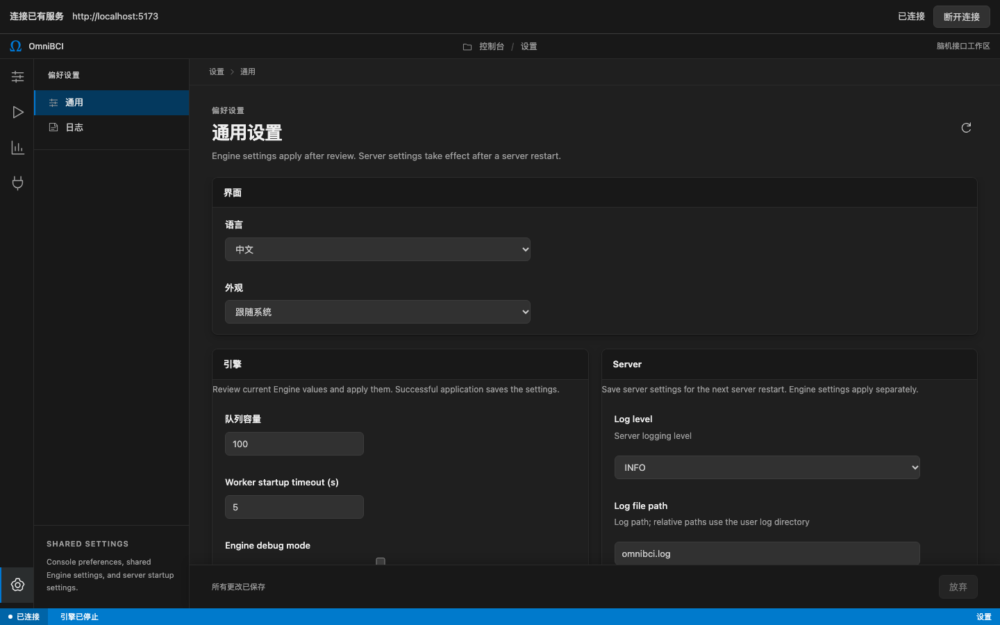

# Frontend UI and UX design

This document describes the visual and interaction design of the React console in
`frontend/`. Browsers and the Electron desktop app share this console. For data
flow and server contracts, see [web and server contracts](frontend-separation.md).

Screenshots are in `docs/images/ui/`. They show the dark theme at 1440×900 with
Chinese as the interface language.

The agreed [module and surface names](plugin-marketplace-design.md#32-canonical-module-and-surface-names)
use **Plugins** for the management area and **Plugin Marketplace** for its
distribution capability. The current UI still uses **Extensions**; screenshots,
the `#extensions` route and source identifiers below describe that implementation.
Renaming those requires the later code change; this document only standardizes terminology.

## Layout

The console uses a workbench layout:

| Region | Purpose |
| --- | --- |
| Title bar | Product wordmark and the current area (`控制台 / 配置`). |
| Activity bar (left) | Switches between Setup, Run, Results, Plugins (currently labeled Extensions), and Settings (gear at the bottom). The selected area has an accent stripe and a tinted background. |
| Explorer (second column) | Area-specific navigation: modules, plugin slots, and saved profiles. The selected item has a highlighted background and an inset accent stripe. |
| Editor | The page content. Setup pages keep a footer with save actions pinned to the bottom. |
| Status bar | Connection and engine state, always visible. |

## Pages

### Setup / Acquisition



Setup is for **configuring**, and Run is for **operating**. The Acquisition page
is the one exception: it keeps a slim runtime panel with **Connect / Disconnect**
only, because reading source metadata needs a live connection. Starting and
stopping reading happens on Run. The panel's left stripe is grey while the
source is idle and green while it is connected. Plugin and profile selectors
come next, then the current parameters and the source metadata, side by side on
wide windows.

### Setup / Signal processing, Stimulation, Actuation



These pages have no Start/Stop buttons. A read-only status strip shows the
module state (运行中 / 未运行) and an **在运行页操作 / Operate in Run** link.
Edits here become the current parameters; Run uses them the next time the
module starts. Processing configuration has four steps: channel mapping,
epoching, filters, and the decoder. A segmented step bar sticks to the top of
the scroll area.

### Run: guided pipeline



The Run page is designed around one question: *what do I do next?*

1. **Engine bar.** A compact bar at the top holds Start / Stop engine. While the
   engine is stopped, the bar carries the **下一步 / Next step** badge and an
   accent ring.
2. **Pipeline stepper.** There is one tab per module: 采集 → 信号处理 → 刺激 →
   执行器 (optional). Each tab shows its phase:

   

   | Phase | Look | When |
   | --- | --- | --- |
   | done | Green filled circle with a check; the connector to the next step turns green | Acquisition is reading, or the module is active |
   | working | Spinning accent ring | An action is pending or the module reports progress |
   | failed | Red ring and status | The last action returned an error |
   | partial | Green ring | Connected or active, but not yet at the goal (for example, connected but not reading) |
   | waiting | Grey ring | Configured but not started |
   | unconfigured | Dashed outline, "未配置" | No plugin is selected for the step's main slot |

   The first configured, non-optional step that is not done is marked **Next
   step**. Unless you click a tab, the panel below follows that step, so after
   each action the page moves on by itself. Clicking a tab pins your choice.
   Arrow keys move between tabs (`role="tablist"`).
3. **Step panel (left).** Only the selected step is visible. The other panels
   stay mounted with `hidden`, so a half-filled trial form survives switching
   tabs. Each panel shows the plugin in use, the module runtime panel, and the
   step-specific tools: the chunk preview for acquisition, signal readiness for
   processing, and the trial form for stimulation. The runtime panel highlights
   exactly **one primary action**, the one that moves the module forward
   (Connect → Start reading, Start, Launch). Stop actions are never primary.
   Each disabled action has a one-line reason under the buttons, and longer
   help is folded into **说明 / Details**. When a step is done, a **Next: … →**
   link jumps to the following step.
4. **Live results (right).** A sticky side panel shows the latest decoded
   target in large type, the trial number and confidence, the last 10 trials
   (forced outputs are marked `F`), the feed connection state, and a link to
   the full Results page. You no longer have to leave Run to see whether
   decoding works.
5. **Secondary information** is collapsed below: current parameters, epoch
   processing, and acknowledgements.

At 1440×900 the engine bar, stepper, active panel, and live results fit on one
screen. Below 1100 px the results panel stacks under the step panel. Below
760 px the stepper wraps to two columns.

A mid-session view: acquisition and processing are done, stimulation is next,
and decoded trials arrive in the side panel:



#### Typical session

1. Start engine. The Next badge moves to 采集.
2. Connect, then Start reading. 采集 turns green and the panel advances to 信号处理.
3. Start processing. The panel advances to 刺激.
4. Launch stimulation, then fill in the target sequence and Trigger trial.
   Results appear on the right as each trial is decoded.
5. When every required step is green, a banner confirms that the pipeline is running.

### Results



The page shows the retained decoded trials (up to 200), newest first, with a
search box and a forced-output filter.

### Plugins

The area manages installed Plugin Packages and offers Plugin Marketplace access.
Contribution selection remains in the owning module's configuration. Runtime
preparation creates Instances in that module's backend Host; the management page
itself does not execute plugin code.



### Settings / General



## Design tokens

All colours use `light-dark()`, so a single declaration covers the light and dark
themes. The tokens are defined in `frontend/src/styles.css`:

| Token | Use |
| --- | --- |
| `--accent`, `--accent-soft` | Primary actions, selection, focus rings, text-button hover. |
| `--ok`, `--err`, `--warn` | Active/running, errors and danger actions, unsaved changes. |
| `--tint` | Read-only or secondary surfaces: summaries, runtime panels, hovered rows. |
| `--card-radius` | Shared corner radius for cards, setting groups, runtime panels. |
| `--shadow` | Light elevation for cards and setting groups. |
| `--ease` | 120 ms transition for hover, press, and state changes. |

## Interaction rules

- **Immediate feedback.** Buttons, inputs, explorer items, and cards animate
  colour and border changes over 120 ms. Inputs darken their border on hover.
  Text buttons get a soft accent background on hover. Danger buttons show a red
  border on hover.
- **State at a glance.** A coloured left stripe marks module and engine state:
  grey when idle, green when active. Status pills follow the same colours.
- **One place to operate.** Module lifecycle actions live on Run only. Setup
  shows state and links to Run; the only exception is Connect / Disconnect on
  Acquisition, which metadata needs.
- **One obvious next action.** The stepper marks the next step, the panel
  follows it, and each runtime panel highlights a single primary button.
  Disabled buttons always explain why in one line.
- **Less text by default.** Long help sits behind **说明 / Details**
  disclosures. Secondary data (current parameters, epochs, acknowledgements)
  is collapsed.
- **Results while operating.** The Run page always shows the latest decoded
  output.
- **Smooth in-page jumps.** Setup scroll areas use smooth scrolling, so the
  processing step bar visibly moves to its target section.
- **Reduced motion.** With `prefers-reduced-motion: reduce`, all transitions and
  smooth scrolling are off.
- **Accessibility unchanged.** Focus rings, ARIA roles, keyboard shortcuts
  (Ctrl/⌘+S saves a profile), and high-contrast overrides are unchanged.
  The runtime panel exposes its active state with a `data-active` attribute
  rather than an extra class, which keeps existing selectors stable.

## Changed files

| File | Change |
| --- | --- |
| `frontend/src/styles.css` | New tokens and transitions; hover states; activity-bar and explorer selection; rounded, elevated cards and groups; status pills; sticky engine card; footer elevation; reduced-motion support. |
| `frontend/src/ModuleRuntime.css`, `ModuleRuntime.tsx` | Runtime panel with a state stripe and `data-active`. |
| `frontend/src/PluginProfiles.css` | Segmented processing step bar. |
| `frontend/src/RunConsole.tsx`, `RunConsole.css` | Guided pipeline: engine bar, stepper tabs, step panels, next-step logic, two-column layout, collapsed secondary sections. |
| `frontend/src/LiveResults.tsx`, `LiveResults.css` | New live results side panel. |
| `frontend/src/ModuleRuntime.tsx` | `actions="connection"` mode for Setup / Acquisition; single primary action. |
| `frontend/src/PluginProfiles.tsx` | Setup shows a status strip and an "Operate in Run" link instead of lifecycle buttons. |
| `frontend/src/locales/runtime.ts`, `profiles.ts` | `pipeline.*`, `live.*`, and Setup status strings (en and zh). |
| `frontend/tests/run-configuration-state.test.mjs`, `plugin-profiles.test.mjs` | Stepper tests; Setup lifecycle tests now start modules through the shared runtime controls that Run uses. |

## Regenerating screenshots

Start the Server and the Vite dev server, then capture each page with headless
Chrome. `run-pipeline.png` and `run-stepper.png` need a running session. Start
the engine, connect, read, and start processing first, then capture
`#run` (crop `.run-pipeline` for the stepper close-up).

```sh
uvicorn omnibci.presentation.main:app --host 127.0.0.1 --port 8000 &
(cd frontend && npm run dev) &
CHROME="/Applications/Google Chrome.app/Contents/MacOS/Google Chrome"
for page in acquisition processing run results extensions general; do
  "$CHROME" --headless=new --disable-gpu --hide-scrollbars --window-size=1440,900 \
    --virtual-time-budget=6000 --screenshot="docs/images/ui/$page.png" \
    "http://localhost:5173/#$page"
done
```
