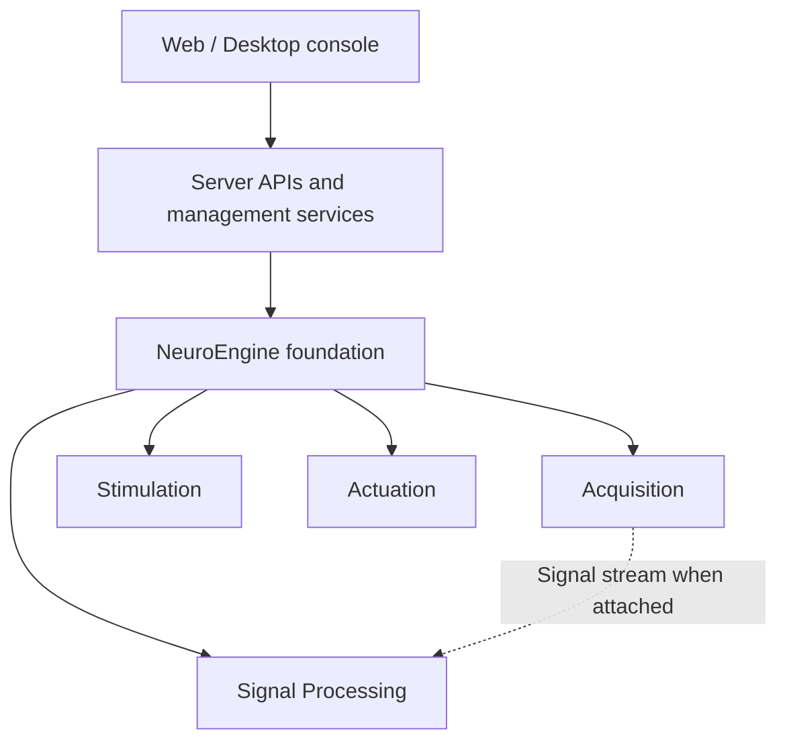

# Module configuration

The server keeps four independent accepted configurations: Acquisition,
Signal Processing, Stimulation, and Actuation. Each owns its settings, pinned
plugin bindings, content revision, file, lock, and application history.
Named saved Profiles remain independent for each plugin.

## Configuration management package

`application/configuration` owns configuration definitions, validation, models,
the storage port, and one `ConfigurationService`. Server settings, Engine settings,
module configuration and named plugin Profiles use this same service. Profiles
remain independent saved parameter sets; they are not a second configuration
management subsystem.

`infrastructure/repositories/configuration_repository.py` implements the storage
port with `TomlConfigurationRepository`. It owns TOML serialization, atomic writes,
file locks and revision checks. Bootstrap injects one service/repository pair.
The configuration package does not import runtime services or infrastructure.
Runtime application and lifecycle coordination remain in their existing services.

Workers and output processes receive explicit configuration snapshots. They do
not load user files or install process-wide configuration. The old `conf` package,
global settings instance, separate Profile service and packaged default TOML are
removed without compatibility aliases.

Server and Engine share a physical file, but each validates only its own values.
Invalid Engine values do not block Server reads/saves, and invalid Server values
do not block Engine reads/saves. Invalid TOML syntax prevents both from reading
that file. Plugin Profiles and module files remain independently readable.

## Server and Engine

**OmniBCI Server** is the Python service: HTTP/WebSocket APIs, configuration and plugin
management, logging, and runtime control. It can serve configuration requests
while the Engine is stopped.

**NeuroEngine** is the runtime foundation controlled by that service. It owns
message transport, queues, worker lifecycle, and output gateways. After Engine
startup, Acquisition, Signal Processing, Stimulation, and Actuation have their
own start/stop paths. Starting Engine alone starts none of those modules;
stopping it stops all four.

**Engine configuration** uses `EngineSettings`, `/config/engine`, plan
`module: "engine"`, and `engine_revision` consistently. It contains queue
capacity, worker startup timeout, and debug mode, stored under `[engine]`.
Engine is the foundation configuration scope, alongside four module scopes.

**Server diagnostics** use `/server/info` and `/server/logs`. The diagnostic
router is `presentation/routers/server.py`; logging, shutdown and desktop
connection code use `ServerLogging`, `ServerShutdownService`, and
`ServerConnection`. The composition root's `AppContainer` groups services;
it is not a separate runtime or configuration layer.



Independent lifecycle does not remove data dependencies: Processing can start
in standby, but needs an Acquisition descriptor and stream to process samples.
Stimulation and Actuation do not require Acquisition or Processing to run.

## Ownership

| Section | Owned settings | Plugin bindings |
| --- | --- | --- |
| acquisition | None | Source |
| processing | `ALGORITHM.baseline_duration` | Decoder, Epoch Detector, ordered Filters |
| stimulation | Address/port, renderer, `auto_spawn` | Paradigm, Trigger |
| actuation | Address/port, watchdog, command age, `auto_spawn` | Effector |
| engine | Queue capacity, startup timeout, `debug` | None |

The `engine` revision represents shared infrastructure settings, not an aggregate
of module revisions. A derived `ActivationSet` combines only the files needed by an operation;
it does not introduce another saved object or global revision.

The four modules keep separate `activation/<module>.toml` files. Engine settings
use `[engine]` in the user `settings.toml`, alongside Server startup settings.
Engine revisions hash only Engine values; Server save revisions hash only Server
values. Writers share a file lock and preserve the other group's latest values,
including during Engine rollback. Module storage and history remain independent.

Setup edits Stimulation's `STIMULATION.server_ip`, `STIMULATION.server_port`,
renderer and managed/external mode, and Actuation's corresponding address,
mode, watchdog and maximum command age. These are module settings, separate
from plugin Profiles. Stimulation defaults to `127.0.0.1:8765`; Actuation defaults
to `127.0.0.1:8001`. Maximum command age `0` disables age filtering.
Each output owns its listener settings even though Engine hosts the listener.
Changing them replaces only that output, preserving the foundation generation,
other listeners, and A/P workers. A connected external node must disconnect
before its settings change.

## Shared user settings file

The user configuration root is `OMNIBCI_CONFIG_DIR` when set, otherwise the
platform user configuration directory. Its `settings.toml` holds both Engine
and Server startup settings:

```toml
[engine]
"NEUROENGINE.queue_size" = 100
"NEUROENGINE.startup_timeout_s" = 5.0
debug = false

[LOGGING]
level = "INFO"
file_path = "omnibci.log"

[NEUROENGINE]
command_timeout_s = 10.0

[PLUGINS]
user_dir = ""
```

Only supplied values need to be present. An absent `[engine]` means no Engine
settings have been accepted; an empty table preserves an accepted empty
configuration. Missing Engine fields use defaults declared in
`application/configuration/definitions.py`. Module defaults come from the same
definitions, independently of the Server settings file.

Engine Review uses current editor values. Successful application stores
`[engine]`; when running, it rebuilds Engine and restores the modules that were
running. Server Save writes its own fields for the next Server startup. The
page shows saved values separately from that process's startup values. Restarting
Engine alone does not apply Server edits.

Both writers use `locks/settings.lock`, reread the latest document under the
lock, check their own content revision, and atomically replace the file. Engine
rollback restores or removes only `[engine]`, preserving concurrent Server
saves. Revisions are derived, not additional stored fields. Shared settings are
read only from the user `settings.toml`; there is no legacy migration layer.

## Apply flow

Connect and module Start each submit one request containing `operation_id` and
`configuration: {expected_revision, settings, bindings}`. The expected revision
belongs to the editor's actual baseline, not a newer value fetched just before
submission. Settings replace the module's submitted settings; they are not a
patch and are not read implicitly from the host settings file.

The server owns validation, configuration application, and the requested action
until its core transition finishes. It uses the existing application boundaries
and returns the completed operation. A retry with the same operation UUID and
content observes that operation; different content with the same UUID conflicts.
HTTP cancellation does not abandon owned work. Stop waits for the affected
module's in-flight core transition.

An operation reports `result.configuration_applied` as soon as application is
confirmed. If connection or startup subsequently fails, accepted values remain
available for correction, and the operation reports failure without claiming a
rollback. The browser acknowledges its own accepted baseline while retaining
edits made during the request. Other clients' updates never silently rebase a
dirty editor. Successful changes record module history once per operation.

Engine settings and module-history restoration retain explicit plan review and
Apply. The server rechecks their dependency revisions and generation before
execution. These review plans are not a prerequisite for ordinary module actions.
Engine review takes the editor's current settings directly; no prior Save is
required. Server startup edits use a separate Save action and require a server
restart. Pending Server edits do not block Engine review or module actions.

Unrelated module edits do not invalidate a narrow plan. Processing also depends
on Acquisition; every module depends on Engine. An Engine rebuild depends on all
sections because it replaces the shared runtime. A first module selection also
initializes Engine with declared defaults through an explicit plan candidate when
the `[engine]` table is absent.
Starting an empty engine accepts initial shared settings without selecting plugins.

| Change while running | Boundary |
| --- | --- |
| No semantic change | No runtime update or history entry |
| Engine | Restart the engine and restore the previously running modules |
| Acquisition | Restart only Acquisition; revalidate active Processing against source metadata |
| Processing input, Epoch Detector or baseline settings | Restart only Processing |
| Decoder/Filter parameters marked `x-apply: trial` | Trial boundary |
| Other Decoder/Filter changes | Drain, replace Processing in its existing worker, resume |
| Stimulation or Actuation | Replace only that output module |

A stopped module accepts its configuration without starting it. The applied map
reports the engine's prepared configuration; module status reports actual execution.
Narrow Stimulation and
Actuation updates do not broadcast revisions to Acquisition or Processing.
Unknown worker results require recovery of the affected modules; the coordinator does not replay data
or recreate an output driver whose state is unconfirmed.
Independent modules can apply concurrently. Acknowledgement and rollback merge
only the changed module, preserving other modules' completed updates. The shared
engine revision is a dependency check, not a global lock on every operation.
History-only write failures report that configuration was applied but history
was not saved; they do not quarantine a confirmed running module.

Live runtime operations require one server owner for each configuration root.
Independent section locks protect file writes; dependency checks do not form an
atomic transaction against arbitrary other processes editing those files.

External nodes bind their own module and engine revisions. Their module cannot
be changed while they are connected. Engine rebuilds also require those peers to
be disconnected; unrelated narrow module updates remain possible.

## Independent modules on NeuroEngine

NeuroEngine provides the shared event bus, command transport, and peer gateways.
**Start engine** starts this foundation with no source or plugin required. It does
not read business-module files, bind output ports, apply current module edits, or start Acquisition, Processing, Stimulation, or
Actuation. **Stop engine** stops all modules and the shared runtime.

- **Connect** applies current Acquisition values, starts the engine when needed,
  starts the Acquisition worker, and connects the source. Disconnect releases that
  worker; Stop reading keeps the connection.
- **Start processing** applies current Processing values and starts its worker.
  It can wait in standby without a connected source. Observed source metadata
  prepares Processing before its input is attached.
- Acquisition reads and previews data while Processing is stopped. Stopping
  Processing detaches its input without stopping or restarting Acquisition.
- Stimulation and Actuation start and stop independently, using only their own
  current values. External nodes require the engine's transport, but neither
  an Acquisition selection nor running A/P workers.
- External preparation applies only the corresponding output configuration and
  ensures its listener is ready, including when the values are unchanged.
  Start/connect the external node, then enable that module. `auto_spawn` selects
  managed or external deployment; no separate Actuation enable setting is needed.
- Managed output start ensures its own listener before spawning the process.
  A port or cleanup failure affects only that output. Module Stop retains the
  prepared listener for reconnect; Engine Stop releases every listener.

Processing input attaches and detaches at ordered queue boundaries. Partial
epochs are interrupted; samples from separate inputs are never joined into one
epoch. Acquisition continues reading and previewing while Processing is detached.
These samples are not buffered or replayed. File inputs also continue advancing;
prepare Processing before reading when complete file analysis is required.
Preview and diagnostic logging are not full raw-signal recording.
If the Processing input queue fills, delivery stops and Processing reports a
recoverable error while Acquisition continues reading and previewing. Faults
from a previous input cannot interrupt a newer attachment.
The real signal queue uses the positive `NEUROENGINE.queue_size` capacity
(default 100), including input-start and drain markers in the same FIFO. A
missing drain marker is never reported as a completed drain, including retries.

Each output peer has one sender and a 64-item queue. EventBus handlers enqueue
without awaiting socket writes, so a slow output cannot delay A/P command
receipts. Direct terminal-result writes use the same FIFO and await the actual
write. Queued messages belong to their original socket connection and are never
replayed after reconnect. Queue overflow or write failure closes that channel
and marks only its output module for recovery. Command errors distinguish
definitely unsent requests from unknown execution outcomes; a successful socket
write alone is never an execution receipt. Prepared listeners remain available
when no node is connected. External nodes also stop their local output on a
delivery fault and use their existing reconnect procedure.

Stop closes admission for the affected modules, lets existing operations finish
or reconcile their bounded timeouts, and then confirms shutdown. Other modules
remain controllable. Module Stop/Disconnect is also available when its process
has exited but recovery is still required. An HTTP disconnect does not abandon
an owned Start, Prepare, or Stop. Server shutdown uses the Engine Stop path.
Shared infrastructure failures and explicit Engine transitions have
global scope; ordinary module failures do not.
If an external output disconnects before confirming Stop, its recovery state
remains. Once local resources are released, Engine can restart to accept a
reconnection. The existing external Prepare action republishes that output's
retained configuration under the new engine generation without applying drafts
or enabling output. Reconnect and confirm the module's Stop before starting it.

Worker restarts retain the engine generation. Source sequence, trial, and epoch
counters remain monotonic during that generation. Worker failure affects that
module's availability, not foundation readiness or unrelated module lifetimes.

The signal configuration query uses `source_revision` to detect changes to the
selected acquisition source and observed metadata. It does not expose a Server
settings revision or read the Server settings file.

## Runtime identity

Runtime settings contain `CONFIG.module_revisions`, `CONFIG.engine_revision`,
and `CONFIG.generation`. Node configuration uses a revision map: the engine
receives Acquisition and Processing, and each external output node receives its
own module. Handshakes check the relevant module, engine, and generation.

Node configuration has `format_version: 1` and an `engine_revision` field.
External-node IPC uses protocol version 1. The desktop handshake calls
`/server/info` and requires `desktop_api_version: 1`. These unreleased contracts
accept only the current fields and version 1. Removed routes return 404;
obsolete or unknown fields are rejected without aliases or fallback parsing.
Deploy matching Server, desktop and node builds.

Peer sockets use one strict Event decoder and an explicit receive handler.
Malformed frames disconnect the peer; valid keep-alives and accepted Event
messages refresh its liveness state. Acquisition and Processing command queues carry
`(command, payload)` pairs, including process stop with a `None` payload.

Engine configuration hashes use the `engine` namespace independently of module
revisions and module/Profile history. Engine generation identifies the running
instance.

SDK `PluginContext.module_revision` identifies the consuming module. A Trigger
shipped in an acquisition-domain package therefore uses the Stimulation revision
when loaded by Stimulation. Results carry Acquisition and Processing revisions;
source preparation and preview identify the Acquisition revision.

## API and storage

All routes use the normal `/api/v1` prefix and response envelope.

| Route | Purpose |
| --- | --- |
| `GET /config/plugin-catalog/{kind}` | Plugin selections, schemas, availability and trial controls for one kind |
| `POST /engine/start` | Start shared infrastructure only |
| `POST /engine/stop` | Stop every module and shared infrastructure |
| `POST /engine/modules/{module}/start` | Apply current Processing or Actuation and start/prepare that module |
| `POST /engine/modules/{module}/stop` | Stop the specified module |
| `POST /engine/modules/{module}/prepare` | Prepare retained Stimulation or Actuation configuration for recovery; no draft |
| `POST /acquisition/connect` | Apply current Acquisition, start its worker, and connect in one operation |
| `POST /acquisition/stream/start` | Validate source revision, engine generation and connection ID, then start reading |
| `POST /stimulation/start` | Apply current Stimulation and start it, or prepare its external listener |
| `GET /config/modules` | Accepted modules plus engine, with errors reported per section |
| `GET /config/modules/{module}` | One module; revision is null when absent |
| `POST /config/apply-plan` | Plan current values for the required module |
| `POST /config/apply` | Execute a reviewed plan |
| `GET /config/runtime` | Accepted/applied maps, module-keyed `operations`, `recovery`, and read `errors` |
| `GET /config/modules/{module}/history` | Successful application entries, newest first |
| `GET /config/modules/{module}/history/{entry_id}` | Historical full module snapshot |
| `POST /config/modules/{module}/revert-plan` | Plan restoration by history entry ID |
| `GET /config/engine` | Accepted shared settings |
| `GET /config` | Server saved values, startup values, restart flags, and Server save revision |
| `PATCH /config` | Save Server startup values with `expected_revision`; does not apply Engine settings |
| `GET /config/plugin-profiles/{id}/history` | Saved Profile revisions |
| `POST /config/plugin-profiles/{id}/revert` | Copy a historical Profile into a new revision |

See [Plugin profiles](plugin-profiles.md) for current-value workflows, storage,
A → B → A history semantics and independent Profile restoration. There is no
legacy activation endpoint, implicit legacy alias selection, or format migration.
