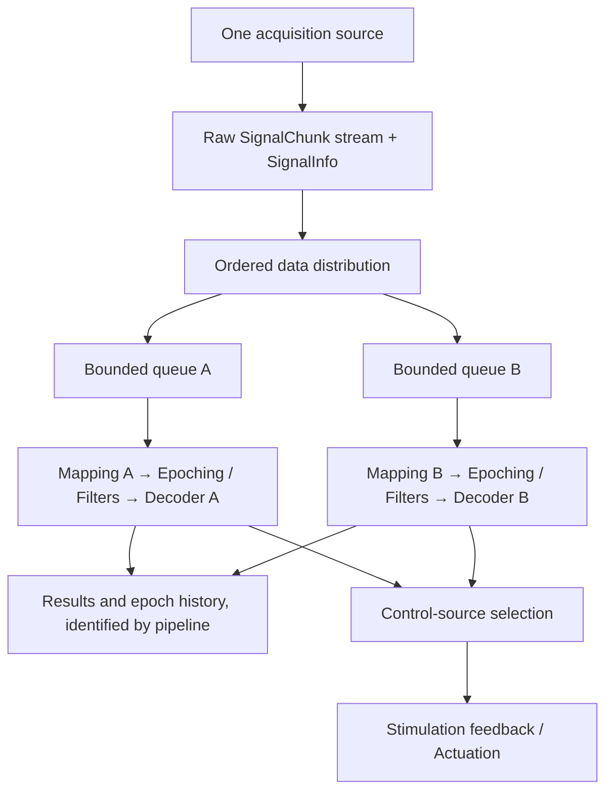

# Parallel Decoder processing from one acquisition source

Date: 2026-10-30 (Asia/Shanghai)

Status: proposed design for review; not implemented.

Scope: one acquisition source feeding multiple independent processing pipelines.
This document does not change runtime behavior, configuration schemas, or plugin
contracts. The first-release choices below are recommendations for implementation
review, not existing capabilities.

## Goal and first-release scope

Connect to one acquisition device once and deliver its complete multichannel
stream to multiple Decoders concurrently. Support these cases:

- Different algorithms using the same channels.
- Different or overlapping channel selections using independent Decoder Profiles.
- Multiple instances of the same algorithm with different parameters.

For example, a device with 32 signal channels could feed:

| Pipeline | Decoder Profile | Source signal rows | Role |
| --- | --- | --- | --- |
| A | Algorithm A profile | 1-8 | Control output |
| B | Algorithm B profile | 1-8 | Algorithm comparison |
| C | Algorithm A extended | 5-16 | Channel-selection comparison |

Rows in this example use the UI's one-based numbering and exclude the event row.
The API's `source_channel_index` remains zero-based.

The first release should use one source sample rate and event stream, independent
mapping/filter/Decoder state, and at most one pipeline selected for control.
Results from every pipeline remain available for inspection. Topology changes
require stopping and draining the affected Processing pipelines, followed by
explicit application and preparation. Acquisition can continue independently.

Out of scope: multiple acquisition devices, distributed execution, resampling,
general processing graphs, automatic result fusion, live pipeline insertion,
shared-memory optimization, and a new persistent results or Session repository.

## Current implementation and constraints

| Current behavior | Code and consequence |
| --- | --- |
| A Decoder Profile owns `processing_input`. | [PluginProfile](../omnibci/application/plugin_profiles.py) already supports independently saved channel mappings. Preserve this ownership. |
| Configuration selects one `processing.decoder` and one `processing.epoch_detector`. | [Node configuration](../omnibci/application/node_configuration.py) and [processing source resolution](../omnibci/application/processing_source.py) assume one pipeline. |
| One acquisition worker and one processing worker share one data queue. | [Engine builder](../omnibci/infrastructure/neuroengine/builder.py) and [DataManager](../omnibci/infrastructure/ipc/data_manager.py) use destructive queue reads. Multiple consumers of this queue would divide chunks between themselves. |
| A SignalProcessor owns a detector, Decoder, filters, pre-trigger buffer, and current epoch. | [SignalProcessor](../omnibci/infrastructure/signal_processing/signal_processor.py) provides the natural unit to instantiate independently. |
| Mapping selects signal rows and appends the original trigger row. | [ResolvedSignalPlan.apply](../omnibci/domain/channel_mapping.py) preserves source timestamps and sequence IDs. |
| Results have no pipeline identity. | [Event payloads](../omnibci/application/events.py) and [ResultsService](../omnibci/application/services/results_service.py) would collide when multiple pipelines emit the same trial or epoch number. |
| Completed trials feed both actuation and stimulation. | [Actuation translation](../omnibci/infrastructure/neuroengine/actuation_translator.py) and [peer routing](../omnibci/infrastructure/neuroengine/gateway/peers.py) need explicit control-source selection. |

This is a runtime, configuration, and result-routing change, with a corresponding
UI change. Adding another Decoder selector alone cannot provide the behavior.

## Processing topology

Distribute the source stream before channel mapping. Each enabled pipeline must
receive the same source chunks, in the same order, while it is healthy. Its
mapping then selects, orders, names, and declares types for its own signal input.
Selections can overlap across pipelines; existing duplicate-source checks still
apply within each mapping.

The normalized trigger row is copied unchanged into each mapped stream. It is
never a user-selected mapping row and never becomes a Decoder signal channel.
This design does not change hardware trigger sending or clearing.

Use one processing worker process per pipeline initially. Decoder and filter
execution is synchronous today; multiple tasks on one event loop would not
isolate a slow computation. Separate processes provide independent progress and
plugin state, but still share finite CPU and memory resources.

Use ordinary process queues and independent payload copies first. The current
`SignalChunk` is a frozen dataclass whose NumPy payload remains mutable; freezing
the dataclass does not make shared array access safe. Preserve producer ownership
rules, including no mutation after enqueue. Consider shared memory only after
measurement demonstrates a need and its ownership protocol is designed.

## Configuration ownership

A saved Profile is reusable configuration. A pipeline is a running instance with
its own identity and state. Two pipelines may reference the same Profile without
sharing Decoder, detector, filter, or buffering instances.

| Owner | Configuration or state |
| --- | --- |
| Acquisition | One source binding, connection, observed `SignalInfo`, source sample rate, raw signal and trigger stream. |
| Decoder Profile | Exact Decoder plugin/version, algorithm parameters, and `processing_input`, including Manual mapping. |
| Processing configuration | Pipeline list, stable IDs, names, enabled flags, Profile selections, ordered filter instances, per-pipeline pre-trigger settings, and optional control pipeline ID. |
| Pipeline runtime | Prepared mapping, plugin instances, pre-trigger/epoch buffers, queue, progress, trial/epoch counters, and status. |

Conceptually, each pipeline references one Decoder Profile, one Epoch Detector
Profile, and zero or more ordered Filter Profiles. The initial comparison use
case can reuse the same detector Profile across pipelines, with separate detector
instances. No composite Pipeline Profile is required in the first release.

The existing Processing `baseline_duration` setting controls pre-trigger capture; it
is not an independent post-trigger decoding-window setting. Decoding readiness
continues to follow each Decoder's `should_decode()` contract. Do not introduce a
second universal window parameter without a separate requirement.

Applying configuration pins the current plugin selections and parameter values,
including each mapping. A saved Profile can supply those values but is not
required. Saving a newer Profile never changes an accepted or running pipeline.
Names are display labels; `pipeline_id` is the stable identity, distinct from
`profile_id`. Disabling and re-enabling a configured pipeline preserves its ID;
duplicating one creates a new ID.

The persisted field names and schema version require implementation design. This
document defines ownership and behavior rather than a new JSON/API contract.

## Preparation and lifecycle

Keep Profile saving independent of engine state and Metadata availability.
Offline Manual mappings remain **Not verified** until checked against the current
source descriptor. A saved mapping is not evidence that its rows exist.

Before the requested Processing pipelines consume source data:

1. Pin the enabled pipeline set and accepted configuration revision.
2. Obtain the current source descriptor and validate existing source expectations.
3. Compile each pipeline's mapping and validate its selected Decoder's input
   requirements against its mapped channels and observed sample rate.
4. Prepare each worker and collect receipts identifying its pipeline, generation,
   configuration revision, source connection, and prepared plan.
5. Permit those pipelines to consume data only after every enabled pipeline has
   acknowledged readiness.

Preparation failure identifies the affected pipeline and blocks that requested
multi-pipeline Processing start. Do not silently omit it. The operator may
explicitly disable or repair it and review/apply the changed configuration.
Acquisition configuration, connection, reading, and metadata inspection remain
independent, including while Processing is unprepared or failed. Zero enabled
pipelines preserves source-only acquisition.

Reconnect, source changes, and metadata invalidation invalidate affected readiness.
Retain the drain-before-prepare boundary for Processing input. Do not
reuse a receipt from another connection or accepted revision.

For stop-and-drain, distribute the barrier after the final chunk to the exact
pipeline set participating in that stream. Collect one receipt per pipeline and
check its identity and final sequence. The coordinator emits one aggregate command
result only after all required receipts or explicit failures/timeouts are known.
The first worker acknowledgement must not complete the whole operation. A failed
pipeline remains listed in the outcome instead of disappearing from membership
and allowing a false success report.

Draining proves processing completion or interruption, not physical output
completion. Preserve the existing distinction expressed by
`StreamDrainReceipt.outputs_settled`; stimulation/actuation acknowledgements have
their own lifecycle.

Initially, changes to pipelines, mappings, current plugin values, or control-source
selection use a reviewed Processing stop/drain and rebuild path. Failed application must
report the accepted and actual runtime state without claiming a partially
prepared pipeline set is fully active.

## Result identity and event correlation

Trial and epoch numbers are local to a pipeline. Proposed result keys are
`(generation, pipeline_id, trial_number)` and
`(generation, pipeline_id, epoch_number)`. Extend result storage, API responses,
event transport, and UI grouping together. Preserve configuration revision and
the pinned Profile references so the producing algorithm and mapping are known.

Comparing algorithms also requires identifying the same source event occurrence.
The trigger value (`event_id`) can repeat, and pipelines finish at different
times, so neither trigger value nor arrival order is a correlation key.

Introduce an occurrence reference based on the prepared source identity and the
original trigger location, for example:
`(generation, connection_id, source_chunk_sequence_id, sample_offset_in_chunk)`.
Propagate that location through chunk slicing and epoch creation. These are
proposed result fields; current `SignalChunk` does not carry a complete event
occurrence reference or an absolute sample index. Preserve sequence uniqueness
within a generation/connection across stop/start, or add an explicit stream-run
identity if that invariant changes.

Pipelines that detect the same source event share its occurrence reference even
when they decode at different times. Different detector rules can produce
different epoch sets; do not manufacture one-to-one comparisons for unrelated
events. Keep pipeline-local epoch identity as well as source-event identity.

Results and epoch history remain runtime inspection data in the first release.
Durable recording, retention, and experiment archives are separate work.

## Control output and experiment timing

Allow zero or one enabled pipeline to be selected for control. Zero means
observation only. All pipelines publish inspectable results, but only the selected
pipeline may produce decoded-result feedback for stimulation or commands for
actuation. Gate both paths; filtering only the actuation translator would leave
stimulation receiving every pipeline's result.

Apply control selection in application-level routing before crossing either
output boundary. Selection must respect generation/configuration identity and
reject stale results. Keep ordinary stimulation lifecycle commands independent
of decoded-result selection. The control Decoder's target meanings must remain
compatible with the selected paradigm and effector.

Do not automatically promote an observation pipeline after a control failure.
Do not compare confidence scores across algorithms or perform voting implicitly.
Any future fusion policy needs its own explicit input and output contract.

Independent workers do not guarantee arbitrarily long decoding windows. In the
current [epoch state machine](../omnibci/infrastructure/signal_processing/processing_state.py),
a next-start or end marker forces a decode attempt and closes the current epoch.
If A needs one second and B needs two seconds, a new trial beginning after one
second can truncate B's input even though B runs independently.

For the initial comparison workflow, configure stimulus boundaries to provide
enough source data for all participating algorithms. A workflow that waits for
all selected algorithms before advancing would require a separate trial
completion/timeout policy; it is not an automatic consequence of broadcasting.

## Lag and failure handling

Queues must be bounded. Expose per-pipeline progress, backlog, processing latency,
and failures. Distribution must not block indefinitely on one full queue, and
must never silently drop chunks while treating that pipeline as healthy.

| Condition | Recommended first-release behavior |
| --- | --- |
| Observation worker fails or its queue exceeds its capacity | Mark that pipeline failed, stop its processing, expose the affected sequence boundary, and let healthy pipelines continue. |
| Control worker fails or cannot keep up | Stop decoded control output and coordinate stopping stimulation and acquisition through existing lifecycle controls. Report any incomplete stop; do not claim physical output acknowledgement from drain alone. |
| A pipeline detects a sequence gap | Treat its input as incomplete and fail the pipeline rather than continuing the current epoch as valid. |
| Acquisition or shared distribution fails | Stop the affected run and report that all dependent pipelines lost their source. |
| Drain acknowledgement is missing | Report the named pipeline and timeout/failure in the aggregate result; do not report a complete drain. |

After a failed branch, the run is explicitly degraded; incomplete comparison data
must remain visible. Experiments requiring complete results from every algorithm
may instead need an all-pipelines-stop policy. Confirm that requirement before
adding another runtime mode. Queue sizes, supported pipeline counts, and latency
limits must come from representative cross-platform measurements.

## UI and architecture boundaries

Processing setup becomes a list of pipeline instances. Each exposes its name,
enabled state, Profile selections, mapping verification, and control role.
Results expose pipeline identity and source-event association; runtime status
shows per-pipeline readiness, lag, and errors.

Keep **Save profile** separate from **Review and apply**. Current values can be
applied directly without saving a Profile first. The review shows changed pipeline selections,
channel mappings, filter order, control source, and lifecycle impact. **Continue
editing** returns to the affected editor. Browsing or saving changes does not
change the active pipeline set.

Preserve the existing clean-architecture boundaries:

- Domain: mapping and signal/epoch semantics, without queue or process management.
- Application: accepted pipeline configuration, preparation/drain coordination,
  result identity, and control-selection policy.
- Infrastructure: data distribution, worker processes, plugin construction, and
  IPC adapters implementing those policies.
- Presentation: pipeline editing, review, status, and result inspection.

Reuse the existing Decoder input contract per pipeline. Avoid introducing a
general graph framework or requiring plugins to manage acquisition connections.

## Compatibility and staged implementation

1. **Identity and configuration foundation.** Define the versioned pipeline
   configuration and result contracts, control routing, and legacy single-pipeline
   handling. A valid old configuration can be projected into a `default` pipeline
   in memory with its existing output behavior. Keep old Profile contents and
   accepted revisions unchanged during reads/startup. Persist a new representation
   only through explicit review/application; report invalid inputs for repair.
   Preserve source-only operation and verify single-pipeline behavior first.
2. **Concurrent execution.** Add explicit distribution, per-pipeline workers and
   queues, aggregate preparation/drain, and failure reporting. Implement pipeline
   editing and grouped results using the existing Profile workflow. Changes use
   stopped Processing pipeline rebuilds.
3. **Measure and extend only as needed.** Measure CPU, memory, and latency on macOS,
   Windows, and Linux. Consider shared memory, stricter comparison coordination,
   dynamic topology, or fusion only against concrete requirements.

API/schema updates, generated frontend types, accepted-configuration projections,
and external peer compatibility must be reviewed together. Existing migration
policy remains applicable: no silent legacy settings import or rewriting user
files. See [Plugin configuration](plugin-profiles.md),
[Plugin Profiles](plugin-profiles.md), and [channel mapping](channel-mapping.md).

## Acceptance criteria

| Scenario | Required evidence |
| --- | --- |
| Two or more pipelines receive one source | Each healthy worker receives the complete ordered source sequence and unchanged trigger samples; only one device connection exists. |
| Different and overlapping mappings | Each Decoder sees its own selected row order, names, types, and signal count; the event row never enters mapped signal channels. |
| Same Profile used twice | Worker, Decoder, detector, filter, and buffering instances remain independent. |
| Offline configuration | Different Manual mappings save independently without Metadata, show Not verified, and validate against the real source before their Processing pipeline consumes data. |
| Configuration lifecycle | Current values apply without saving a Profile first; saving does not mutate the accepted configuration; stale revisions/receipts and partial preparation cannot start the requested Processing pipeline set or block independent Acquisition reading. |
| Different decode readiness | Pipelines complete independently; boundary-forced decoding remains explicit and a short stimulus window is not reported as a full longer window. |
| Repeated trigger codes and out-of-order results | Result keys do not collide; the same source occurrence correlates across pipelines; reconnect/restart does not reuse stale event identity. |
| Control routing | Only the selected pipeline reaches both decoded stimulation feedback and actuation; observation-only runs emit neither; stale results cannot trigger outputs. |
| Lag, worker crash, and source failure | Memory remains bounded, missing data is reported, and continuation/stopping follows the documented role-specific policy. |
| Stop and reconfiguration | Barriers follow all data, aggregate completion accounts for every participating pipeline, timeouts are visible, and no new stream uses stale preparation. |
| Compatibility and platforms | Existing single-pipeline and source-only workflows retain their behavior; old files are not rewritten implicitly; process startup/shutdown works on macOS, Windows, and Linux. |

Before implementation, confirm whether observation failures may leave the run
degraded or must stop all pipelines, whether experiments require waiting for all
algorithms, and the supported concurrency/latency targets. The recommendations
above provide an initial scope without implementing those additional modes.
