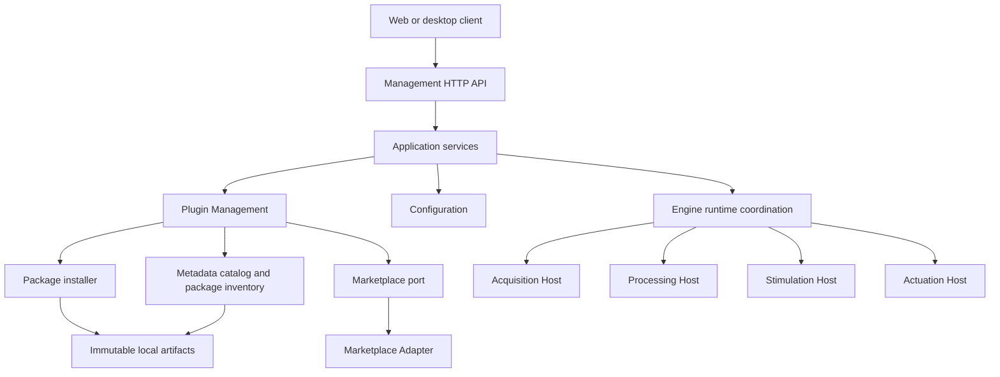
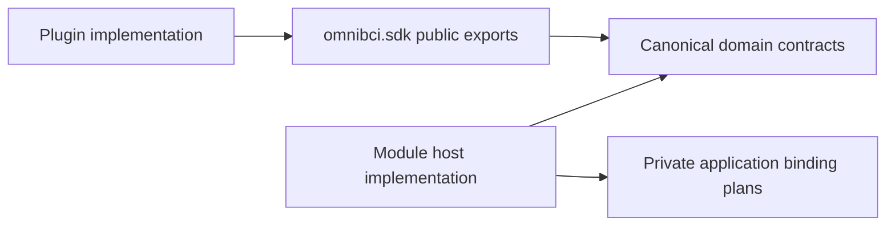
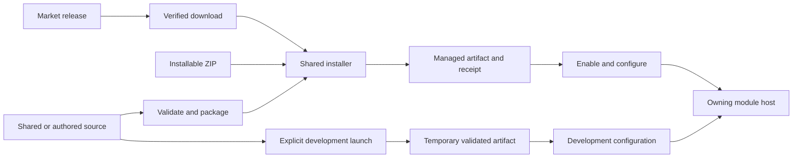

# Plugin and Marketplace Architecture Proposal

Status: target architecture with staged implementation. See the [implementation record](plugin-implementation-plan.md) for completed changes and remaining work.

Updated: 2026-11-20. Current implementation baseline: `0bdd1dd2a296fea4b919d7f1a186a6fb76477b8e` on `refactor/module-interface`.

## 1. Scope and decisions

OmniBCI needs a plugin system that accepts acquisition devices, processing algorithms, stimulation paradigms, triggers, and effectors from a marketplace, archives or source projects shared by others, and the user's own development projects. These workflows obtain plugins using the same format and API. Web and desktop clients manage the same backend capabilities. Device access and Python execution remain on the selected backend or output node.

The target is a **declarative package format, a small public API, module hosts, and a verified distribution channel**. A marketplace distributes packages; it does not participate in signal processing or command execution.

The **public API defines the contract**, the **SDK exposes that contract and supports plugin development**, and the **host supplies runtime capabilities and controls execution**. Keep `omnibci.sdk` as the author-facing Python import path, with one definition of each exported type and no separate SDK runtime or independently versioned SDK distribution for the first release.

The following constraints govern the proposal:

- The system has not launched. Define a single initial **Plugin API v1**, identified by `package.api_version = "1"`, and update all participants together. No backward compatibility, historical API adapters, constructor fallbacks, or parallel API implementations are required.
- API v1 requires complete replacement of the current interfaces and their callers, including built-ins, configuration flows and tests. Reduce exposed information and unnecessary abstractions while preserving existing functionality.
- Preserve explicit configuration and resource injection. The historical implementation called API 1 is not the target contract.
- Remove `PluginContext` in the coordinated v1 implementation. Keep the two explicit constructor signatures in section 4.3, without an alias or compatibility constructor.
- Plugin Management owns local inventory, installation, enablement and resolution. Its marketplace capability obtains remote releases; local import and development do not require a marketplace account or connection. Source workflows are specified in section 9.
- Use `plugin` consistently for OmniBCI. The [canonical terminology and module names](#3-concepts-and-architectural-boundaries) distinguish packages, contributions and instances without an additional extension layer.
- Start with backend contributions. Frontend executable plugins, custom webviews, billing, ratings, and an unrestricted public submission service are outside the first release.
- Keep the domain independent of discovery, packaging, transport, marketplace services, and the SDK facade.
- Make runtime selection reproducible and allow an installed, prepared system to operate offline.
- Treat native Python plugins as trusted executable code. Process separation contains some failures; it does not create a security sandbox.

The initial distribution model is an operator-curated repository. External authors can publish through a reviewed release process; a self-service publisher portal can be added without changing the runtime API. Sections 2–10 define the target. Section 11 evaluates the existing implementation against it.

The companion [Plugin API v1 domain contracts](plugin-api-v1.md) specifies the proposed export inventory, signatures, value invariants and role lifecycles. This proposal owns architectural and manifest/distribution boundaries; the [backend review](backend-interface-review.md) owns code findings and sequencing. The contract summaries here do not introduce alternative signatures or extra runtime layers.

## 2. Lessons from the VS Code extension model

This comparison retains VS Code's official `extension` names. OmniBCI uses `plugin`; borrowing the architecture does not introduce an OmniBCI Extension API, Extension Host or separate extension entity.

| VS Code mechanism | Application to OmniBCI |
| --- | --- |
| A static manifest describes identity, contributions, entry points, and host requirements. | Discover packages and generate configuration forms without importing plugin code. Use typed contribution kinds instead of import-time registration. [Extension manifest](https://raw.githubusercontent.com/microsoft/vscode-docs/main/api/references/extension-manifest.md) |
| Contributions and activation are separate; extensions load when needed. | Browsing, installing, and enabling remain metadata operations. Create Instances for selected Contributions when their owning module prepares to run. Activation follows module lifecycle, so an arbitrary activation-event language is unnecessary. [Activation events](https://code.visualstudio.com/api/references/activation-events) |
| Extensions import the public `vscode` API; `@types/vscode` supplies development-time declarations. `activate(context)` and optional `deactivate()` define entry points. | Separate the public contract and author tooling from execution. Publish a small import surface with complete role-specific lifecycle contracts. [Extension anatomy](https://code.visualstudio.com/api/get-started/extension-anatomy) |
| The VS Code runtime provides the `vscode` module, which extension bundles exclude. | Supply canonical OmniBCI types from the selected host environment. Plugin artifacts must not carry a private copy of `omnibci` or its SDK. Python classes remain runtime objects, so type stubs alone are insufficient. [Bundling extensions](https://code.visualstudio.com/api/working-with-extensions/bundling-extension) |
| `ExtensionContext.subscriptions` disposes registered resources on deactivation; asynchronous disposal is not awaited. | The host owns cleanup ordering, but physical-output shutdown requires explicit, awaited completion or failure. A generic disposal list cannot replace stop/quiesce contracts. [ExtensionContext](https://code.visualstudio.com/api/references/vscode-api#ExtensionContext) |
| Local, remote, and browser hosts have different capabilities and placement rules. | Resolve against the machine that executes the plugin. Acquisition runs near the device; stimulation runs near its display; a browser manages these hosts through the backend. [Extension host](https://code.visualstudio.com/api/advanced-topics/extension-host) |
| Packaged releases support publisher identity and platform-specific artifacts. | Provide a packaging tool, immutable releases, and artifact selection for the execution platform. Package locally or submit the same artifact to the repository. [Publishing extensions](https://code.visualstudio.com/api/working-with-extensions/publishing-extension) |
| An extension can be installed from the marketplace or a local VSIX; development runs in an Extension Development Host. | Accept one installable ZIP format and provide an explicit development launch using the same module hosts. Keep development state separate from ordinary installed versions. [Install from VSIX](https://code.visualstudio.com/docs/configure/extensions/extension-marketplace#install-from-a-vsix), [First extension](https://code.visualstudio.com/api/get-started/your-first-extension) |
| Publisher trust and package verification are separate from runtime permissions; the extension host has the application's permissions. | Authenticate publishers, verify repository metadata and artifact digests, and make operator trust explicit. Do not present signatures or a child process as proof that plugin behavior is safe. [Extension runtime security](https://code.visualstudio.com/docs/configure/extensions/extension-runtime-security) |

OmniBCI uses Python packages and its own execution contracts. VSIX, JavaScript APIs, a general command registry, and editor-specific contribution points are unnecessary. BCI workloads also require sample ownership, renderer thread affinity, bounded queues, and physical-output shutdown semantics that an editor extension model does not define.

## 3. Concepts and architectural boundaries

### 3.1 Canonical plugin terminology

This section is the terminology authority for the design and related guides. Use **plugin**, not `plug-in` or `extension`, for OmniBCI's extensibility. `Plugin` is the general term; use the precise nouns below when describing identity, operations or ownership. These terms describe existing responsibilities and the agreed target, not mandatory new classes or SDK exports.

| Canonical term | Meaning and identity | Operations and owner |
| --- | --- | --- |
| Plugin Package (`Package`) | The distribution and installation unit. Its canonical ID combines `package.publisher` and the unqualified `package.id`, for example `example.analysis-kit`; an exact release additionally has a version. It declares one or more Contributions. | Plugin Management installs, enables, disables and removes package versions on a node. A package is not a running object. |
| Contribution | A static declaration of one selectable capability: package-local ID, kind, entry point and relevant configuration/input/payload declarations. Its kind selects the role contract and owning module. Exact selection uses package ID, contribution ID and package version. | The catalog describes it; Configuration selects it and supplies parameters through a binding. The declaration is neither a Python class nor an instance; its entry point identifies the implementation class. |
| Plugin Instance (`Instance`) | A runtime object constructed from a selected Contribution for a prepared binding. It owns that object's configuration snapshot and runtime state. It has no independent package version; runtime identity remains private to the host. | The owning Module Host constructs, prepares, invokes, stops and releases it according to its role contract. |
| Artifact | The immutable bytes of one package release for one execution target, identified by a digest. A release may have several target artifacts. | Plugin Management verifies and resolves the local artifact; preparation pins it. It is not another plugin API or an instance. |
| Publisher | The namespace owner authorized to publish packages in it. A manifest string alone does not establish ownership. | The marketplace verifies publication authority; local import does not require a marketplace account. |
| Profile | A named reusable parameter set for an exact Contribution version. | Configuration saves and loads it; loading a Profile does not construct or start an Instance. |
| Binding | A module slot's accepted Contribution selection and parameter snapshot. Runtime preparation additionally pins the artifact/environment and prepares required inputs. | Configuration owns accepted data; runtime preparation and the Module Host own execution. A binding is not the live Instance. |
| Module Host (`Host`) | The execution owner within Acquisition, Processing, Stimulation or Actuation on an execution node. A node is the machine/environment in which execution occurs. | Owns Instances, scheduling, resources and failure handling. A host is not necessarily a separate process or one process per Instance. |

A Plugin Package declares **1..N Contributions**. Each Contribution can produce **0..N Instances** across bindings, runs and hosts; installation and enablement can leave that count at zero. For example, the target package `example.analysis-kit@1.0.0` may declare a decoder and a paradigm. Processing Host constructs a decoder Instance, and Stimulation Host constructs a paradigm Instance. The two objects do not share runtime state merely because they came from the same Package.

Use the verbs consistently: **install a Package, select/configure a Contribution, construct/run/stop an Instance**. Shared code may be imported once per artifact/process while Instances retain independent state. A Python import package or application source directory is called a *Python package* when that distinction matters; it is not automatically a Plugin Package. Profiles, bindings and artifacts clarify these boundaries without adding an `Extension` wrapper around them.

### 3.2 Canonical module and surface names

| Canonical name | Scope and responsibility |
| --- | --- |
| Plugin Management | The backend plugin module: package inventory, installation, enablement, static definitions, local resolution and mutation admission through reference queries. It does not own Profiles or Instances. |
| Plugin Marketplace | The distribution capability and user-facing market name. Within Plugin Management, a Marketplace Adapter queries a Marketplace Repository for releases, archives and verification evidence. These are capability/adapter/service boundaries, not another local installer or runtime module. |
| Configuration | Profiles, accepted module bindings, parameter snapshots, revisions and history. |
| Engine | Shared runtime coordination and admission across modules. The runtime coordinator is a responsibility of existing application services, not a new plugin lifecycle module. |
| Acquisition / Acquisition Host | The module and its execution owner for `acquisition` Contributions implementing `SignalSource`. |
| Processing / Processing Host | The module and its execution owner for `filter`, `decoder` and `epoch_detector` Contributions. `Signal Processing` may remain a descriptive phrase or a quoted current UI label. |
| Stimulation / Stimulation Host | The module and its execution owner for `paradigm` and `trigger` Contributions. Renderer adapters remain host components. |
| Actuation / Actuation Host | The module and its execution owner for `effector` Contributions. |
| Plugin API v1 | The public behavioral contract and required types; it is not a runtime module. |
| Plugin SDK | The thin public facade at `omnibci.sdk` and its development tooling; it does not own production execution. |
| Plugins | The target name of the web/desktop plugin management area. Use Plugin Marketplace for its distribution capability, not for all installed-package or runtime operations. |

Use the four concrete Host names when the owner is known, and Module Host otherwise. Do not introduce a generic Plugin Host service or treat every file in `infrastructure/plugins` as belonging to Plugin Management. Python paths, manifest keys, role names, HTTP routes and referenced classes are code identifiers; this terminology change does not rename them or require a new service for each name above.

Current guides may quote the existing **Extensions** UI label, the `#extensions` route and existing screenshot paths so their instructions remain usable. Mark these as current implementation names, and use **Plugins** for the agreed target. VS Code's official names and Python binary-extension terminology also retain their original meaning. Update the actual UI/callers together during implementation; add no old-name alias or compatibility layer. Existing API 2 guides continue to describe current behavior until the coordinated v1 implementation, and the new developer guide remains deferred.

### 3.3 Architectural boundaries



These are logical responsibilities, not a requirement to create a service or class for every box. The backend remains one application with adapters and worker processes.

Plugin Management is a separate backend module within that application. The marketplace adapter returns downloaded bytes and verified release evidence to its application use case; it does not own local installation or module execution. Configuration owns profiles and accepted selections. Module hosts own instances. The [boundary operations](#96-module-boundary-operations) apply equally to market releases and local imports.

The `infrastructure/plugins` directory is not the module boundary. The loader is a shared execution adapter invoked inside a module host; built-in drivers/algorithms/paradigms are plugin implementations; node configuration transport belongs to runtime/configuration integration. Keeping related files together does not authorize the management service to import contributions, own module state or acquire hardware. Define imports and responsibilities before moving files.

| Layer | Owns | Must not own |
| --- | --- | --- |
| Domain | Signal/prediction values, execution semantics, the seven role contracts, and narrow runtime capability protocols such as `RenderSurface`. | Manifests, installation paths, HTTP, marketplace identities, plugin import machinery. |
| Application | Private runtime/binding plans, package/configuration use cases, resolution and admission decisions, and ports for catalogs, storage, repositories, and runtimes. | Filesystem scanning, archive extraction, Python module loading, cryptographic implementations. |
| Infrastructure | Manifest parsing, package storage, signatures, downloads, entry-point loading, process management, rendering/device adapters. | Decisions that bypass accepted module configuration or runtime admission. |
| Presentation | Management endpoints and serializable responses for web/desktop clients. | Importing plugins or selecting runtime classes. |
| Plugin SDK | A documented subset of canonical contracts and values for plugin authors. | Independent domain models, service locators, runtime orchestration, or compatibility logic. |

Use ports where an application use case crosses an external boundary. Do not introduce a second plugin framework alongside existing domain contracts.

## 4. Public API, SDK, and module hosts

### 4.1 Responsibility boundaries

The public API is a behavioral agreement, not another architectural layer or runtime service. It covers both host calls into a plugin and the narrow capabilities a plugin can use. Its Python entry point remains `omnibci.sdk`; introducing a second `omnibci.api` facade would add no capability.

| Boundary | Owns | Excludes |
| --- | --- | --- |
| Public Plugin API v1 | Supported role methods, necessary construction inputs, data/results, narrow host capabilities, ownership, threading and failure semantics. | Module/revision/session identities, concrete workers, transport objects, package scanning and marketplace operations. |
| Plugin SDK | Documented Python exports, type information, API reference, examples, and development/contract-check tooling. Tooling consumes the same contract definitions. | Production discovery, instance registries, scheduling, device access, resource ownership, global configuration and API compatibility dispatch. |
| Module Host | Validate the accepted binding, load the declared entry point, construct instances, inject capabilities, schedule calls, enforce boundaries, observe results, and drive cleanup. | Plugin algorithms, device-specific logic, and a second set of public model definitions. |
| Plugin implementation | Implement its declared role, maintain private algorithm/device state, validate plugin-specific assumptions, and acquire/release its own resources through the declared lifecycle. | Starting modules, selecting other plugins, importing host internals, changing accepted configuration, or controlling host process/window lifecycles. |
| Plugin Management | Catalog metadata, validate/install packages, resolve artifacts and manage enablement/admission. The Marketplace Adapter supplies releases and evidence. | Editing profiles, owning module preparation, importing plugins while browsing/installing or executing them from the marketplace service. |

The host decides **when** setup, execution and cleanup occur; the plugin implements **how** its resources are opened, used and released. Returning from a constructor is not activation. Calling an SDK helper is not permission to bypass host admission. Built-in and external contributions use the same API and loading path.

The SDK name and a separate installation package are optional engineering choices. A complete public contract and a module host are necessary. For OmniBCI, retaining the existing thin SDK facade is the smallest useful choice; explicit constructor inputs are a separate API decision.

### 4.2 Canonical definitions and public imports

Define every contract once. The SDK re-exports those same objects rather than wrapping or copying them. For example, `omnibci.sdk.Filter` and the host's canonical domain `Filter` must be the same Python class.

| Public surface | Canonical owner | Exposure rule |
| --- | --- | --- |
| Seven contribution roles | Domain ports: `SignalSource`, `Filter`, `EpochDetector`, `Decoder`, `Paradigm`, `TriggerEmitter`, `Effector` | Export their complete v1 contracts; do not require an additional universal plugin base class. |
| Structured values/results required by those roles | Domain | Export meaningful records and nested public value types; use ordinary exceptions and direct arguments where another type adds no value. |
| Drawing and resource capability | Domain `RenderSurface` protocol and its value types | Export only the plugin-facing capability; window initialization, event polling, frame submission and shutdown remain host-facing operations. |
| Trigger capability and source resume | Domain `TriggerOutput`; `SignalSource` checkpoint methods and `SourceCheckpoint` | A paradigm gets send/clear only. Keep existing checkpoint functionality without a second source base class. |
| Constructor inputs | Standard-library mapping/path types and domain `SignalInfo` | Pass plugin parameters and its own resources; processing also requires the actual input layout. Do not publish generic contexts or host identities. |
| Workers, engine handles, configuration repositories, buses, peer channels and concrete adapters | Application/infrastructure internals | Never export through the plugin SDK or require authors to import them directly. |

The [proposed 18-name inventory](plugin-api-v1.md#2-public-export-inventory) contains the seven roles, necessary structured values and narrow drawing/trigger capabilities. It excludes construction contexts, SDK-specific mapping aliases, a decode-attempt wrapper, frame phases and a custom error hierarchy. Standard-library and third-party types keep their own import paths. The full `Renderer` stays internal; a narrow Python protocol defines supported use without creating a security sandbox or compatibility wrapper.



Arrows describe contract imports, not runtime call direction. The host dynamically loads plugins through its infrastructure loader. Domain/application code never imports the SDK; host implementation code imports canonical owners. Published plugin code, including built-ins, imports the public SDK so internal conveniences do not become undocumented requirements.

Ship the facade, annotations, reference and development checks with the host release initially. Development uses the selected host release and its managed environment; an installed plugin uses the canonical definitions already present there. Do not vendor `omnibci`, shadow its module namespace, or bundle a second SDK copy inside an artifact. Packaging validation must reject reserved host namespaces. This preserves class identity and one source of truth without emulating VS Code's JavaScript module-loading mechanism.

Keep package identity and static contribution metadata in application-owned plugin contracts. Configuration refers to them but owns profiles, slots, revisions and channel-selection preferences. S2a moved the existing `PluginSelection`/kind definitions into [plugin identity](../omnibci/application/plugin_identity.py), without retaining import aliases or introducing another shared framework; metadata remains in its existing application contracts. S2b moves version-profile operations to Configuration, uses a two-query metadata port and supplies saved/accepted references to Plugin Management through a callback. Bootstrap shares the existing store and reference guard. See the [execution record](plugin-implementation-plan.md#s2b-execution-2026-11-20) for verification and remaining scope. These internal management values are not SDK exports; the seven domain role contracts remain domain-owned.

Importing the SDK must not bootstrap the backend, discover plugins, create services, open devices, or load optional GPU/driver packages. Development tools may launch a test host explicitly; the import facade itself does no orchestration. A separately installable SDK can be reconsidered for demonstrated tooling needs without moving execution into it or duplicating canonical types.

### 4.3 Construction and injected capabilities

Use explicit keyword arguments selected by contribution kind:

```python
# Acquisition, paradigm, trigger and effector.
def __init__(self, *, parameters: Mapping[str, object], resource_root: Path):
    ...


# Filter, decoder and epoch detector.
def __init__(
    self, *, parameters: Mapping[str, object], resource_root: Path,
    input_signal: SignalInfo,
):
    ...
```

These are target signatures, not implemented changes. `Mapping` and `Path` are standard-library types. The host validates/copies this contribution's JSON parameters and selects the required inputs from its kind. No exception-driven signature probing or generic `context` object is needed.

Removing `PluginContext` is an agreed v1 simplification. Its original explicit injection, configuration separation and serializable snapshots were useful. After keeping host revisions private and deriving the rate from required `input_signal`, only these few inputs remain; direct arguments express their requirements without a mostly optional shared record. The decision does not classify context objects as compatibility layers or service locators. Preserve the original isolation from global settings.

| Input | Contents and lifetime | Provider |
| --- | --- | --- |
| `parameters` | Only the contribution's schema-validated, copied JSON configuration. | The host resolves the accepted binding. |
| `resource_root` | Only the plugin's own verified package resource directory; read-only by contract. | The host resolves the artifact on the execution node. |
| `input_signal` | Required mapped `SignalInfo` for the three processing roles: rate and channels, without host identities or upstream descriptors. | The processing host supplies it after input preparation. |
| Role lifecycle arguments | Narrow capabilities, such as a drawing surface or the selected trigger's emission operations. These are process-local runtime objects. | The owning host supplies them during setup/binding and retains lifecycle ownership. |
| Per-call arguments | Borrowed arrays, optional baseline, trial requests and command payloads needed by the role. | The host validates and supplies them for each invocation. |

Sample rate and channel layout come from one `SignalInfo`; no separate rate or original acquisition descriptor is passed. A changed input binding requires a newly prepared plugin instance. Acquisition, Stimulation and Actuation can run independently of a connected acquisition source.

Module IDs, configuration revisions, source/connection identities and command correlation stay in the host, including diagnostics. Plugins receive no global settings, registry, event bus, engine handle, credentials or arbitrary service map. A paradigm uses only the selected trigger's send/clear capability; the host retains its lifecycle.

Construction establishes configuration and local state. Device connections, worker threads, GPU contexts, and other external resources are acquired by explicit lifecycle operations. Heavy initialization runs during preparation outside the live processing loop. Each module host imports selected Contribution implementations and constructs their Instances within its execution boundary. Plugin module import must also avoid device/thread/resource acquisition so preparation can establish ownership before side effects.

### 4.4 Contribution contracts

Each kind has its own contract. Do not impose one universal `Plugin.activate()` object on all real-time roles. The following behavior is refined by the [v1 signatures](plugin-api-v1.md) and must pass conformance checks before the API is frozen.

| Kind and owner | Required contract |
| --- | --- |
| `acquisition` / Acquisition | Read fixed trigger/resume mode properties without I/O; connect, observe native metadata/optional layout, start, read, stop, disconnect and checkpoint/restore. Modes do not depend on observation. Preserve partial-inspection diagnostics and preview without typed metadata; require prepared layout for processing attachment. |
| `filter` / Processing | Transform a borrowed, read-only epoch window. API v1 preserves channel order/count, sample count, and sampling rate; configuration chooses channels before the filter chain. Shape-changing transforms need an explicit metadata transformation contract before support is advertised. |
| `epoch_detector` / Processing | Find ordered boundaries with documented sample-index semantics, including multiple markers in one chunk. Use explicit absence/results and bounded scanning behavior. |
| `decoder` / Processing | Setup/teardown model resources, reset with `begin_epoch()`, gate on the raw window and receive filtered/latest-raw arrays through named arguments. The host owns event/forced/correlation metadata. Preserve one active epoch and window semantics. |
| `paradigm` / Stimulation | Setup with drawing/trigger capabilities, teardown, schema-validated trial/result input, `render_frame -> None` and required readiness. Serialize calls on the renderer owner thread. Preserve cued/free-run/feedback behavior without adding a public phase enum. |
| `trigger` / Stimulation | Explicit setup/teardown, send and clear as completion-or-error operations. Inject only the `TriggerOutput` capability into the paradigm. A device-driver package may also provide this contribution. |
| `effector` / Actuation | Setup, execute a schema-validated command, quiesce, and teardown. Quiescence means physical output has stopped or a failure is reported. Specify serialization, replacement of pending commands, and uncertain execution outcomes. |

Configuration schemas and runtime command schemas have different jobs. Validate paradigm trial/result requests and effector commands against the [role-specific payload declarations](#51-package-contents) before dispatch; do not treat a constructor-parameter schema as a command contract. Preserve command IDs, session/generation identities and relevant revisions in host-owned envelopes. Plugins receive only the payload and explicit inputs their role needs.

Use ordinary exceptions; the host creates structured results from its admission/execution stage. A failure after invocation is not proof of no side effects. Cleanup is attempted on partial preparation and normal stop; record cleanup failure without hiding the original cause. No SDK exception hierarchy is required.

The [Stimulation interface and rendering design](stimulation-interface-design.md) details the module's existing problems, minimal public boundary, lifecycle order and acceptance criteria.

### 4.5 Author workflow and runtime call flow

An author implements a role and declares its entry point. There is no import-time self-registration, plugin-created host, or required `activate()` function. Static contributions determine selection; the owning module's preparation is the activation boundary. Algorithms and device drivers need their role-specific methods rather than an editor command registry.

This target API v1 example uses explicit inputs and no extra context type. Its pure filter does not need setup/teardown methods:

```python
from collections.abc import Mapping
from pathlib import Path

from omnibci.sdk import Filter, SignalInfo


class GainFilter(Filter):
    def __init__(
        self, *, parameters: Mapping[str, object], resource_root: Path,
        input_signal: SignalInfo,
    ):
        self._gain = float(parameters["gain"])

    def apply(self, data, *, pre_trigger_data):
        return data * self._gain
```

The package declares `kind = "filter"`, entry point `acme_gain.filter:GainFilter`, API `"1"`, and a schema requiring numeric `gain`. The host supplies the inputs required for that kind. The filter returns a new array with unchanged shape and leaves borrowed inputs untouched. All existing built-ins and callers must be updated to the same contract.

| Step | Responsible component | Observable boundary |
| --- | --- | --- |
| Discover and install | Catalog and package-management adapters | Parse/verify static files; no entry-point import or constructor call. |
| Select and prepare a binding | Application services and module supervisor | Resolve an exact artifact/environment, validate parameters and input requirements, and select the execution node. |
| Import and construct | Module Host through its loader | Verify the v1 role, call the constructor once with explicit inputs, and register instance ownership. A constructor exception fails preparation; it never selects another signature. |
| Acquire resources | Host-driven role lifecycle | Establish renderer/device/thread ownership, invoke plugin setup where required, and publish readiness only after successful preparation. |
| Execute | Owning module scheduler | Call the role's methods, supply narrow capabilities/data, and validate output shape/results. The SDK is not a scheduler or data router. |
| Stop or fault | Owning module host and plugin lifecycle implementation | Stop admission, settle accepted work, confirm quiescence where applicable, then release plugin and host resources in order. |

Setup failure requires cleanup attempts for resources already acquired, including partial resources inside a failed plugin setup. Follow the [role ownership and cleanup order](plugin-api-v1.md#6-failures-and-resource-ownership). The plugin implements partial cleanup; one module owner attempts the remaining safe releases and records each failure. Asynchronous shutdown is awaited under the module's timeout policy; timeout remains an unresolved/faulted outcome rather than proof of physical stop.

### 4.6 Version policy

| Version or identity | Meaning |
| --- | --- |
| `package.api_version = "1"` | The initial public contract, including construction, role methods, values and host capabilities. Unsupported values are rejected before import. It is not merely a constructor selector. |
| Package release version | An author's release identity. Resolve and pin an exact version; do not select `latest` during execution. |
| `manifest_version` | File-format discriminator. Retain `2` for the existing contributions-based container format; this is not Plugin API 2. The coordinated target accepts only the newly defined API v1 contract. |
| Configuration schema revision | Identifies the parameter shape for a contribution release. It does not enable an old runtime API. |
| Host version requirement | Installation eligibility for a host release. It does not select an adapter or alternate constructor. |
| SDK distribution | Ships with the host release initially; no independent SDK API version or versioned Python import path. |
| `/api/v1` and runtime wire protocol | Separate transport contracts. Do not derive their versions from package versions or the manifest format. |

Remove `signal_input_contract = 1/2` branching from the target plugin API. Express input requirements as static fields under the single v1 definition. Since there are no released consumers, revise drafts freely until v1 is frozen and update built-ins, examples, manifests, tests, and author documentation together. Historical plugins and configuration can be recreated or republished; no historical reader, deprecation bridge, or automatic migration layer is required.

Keep `manifest_version = 2` solely as the document-format discriminator; it does not retain the current API 2 execution path. A package that used the historical API 1 is not made valid by its number: it must be rewritten and validated against the new v1 contract. Current implementation guides still describe the inspected API 2 behavior until the coordinated implementation; changing a manifest number alone is insufficient.

### 4.7 Code loading and instance ownership

The module host receives a locally resolved artifact under the [preparation handoff](#98-preparation-handoff-and-mutation-authority). The private record pins the complete payload digest and exact entry point; static declarations are read from that verified manifest, avoiding a second serialized schema model. Its execution adapter imports only that artifact and declared entry point. It cannot repeat a global catalog search or fall back to a different location after preparation has pinned the bytes. Plugin Management never returns a Python class or live instance to Configuration or an HTTP caller.

Cache imported code by exact artifact identity within one host process. A package version/target/digest has one private namespace in that process, shared by its contributions; each selected binding still receives a fresh plugin instance with independent configuration and runtime state. Ordinary relative imports and package initialization run once in the host after admission. Keep global `sys.path` unchanged and do not expose artifact namespaces as author API. Root/intermediate package initializers must follow the chosen Python package semantics consistently with contract tests, rather than being silently skipped by one entry path.

The target uses normal initialization for Python packages below the private artifact namespace; that synthetic namespace is only a container and executes no root-level initializer. Internal package imports are relative; third-party dependencies come from the fixed host environment. Module import and constructors retain the side-effect restrictions in section 4.3. No manifest-selected alternate import mode or historical `module.py:Class` spelling is needed.

Stopping an instance invokes its lifecycle cleanup; it does not evict code used by other instances from `sys.modules`. A changed artifact gets a distinct namespace or a fresh host under the normal update boundary. Development restart uses a fresh host. Failed import/preparation remains an explicit failure, with cleanup limited to resources owned by that attempt. Do not add a dynamic unload/hot-reload manager or put code caches and instance registries in the management service.

## 5. Package and manifest design

### 5.1 Package contents

Keep a portable ZIP containing a root `manifest.toml`, importable package code, local JSON schemas, resources, README and license. Installation never executes package code or install hooks.

The packaging tool can display its file inventory. The installer computes the archive digest and extracted-file hashes and persists them in its own receipt; a market release authenticates the archive digest through repository evidence. Do not require a second author-maintained `release-files.json` or accept a package-supplied host receipt. This reuses the current integrity mechanism without adding another public package contract.

```text
manifest.toml
README.md
LICENSE
acme_ssvep/
    __init__.py
    decoder.py
schemas/
    decoder.json
resources/
```

The following illustrates the target vocabulary. It is not a manifest accepted by the current loader; new fields require a coordinated schema implementation. The dependency version is an example from the inspected host, not a promise of future host availability.

```toml
manifest_version = 2

[package]
id = "ssvep"
publisher = "acme"
version = "1.0.0"
api_version = "1"
display_name = "Acme SSVEP Decoder"
description = "An epoch-based SSVEP decoder."
license = "MIT"

[package.requires]
numpy = "2.4.4"

[artifact]
target = "universal"

[[contributions]]
id = "decoder"
kind = "decoder"
entrypoint = "acme_ssvep.decoder:SSVEPDecoder"
display_name = "SSVEP Decoder"

[contributions.configuration]
schema = "schemas/decoder.json"
schema_version = 1

[contributions.channel_requirements]
signal_type = "eeg"
min_count = 1
required_names = []
default_names = []
```

A `universal` artifact contains portable Python/resources; dependencies must still match the actual host environment. Native artifacts declare a target such as `darwin-arm64`, plus supported interpreter/ABI and OS constraints. Those constraints determine artifact eligibility; the host records the selected environment separately. No selectable `runtime_profile` or decoding `mode` field is needed: the initial deployment uses its fixed host environment and API v1 defines window decoding.

`package.publisher` and the unqualified `package.id` form the canonical identity, for example `acme.ssvep`. A source checkout uses the same manifest as its packaged release. A generic repository ZIP, wheel or standalone Python file is not automatically an installable OmniBCI plugin; follow the [source import workflow](#93-local-archives-and-shared-source).

Keep the existing `channel_requirements` vocabulary and [validation](../omnibci/domain/decoder_input.py). Under v1 every decoder supplies it without a separate `signal_input_contract` switch. `required_names` are enforced requirements; `default_names` only suggest an editable initial selection. Retain type/count/name checks and mapped-channel ordering instead of replacing them with a second input-requirement schema. Filters and detectors use the prepared layout without another requirement/version declaration.

Declare runtime JSON schemas only for roles that accept plugin-defined payloads:

| Contribution kind | Required local schema paths under `contributions.payload_schemas` | Validates |
| --- | --- | --- |
| `paradigm` | `trial`, `result` | The respective `present_trial` and `present_result` objects. |
| `effector` | `command` | The device payload passed to `execute`, excluding the host envelope. |
| Other kinds | None | Their runtime arguments follow the typed Python API. |

For example, an effector declares `payload_schemas = { command = "schemas/command.json" }` inside its contribution. These are bounded local schema files using the existing validator; they cannot fetch remote references or run plugin code. The exact package release pins them, so no additional payload-schema version, command registry or migration hook is required. Trial/result shapes must preserve existing cued/free-run/feedback behavior. Constructor schemas remain under `configuration`. S1f implements these declarations and validates copied payloads without applying defaults. Classic40 uses explicit `event_id` (0 for free run, 1..40 for cues) and result `target_id` (1..40); logger commands require `target_id` with optional non-null `event_id`/`confidence`. Schema data stays with the owning host and adds no SDK exports.

The exact schema should define identifier grammar, required fields, size limits, and field semantics. Reject unknown manifest fields so misspelled capability or trust fields cannot be silently ignored; v1 has no general metadata namespace. Use one manifest parser/validator for packaging, catalog discovery, installation, and repository publication.

### 5.2 Contributions and resolution

A package can contribute several kinds, including an acquisition driver and its stimulation trigger. Module ownership follows contribution kind. Package-level categories are marketplace metadata; a package-wide domain restriction should not determine where all its contributions execute.

Do not support plugin-to-plugin runtime calls or a plugin dependency graph in the first release. Related contributions can share code inside their package and communicate through the host's existing module contracts. One package may be instantiated in several hosts; Python object identity and in-memory state do not cross those hosts.

Resolution and preparation apply the following checks at their owning boundaries:

1. Canonical package/contribution identity and exact release version.
2. Host-recorded origin and its admission policy: verified repository evidence for market packages, operator acceptance for local archives, host distribution for built-ins, or an explicit development launch for a temporary development snapshot. Check enabled state and applicable revocation policy.
3. Contribution kind, API v1, and host eligibility.
4. Execution-node platform, architecture, interpreter/ABI, and required device/display capabilities.
5. Actual host interpreter/library availability and environment identity.
6. Configuration validates parameters against the pinned static declaration; Processing validates the actual prepared input layout; the owning runtime module validates call payloads before dispatch. Plugin Management supplies declarations and does not inspect live signal data or device state.

Select an exact native target before a declared universal artifact; reject multiple candidates at the same specificity. Persist the selected origin, repository when applicable, package version, target, digest, and environment identity in the prepared binding. Conflicting bytes for the same release/target identity are an error. Never resolve by filesystem search order or fall back to an unrelated registered class. Ordinary resolution uses enabled managed packages and host-distributed built-ins; mutable source directories are only inputs to explicit development snapshots.

A package is structurally invalid if any contribution is malformed. A valid contribution can nevertheless be unavailable on one execution node; expose that reason without hiding other usable contributions.

Static definition lookup, node eligibility, enabled state and runtime readiness are distinct answers. Schema lookup can describe an installed disabled package without executing it; the consuming use case still applies its enablement/reference rules before selecting or preparing it. Catalog eligibility covers platform/interpreter/dependencies and local policy. Device connection, channel mapping, renderer availability and successful model setup belong to their module hosts. A node that has not reported eligibility is unknown, not implicitly equivalent to the management server. Do not make one global `available` boolean promise all of these states.

## 6. Module hosts and dependency policy

### 6.1 Placement and process boundaries

Use the module as the default failure and scheduling boundary. The control process performs metadata/configuration work and supervises runtimes; it does not import third-party entry points.

| Host | Placement and execution rules |
| --- | --- |
| Acquisition | Backend near the device. Own the connection, sample clock, input buffers, and bounded delivery to consumers. |
| Processing | Backend worker selected for computation. Epoch detector, filters, and decoder normally share a process to avoid serializing every intermediate array. A failure affects that pipeline. |
| Stimulation | Machine attached to the display/trigger. Honor renderer and platform main-thread requirements across setup, frame rendering, and teardown. |
| Actuation | Machine attached to the controlled device. Serialize execution and own the physical stop/watchdog behavior. |

Separate processes do not guarantee hard real-time scheduling or protection from CPU/memory exhaustion. Measure the actual device and workload. Do not add one process per filter or assume every plugin deserves a separate RPC boundary.

Keep control messages distinct from bulk signal transport. Control messages need bounded, validated DTOs, operation IDs, deadlines, and explicit results. Bulk signals retain existing sequence counters, observation timestamps, ownership and bounded buffers; state their scope and units. New stream IDs or sample-offset protocols are not prerequisites for API v1. Remote nodes receive validated data, never pickled Python objects or a request to import an arbitrary module path.

An external output node verifies its own artifact and runtime lock before accepting work. Distribution/preparation is explicit and occurs before starting the module. A web browser's OS does not determine that node's artifact. A thin protocol adapter can preserve local and external module semantics without creating a separate plugin API.

### 6.2 Python dependencies

For the first curated marketplace, use **the host's existing fixed environment**: one supported interpreter/library set per host release and execution target. A package declares required libraries; preparation checks the actual host environment. A missing or conflicting library makes the package unavailable with a specific reason. No profile registry, plugin-selected environment or dependency solver is needed.

Installing a plugin must not run `pip`, alter the backend environment, compile native libraries, or download a model during activation. Build dependencies, models, and native assets in the publisher's release workflow; declare their licenses and package approved runtime assets. Supply system drivers separately through deployment instructions.

This constrains which third-party packages can run, but keeps the first marketplace reproducible. Derive an environment identity from the deployed interpreter and dependency lock; all selected contributions in one process must work with that environment. This identity belongs in host preparation records and diagnostics, not the plugin constructor or another author-facing selector.

If supporting arbitrary third-party Python dependencies becomes a product requirement, introduce a prepared environment **per module binding set**, built outside runtime from approved, pinned wheels. Include the host worker and canonical contract package in that environment. Launch its interpreter explicitly and communicate through the existing wire contract; changing the parent process's imports does not select another interpreter. Reject conflicts within one processing pipeline instead of pretending separate virtual environments can coexist in its Python process.

Per-package environments only help when packages also execute in separate processes. That additional isolation, serialization cost, and protocol work should follow a demonstrated need. It is not required to open the first curated repository.

## 7. Lifecycle, updates, and failure behavior

Package inventory and runtime state are separate:

| State or action | Applies to | Meaning |
| --- | --- | --- |
| Available in repository | Package release metadata | Verified metadata can be browsed without downloading or loading executable code. |
| Installed | Package artifact on a node | Validated bytes and an installation receipt exist locally. Installation does not enable the package. |
| Enabled | Package version on a node | Operator policy permits selection on that execution node. Enabling creates no Instances. |
| Selected | Contribution in a Profile/editor/binding | An exact Contribution version is named. Selection does not imply execution. |
| Prepared | Module binding and its Instances | The Host has resolved and verified the binding, validated inputs, and acquired the resources needed for that module. |
| Running | Module activity and its Instances | The module has explicitly started its activity. A connected acquisition source can remain prepared without streaming. |
| Stopped or faulted | Module activity and its Instances | Execution has ended or failed; retained configuration and installed package state remain independently visible. Unresolved cleanup retains runtime ownership. |

Preparation imports the selected Contribution's implementation, constructs an Instance, then performs role-specific setup. Processing can wait without an Instance until its required input metadata exists. Never invent an input layout merely to satisfy a constructor.

Stopping follows the module's contract: reject new work, drain or cancel accepted work with explicit outcomes, release resources, and report terminal state. Physical outputs first quiesce. Killing a worker is a last-resort containment action and does not prove a hardware device has stopped.

Host behavior must preserve these guarantees:

- Acquisition can continue previewing when Processing stops or rejects input. Stream/configuration changes establish an explicit input boundary; old samples cannot enter a newly prepared pipeline.
- Stimulation distinguishes request acceptance, observed frame submission and trial completion without claiming exact first-stimulus or physical-display timing. Frame callbacks and readiness queries are declared contracts, not optional duck typing.
- Actuation uses a documented bounded policy. The v1 default preserves latest-pending-command replacement: a superseded command receives an explicit outcome. It does not promise a queue of every command.
- Failure, rejection, timeout, and uncertain execution remain distinct. Never automatically replay a stimulus or physical command whose execution outcome is unknown.
- Worker restart requires a new generation and explicit readiness. Do not silently resume physical output after a crash.

### Package updates

Download and install a new version alongside the old version. Validate its schema and prepare a new binding. The operator applies that binding through the owning module's normal admission boundary; running code is never replaced in place.

The default update boundary is a stopped module. A narrower boundary, such as a trial boundary, is allowed only when the specific module contract proves that all affected state and resources can be replaced safely. Package availability must not trigger automatic runtime updates.

Use operation IDs and configuration revisions to prevent concurrent installs, removals, and applies from producing mixed bindings. Retain references from profiles, accepted configuration, pending preparations, and running instances; refuse disable/removal while required references remain. Historical snapshots may become non-restorable after explicit removal and must report missing pins accurately.

Rollback means explicitly selecting and preparing a retained, policy-eligible package version with API v1. It does not restore a historical API implementation, undo emitted stimuli, or reverse physical actions. Validate parameters against the target version's schema; offer a validated copy, not an implicit migration hook.

## 8. Marketplace, publication, and trust

### 8.1 First repository

Use a signed static index plus immutable artifact storage. The installed client can implement search/filtering over that bounded index. A database-backed search service and publisher portal can later expose the same release metadata without affecting runtime loading.

The signed release record includes repository ID, canonical publisher/package identity, version, available target artifacts, size/digest, API and runtime requirements, contribution summaries, and publication status. Index validity includes issue time, expiry, and a monotonic revision. Persist the greatest accepted revision per repository to reject older metadata within an otherwise valid time window. Trust roots come from operator configuration, not from the fetched index.

Fetch metadata and artifacts from configured HTTPS origins with size/time limits and a controlled redirect policy. Archive and manifest metadata must agree with the signed release record. Install into a staging directory; validate limits, portable paths, symlinks, case collisions, schemas, and digests; atomically publish an immutable directory and receipt. Repository and local installation use the same validator. Preserve the accepted metadata proof in the receipt.

Source precedence is never implicit. The initial client uses one configured repository; local archives use operator acceptance recorded when enabling that exact artifact, and cannot impersonate an approved repository release by copying its ID. They do not need repository signatures or registered publisher accounts. Built-in packages use the same contribution rules but have a host-distributed trust origin. The [origin and conflict rules](#95-origins-conflicts-and-updates) prevent local bytes from silently replacing market releases.

### 8.2 Publisher workflow

1. Establish publisher namespace ownership. An authenticated account or reviewed CI identity must be authorized for that namespace; reserve host/system identities.
2. Build artifacts for declared targets and produce dependency/license inventories and reproducible build metadata where feasible.
3. Run static validation, contract tests, import/setup smoke tests in isolated CI, and applicable device/simulator checks. Scan for secrets and malicious content before publication.
4. Review release metadata and privileges. The repository operator approves the artifact and signs the resulting index; client trust is rooted in the repository's approval.
5. Publish immutable artifacts and the new index. Never replace bytes under an existing package/version/target identity.
6. Support deprecation, withdrawal, and revocation as distinct states. Deprecation discourages new use; withdrawal removes ordinary discovery/download; revocation blocks new activation under operator policy.

The first workflow can use reviewed release requests and CI rather than a custom account service. Public self-service publishing later adds publisher accounts, scoped automation credentials, moderation, audit logs, quotas, and abuse reporting. Authentication and namespace enforcement are required even if upload and review are manual.

### 8.3 Runtime trust and offline use

Integrity verification answers which bytes were approved. Publisher authentication answers who submitted them. Operator approval answers whether this deployment allows them. None of these proves correct runtime behavior.

Native Python can access files, devices, networks, and subprocesses with its operating-system identity. Declared resource needs help review and deployment but are not enforced permission boundaries. Do not advertise unrestricted untrusted-code execution until a separate OS isolation design has been implemented and tested across supported platforms.

Repository key rotation, compromised-key recovery, and revocation distribution need an operator-controlled procedure. An index cannot authorize its own replacement trust root. Fresh repository proof is required for a new market installation; the installation use case revalidates the retained proof before publishing it. An explicit repository refresh updates local publication/revocation policy. Cached metadata must not be represented as fresh after expiry.

Preparing an already installed, enabled package reads local acceptance, integrity, environment and known denial/revocation state only. It does not fetch market metadata, require an online activation check, or introduce a separate offline-approval token. Expiry of the index used during installation does not itself revoke an accepted artifact. This lets retained market packages and local imports operate offline under the same runtime boundary. Report when repository status was last checked; an offline host cannot know about later revocations. A missing/corrupt artifact, incompatible environment or known local denial still blocks preparation.

For a running revoked plugin, management records denial of new starts and the application coordinator requests the module's controlled stop/quiescence policy. This does not bypass normal reference protection or make the marketplace a runtime controller. Do not silently delete files or kill a physical-output process as a substitute for stopping the device. Keep the event and operator action auditable.

## 9. Management API and author workflow

### 9.1 Three entry workflows and one runtime contract

The entry workflows share one plugin API and loader:

| User source | Entry workflow | Result |
| --- | --- | --- |
| Marketplace | Choose a release and execution node; obtain its verified artifact from the configured repository. | A disabled managed installation with repository evidence. |
| Package or source shared by another person | Import an installable ZIP. For source, select its plugin root, validate and package it first. | A disabled managed installation identified as locally imported. No market account is required. |
| User-authored plugin | Create a role project, validate it, launch development runs, then package it for installation or sharing. | Temporary development snapshots while editing; the same managed ZIP format for ordinary use. |



All artifacts implement API v1 and use the same manifest parser, static validation, entry-point loader and role lifecycle. `PluginContext` is removed for every source. Marketplace identities, source paths, installation receipts and trust evidence remain host-owned; plugins receive only the inputs in section 4.3.

### 9.2 Marketplace installation

1. Select a configured repository release and the node that will execute it. Resolve target and dependency eligibility on that node, not from the browser's OS.
2. The repository adapter downloads a bounded archive and verifies signed metadata, identity and digest. The Plugin Management use case submits the verified artifact to the shared installer.
3. The installer validates static contents, stages the package and publishes immutable bytes plus a host-owned installation record. It neither imports code nor enables the package.
4. Enable the exact installation, create or select a configuration profile, and apply it through the owning module. Preparation and start retain their existing role-specific meanings.

An update is another explicit version installation and configuration apply. A market check cannot modify a running binding. Local installation, enabling and runtime operation remain available when the marketplace is not configured, subject to the selected artifact's own admission policy.

### 9.3 Local archives and shared source

An installable archive has `manifest.toml` at its root, with the declared code, schemas and resources. Import it through the existing ZIP upload flow. The host computes archive/file digests, validates the package, records local origin and installs it disabled. Enabling that artifact records the operator's acceptance; a publisher string or user-supplied digest does not create verified publisher status. Do not require an extra signature service for private local plugins.

A shared repository checkout, repository ZIP or source folder follows a different preparation step: the recipient selects the intended plugin root and runs static validation and packaging locally. A project needs a manifest and a v1 role implementation; a role template supplies the starting structure when these are missing. Static validation checks declarations and referenced files; class inheritance, constructor behavior and lifecycle semantics are checked during explicit contract tests or host preparation. Do not infer a plugin class, automatically rewrite arbitrary code, execute `setup.py`, or invoke a build/install hook. A standalone `.py` file or Python wheel alone is not an OmniBCI package.

Packaging is a bounded file operation over the selected plugin root. Use a dedicated package directory, exclude version-control metadata, virtual environments, bytecode caches and the packager's own previous archives/receipts, and show the included file inventory. Required generated models and runtime assets remain in that inventory. Reject symlinks and escaping paths. Generate a deterministic ZIP without running project code; the installer generates its integrity receipt. Required compilation or model preparation is an explicit author task outside installation. Do not silently unwrap arbitrary ZIP directory layouts or scan an entire repository for candidate classes. The recipient can extract a repository archive, choose its plugin subdirectory, and package that directory.

Web clients upload archive bytes; a client-side path is never a backend filesystem path. A desktop client or local CLI can read a selected folder, use the same packaging tool, and upload the resulting ZIP. The first web flow does not require a folder-upload feature. An explicitly selected server-local directory is a local administration/development operation, not an arbitrary-path HTTP import endpoint. Git URLs are not a fourth installer: clone on the author's machine, then use the same validation and packaging workflow.

Importing a ZIP works offline and uses the fixed host dependency policy. Missing libraries produce an eligibility error; local imports do not gain automatic `pip` installation. Publishing the resulting artifact to a market later is optional.

### 9.4 Development from a source directory

Provide one explicit development launch accepting a project directory and development configuration. This is SDK tooling using the existing application composition and module hosts; it does not add a second runtime engine or a new plugin base class.

The launch validates the project, packages it with the same file-selection rules, and uses the shared installer with a temporary store to obtain a fixed snapshot. It then selects that exact snapshot in a separate development configuration and starts a fresh owning host. The snapshot is temporary, not an ordinary enabled installation. Normal saved profiles and catalog discovery cannot select it. Source files remain in the author's workspace, while `resource_root` points to the snapshot actually being executed.

The development catalog explicitly selects the snapshot for the contribution under test and resolves companion contributions by exact identity from its own development installations or host-distributed built-ins. Companion archives use the same installer in the development store; do not borrow ordinary managed directories without their reference protection. Do not merge a mutable source search root into the normal catalog or silently override an installed package with the same ID. Each run can reuse the project's declared version because its temporary inventory is separate; log the actual snapshot digest for that run.

Use an edit, stop and restart loop. A source edit affects the next snapshot, never the running instance's code or resources. Restart waits for normal stop/quiescence and cleanup before starting another host; unresolved output ownership blocks a replacement run. There is no in-process hot reload or automatic hardware replay. Clean temporary artifacts only after their host has released them. A development run is not an OS security sandbox and retains normal device-admission rules.

To support source debugging, tooling can expose the executed snapshot location and map it to the project in debugger configuration. Do not use symlinks back to mutable sources to achieve source mapping. The first workflow needs no watcher, development registry, editable installation into the backend environment, or version bump on each edit.

For ordinary experiments or sharing, package the reviewed source as a release and install that ZIP. Packaging and installation need no marketplace login. Distributing changed release bytes requires a new release version; development snapshots do not weaken the immutable-release rule. Remote development can initially run this tooling on the execution node or install a packaged artifact there, without adding source synchronization.

### 9.5 Origins, conflicts and updates

Keep the acquisition origin in host-owned records: `market` with repository evidence, `local` with operator acceptance, `builtin` with host distribution provenance, or `development` in a temporary run. This is internal metadata, not a field trusted from the manifest and not a new SDK export. Record origin/trust evidence separately from the immutable package file inventory, using existing receipt/management storage rather than a new trust service. S2e implements first `local`/`market` origin plus one bounded accepted repository proof in the existing receipt. Reverification occurs after archive validation under publication admission; an explicit matching Market install can update this evidence without relabeling local bytes. Identical proof retries do not rewrite the timestamp, and local retries cannot erase evidence. Management responses expose only `origin` and `verified_repository`; proof, signer fingerprint and acceptance details remain private. Built-in and development provenance are completed with their S3/S5 execution paths.

| Situation | Required behavior |
| --- | --- |
| Same package, version, target and archive digest imported again | Reuse the verified installed artifact; preserve enablement, configuration and running state. Import is idempotent. |
| Same package, version and target with different bytes | Reject the conflict. Do not overwrite, select by source priority, or use a force-install bypass. Publish a new version or a distinct fork ID. |
| Local bytes share a market package ID | Keep local provenance. Names alone never establish repository origin, permit a market update, or authorize replacement. |
| An explicit market install verifies the exact digest already imported locally | Reuse the bytes and retain verified repository evidence for future explicit admission. Do not silently rewrite existing binding origins or treat a local import as verified without this check. |
| Development project uses the same identity as an installed release | Allow it only in the explicit development configuration; normal runtime resolution remains unchanged. |
| Local package has a newer version in a market | Do not switch sources automatically. The operator chooses a verified market installation and a new accepted binding explicitly. |
| Disable or remove a referenced installation | Report references and refuse while profiles, accepted bindings, pending preparation, active instances or unresolved runtime ownership still require it. |

Market and local releases share version, target, API, dependency and reference checks. Known artifact revocation or denial applies to matching digests regardless of import origin; changing an origin label cannot bypass it. Source-specific behavior ends at obtaining and admitting the artifact. Runtime loading uses a verified local binding and makes no market request. A package installed on one node is not installed on another; each executing node validates the transferred bytes and retains its own inventory/admission record. Keep credentials, source filesystem paths and repository proofs outside plugin inputs.

### 9.6 Module boundary operations

The names below describe application operations, not additional public plugin classes or a requirement to create one service per row. Reuse and narrow the existing services and ports.

| Caller and owner | Operation and result | Boundary |
| --- | --- | --- |
| Management client → Plugin Management | List installed packages; install a market selection or uploaded archive; enable/disable; query references; remove. | Explicit target node; no arbitrary remote URL, trust key, server path or caller-asserted trusted origin. |
| Plugin Management → Marketplace adapter | List releases and prepare an exact release download → archive plus verified metadata/proof. | Adapter owns repository access and verification; local installation commit stays with Plugin Management. |
| Plugin Management → local installer/store | Validate and publish an artifact → installation record; inspect integrity and inventory. | Both market and local import use this path. Downloads and large file work occur before final mutation admission where possible. |
| Configuration → Plugin Management catalog | List contributions and read the exact release's configuration/input/payload declarations; request eligibility for an explicit execution node. | Static definitions remain readable independently of readiness. Configuration owns profiles, edits and accepted bindings; installing does not create or apply a profile. |
| Module preparation → local resolution | Resolve an exact contribution for its node → private entry point, resource location, artifact/environment pin and local admission result. | Publish the pending reference before releasing mutation admission. The host consumes that pin without catalog re-resolution and owns import/construction. |
| Plugin Management → configuration/runtime reference queries | Read saved, accepted, pending, active and unresolved references before mutation. | Preserve the existing shared admission guard. Do not inspect another module's repository directly or add a generic lease framework. |
| Development tooling → package tools and module host | Build a temporary artifact and launch it with isolated development configuration. | Same validators, loader, public API and host lifecycle; no ordinary inventory mutation. |

S2c removes `PluginMarketRepository.install_prepared()` and the repository's installer dependency. The existing installation service owns both local and market publication, including guarded proof revalidation and the existing archive/identity checks. S2b moved version-profile operations to Configuration. See the [execution records](plugin-implementation-plan.md#s2c-execution-2026-11-20) for verification and remaining work. Runtime source selection does not require a generic `PluginSource` hierarchy or one loader per origin.

Keep the existing backend management endpoint families for market browsing/installing and ZIP installation/lifecycle. Evolve their services and minimal DTOs rather than creating a separate route family for every source. Return display identity, version, contribution summaries, source/verification status, execution node, availability and installed/enabled/reference state. Long operations expose progress and an operation identity. Raw filesystem paths, download URLs, credentials, signed proofs and runtime objects remain internal. Detailed hashes belong in diagnostics or verification details, not ordinary selectors.

These operations have three small facets: package mutations, static definition queries and runtime resolution. Existing services/adapters may implement them without three new frameworks. Definition queries return identity, kind, schemas, declared input requirements and display metadata. Only runtime resolution returns the local entry point/path and complete artifact pin. Reference queries return package/artifact identities with scope/reason; they do not return repositories, entire settings snapshots or live runtime graphs. Keep provider callbacks read-only and wire them at the composition root to avoid Configuration and Plugin Management owning each other's service implementations.

### 9.7 Author tooling and acceptance

These are proposed capabilities, not commands already implemented in this repository. The SDK import performs no orchestration; packaging and static validation never activate plugins.

| Capability | Result |
| --- | --- |
| Create a role project | Minimal v1 manifest, implementation, local schemas and role tests. |
| Validate | Shared static manifest/schema/entry-point-file/resource validation; check the selected host's eligibility without importing code. |
| Package | Inspectable file inventory, deterministic archive and digest using the same rules as development snapshots. |
| Develop | Temporary snapshot and development configuration using the actual owning module host; explicit restart after edits. |
| Run contract checks | Explicit execution of constructor/lifecycle and role semantic checks in the appropriate host; test fixtures supply required inputs. |
| Diagnose | Explain target, dependency, input-layout, resource and admission failures. |
| Submit a release | Publish the same immutable artifact through the repository's authenticated review workflow. |

The implementation must demonstrate the following source scenarios:

- Install a valid local archive with no configured market and no network access; enable and configure it explicitly.
- Reject a generic repository ZIP with no root manifest, invalid paths, malformed declarations and unavailable dependencies before plugin import. Catalog, static validation, packaging and installation never execute entry points or hooks.
- Obtain the same archive through market download and local import; use the same package validation and runtime API while retaining correct provenance.
- Retry an identical installation without changing state; reject changed bytes under the same release/target identity, including across different sources.
- Edit a development project at the same version; a restarted run sees the new snapshot, while the previous run and normal installed inventory remain unaffected. Stop/cleanup failure prevents an unsafe replacement run.
- Install or prepare on an external node using that node's platform/environment; never interpret a browser-local path as a backend path.
- Preserve profile/accepted/pending/running/unresolved reference protection during concurrent install, apply, disable and removal.

Every advertised execution target needs CI coverage. Portable plugins need macOS, Windows and Linux checks; native packages need their supported architectures and interpreter versions. Hardware claims require the appropriate device or simulator. Host diagnostics retain artifact/environment identities, lifecycle steps and actionable failures without adding those fields to plugin constructors or collecting raw signals as marketplace telemetry.

### 9.8 Preparation handoff and mutation authority

An editable selection remains package/contribution/version. A resolved runtime binding additionally pins node, target, artifact digest, origin/admission, environment, entry point and the relevant static declaration. Extend the existing private binding/preparation records rather than adding a public context, generic lease service or mandatory new class for each fact. Runtime history records which pins actually ran; a matching configuration revision alone does not prove identical executable bytes.

1. Configuration validates the proposed parameter snapshot against a known static definition. Planning and metadata inspection do not instantiate code or claim hardware readiness. A review-only plan may become stale and must be revalidated at submission.
2. At preparation admission, resolve the exact locally installed artifact on its execution node. Check its complete payload inventory/hashes, enabled/denial state and environment. Under the existing shared mutation guard, recheck the final state and publish a pending runtime reference before permitting disable/removal. Expensive static work can precede this guarded commit; final admission must detect a changed result.
3. The owning host consumes the resolved record, prepares its actual inputs, imports the pinned code and runs the role lifecycle. Processing supplies mapped `SignalInfo` only when available. No worker independently selects another version/path or requests market access. Readiness requires successful role preparation and a receipt matching the requested binding, node, operation and generation.
4. On replacement, retain old and candidate references until their respective ownership settles. Successful handoff transfers the candidate's pending reference to the active instance without a gap. Failed setup releases its reference only after partial cleanup succeeds; timeout or uncertain shutdown retains an unresolved reference. Cancellation or a disconnected client is not proof of release.

| Reference | Authoritative owner | Release rule |
| --- | --- | --- |
| Saved profiles and accepted selections | Configuration | Explicit profile/selection change; preserve current protection against disabling/removing referenced packages. |
| Submitted preparation or apply | Runtime application coordinator | Transfer to active ownership, or finish failure/cancellation cleanup. |
| Active instance and package resources | Owning module runtime | Confirm stop and cleanup, including resources read lazily after construction. |
| Failed or uncertain cleanup | Runtime recovery state | Retain until that owner confirms recovery; a package operation cannot clear it. |
| Old configuration history | Configuration history | Keep identity for diagnostics; explicit removal may make history non-restorable without blocking forever. |

Use one package-mutation authority per node/store. Web, desktop and CLI mutations go through that owner and its reference guard; filesystem locks for extraction or enabled-state writes alone do not coordinate independent controllers' runtime references. The first implementation should reject a second mutation owner for the same store, using a local ownership lock rather than a distributed lease system. Standalone administration must establish exclusive ownership and reconcile retained references; it cannot assume that another process's exit confirmed device shutdown. Different execution nodes enforce their own local ownership.

The composition root fixes the node, store directory, host environment, catalog roots and policy once, and supplies that same scope to installer, inventory, resolver and runtime. Do not create a default global `PluginCatalog()` inside a store operation that was given a different root. Environment variables can initialize a process at startup; do not switch them per request or per development launch. Development uses its separate store/configuration and the same lifecycle rules. Worker processes consume prepared pins and do not become competing inventory writers.

For external nodes, preserve local validation of their owned contribution kinds. Add actual artifact/environment pins to their preparation/readiness result and compare them at the coordinator before treating the node as ready. Send identities and validated settings, never the controller's filesystem paths or Python objects. An offline node has unknown current inventory/readiness until checked; management may inspect retained definitions without inventing a successful preparation. Remote install/enable/remove must execute at that node's authority, and are unavailable until such an adapter exists. Node-local package administration can precede centralized remote management; no cross-node installation transaction is required.

### 9.9 Validation and failure ownership

| Check or outcome | Owner | Meaning |
| --- | --- | --- |
| Manifest grammar, declared kinds/API, bounded local schemas and entry-point files | Shared static validator used by Plugin Management and tools | Structurally usable metadata; does not prove the Python class or hardware works. |
| Archive paths, sizes, file hashes, origin evidence and installation publication | Plugin Management installer/store | Exact local artifact; no plugin import, connection or module start. |
| Parameter shape/defaults and selected profile/version | Configuration, using the shared schema validator | A valid configuration snapshot; final host admission reuses the pinned declaration. |
| Node platform, interpreter, dependencies and local enablement/denial | Execution-node package resolver | Static eligibility on that node; independent of live device and signal readiness. |
| Actual channel mapping and decoder input requirements | Processing preparation with Acquisition-provided signal metadata | Valid inputs for that processing instance; the generic loader does not inspect acquisition state. |
| Class/role conformance, construction, model/device/display setup | Owning module host and plugin implementation | Prepared runtime or an explicit failure with partial cleanup. |
| Trial/result/effector payload and returned values | Owning module command/result boundary | Validate the call or result; retain host correlation without exposing the full envelope. |
| Package denial discovered while running | Plugin Management records policy; runtime coordinator owns the stop request | Block new admission, preserve active references and follow controlled shutdown. |

Translate failures at the boundary that owns the operation. Package absence, conflicting bytes and unavailable dependencies are management/preparation errors; constructor/setup/run/cleanup failures are runtime outcomes. Preserve actionable reasons and operation correlation without returning raw internal paths, stack traces or plugin objects. A fresh static catalog result cannot erase a runtime fault, and successful installation cannot be reported as successful activation. Reuse existing application error/outcome structures; no new public SDK exception hierarchy is required.

## 10. Implementation stages and acceptance criteria

The [implementation plan](plugin-implementation-plan.md) owns the concrete sequence, affected files, simplification decisions and verification gates. The stages below summarize that same sequence; they do not define a second work order.

| Stage | Deliverable | Acceptance criteria |
| --- | --- | --- |
| 1. Complete the backend contracts (S0–S4) | Domain contracts with their consumers, 18 SDK exports, two constructors, one manifest definition, package/configuration ownership and exact preparation handoff. | All seven kinds use the contract. Existing checkpoint/preview/configuration/output behavior and local/external execution remain covered. Pending/active/recovery references and offline preparation work; no old API dispatch remains. |
| 2. Complete source entry (S5) | Shared ZIP import, static validation/packaging and explicit development snapshots through existing module hosts. | Local import works without a market. Development uses isolated configuration and immutable inputs. Ordinary unmanaged discovery is removed only with its explicit development replacement. |
| 3. Verify and document the completed implementation (S6) | Affected clients/generated contracts, cross-platform and installed-wheel checks, Plugins naming and implementation-accurate guides. | Actual checks pass; examples run against the implemented API. Write the new developer guide after this evidence exists. |
| 4. Extend distribution separately (M1–M3) | Curated publication first; multiple target artifacts and remote administration when their concrete requirements exist. | Fresh installation proof, publisher authority, exact target selection and node-owned mutation are verified for the capability being delivered. Installed eligible packages still prepare offline. |

The new v1 release is a coordinated pre-launch change. Update existing built-ins, host, SDK surface, manifests, examples, callers and tests together; recreate affected saved configuration as needed without removing configuration/apply/history functionality. Follow the [complete replacement checklist](plugin-api-v1.md#7-complete-replacement-of-existing-code). Contract checks cover full execution, partial setup and stop/quiescence. A new interface beside unchanged old consumers is not a completed v1 implementation.

The stages are dependency order within one implementation effort, not releases that keep two plugin APIs alive. Reuse existing hosts, validators and dependency locks; target-artifact expansion and new publication services are separate market work. They must not become prerequisites for completing local v1 behavior.

The initial implementation may keep one selected artifact per package version per node and the fixed host environment, while retaining exact digest/environment checks. Multi-target repository selection, self-service publishing, new environment management and remote package mutation are not implicit requirements of the terminology or API. Results retention and WebSocket delivery remain explicit backend follow-ups in the plan; they are not silently counted as resolved by the plugin refactor.

## 11. Assessment of the current system

### 11.1 What the existing SDK actually is

Git history shows that commit `6a5bdaafa9cfc224b3cd19bdaccdebc87c24999f`, dated **2026-09-23 22:45:14 +08:00**, introduced the minimal SDK and the explicit constructor API together. That commit combined two separate changes:

- A public import surface for existing domain contracts and `PluginContext`.
- An API 2 constructor path while historical API 1 remained supported.

Commit `0b4bd5b3a815ddc8ccc832c0c0081b764434e745` extended explicit configuration to acquisition. Commit `55b0adfb672b6dfa78758f52e7eb87959b108fcd` on 2026-11-15 made API 2 the only accepted plugin API. Commit `eaaa2fca4b9ea09eef0cb674e03797bf6f89e191` subsequently removed additional runtime and SDK compatibility paths.

At the inspected baseline, [the SDK](../omnibci/sdk/__init__.py) exposes 17 names: 15 re-exported domain objects, `PluginParameters`, and the locally defined `PluginContext`. It is already mostly a facade, not a separate runtime framework. The loader checks class inheritance and constructor inputs; importing a base class through the SDK is not a distinct implementation of that base class.

`PluginContext` originally separated plugin parameters from host metadata, standardized construction and supported serializable snapshots. Subsequent signal-layout work added acquired and mapped descriptors. The current record contains optional fields and a separate rate that can disagree with signal metadata; processing construction at the inspected baseline derived them consistently. S1c now supplies only the mapped `input_signal`; the record itself remains until S1f. It has no live services, and its definition in the SDK alone is not evidence of a runtime layering failure.

The agreed v1 decision retains the public facade and removes `PluginContext` in favor of the two minimal constructor signatures. Keep host identity private and preserve explicit configuration, snapshot isolation and resource injection. No legacy alias or adapter remains, and the decision applies to market, locally imported, developed and built-in plugins alike.

### 11.2 Gap analysis

| Area | Inspected baseline and evidence | Target action |
| --- | --- | --- |
| API numbering | [Catalog](../omnibci/infrastructure/plugins/plugin_catalog.py) and [loader](../omnibci/infrastructure/plugins/loader.py) accept only API `"2"`; manifest format is also 2, and processing has separate input-contract versions. | Define one new API v1 and update all producers/consumers together. Keep manifest format numbering separate; remove input-contract version dispatch. |
| Construction inputs | [SDK](../omnibci/sdk/__init__.py) defines a metadata-only `PluginContext` with optional signal fields and a separately stored rate; processing plugins check required fields themselves. | Apply the agreed removal: pass parameters/resource root and required mapped input for processing directly. Preserve explicit injection and snapshots; keep revisions in private host records. |
| Public capability boundary | [SDK exports](../omnibci/sdk/__init__.py) include the full `Renderer`; [Paradigm](../omnibci/domain/ports/paradigm.py) receives it. [A built-in filter](../omnibci/infrastructure/plugins/algorithms/filters/baseline_correction.py) imports role types from internal domain paths. | Export a narrow `RenderSurface`, keep lifecycle control in the host, and make built-ins exercise the same documented imports as external plugins. Do not preserve internal import aliases for compatibility. |
| Static discovery | [Catalog](../omnibci/infrastructure/plugins/plugin_catalog.py) already reads declarative contributions and schema metadata without using the runtime loader. | Preserve this boundary and share validation with publisher tooling. |
| Package ownership | [Manifest rules](plugin-manifest.md) enforce a package domain with a special acquisition/trigger relationship. Seven contribution kinds already exist. | Derive execution ownership from contribution kind; allow a package to distribute related contributions across modules. |
| Exact selection | [Plugin identity](../omnibci/application/plugin_identity.py) pins package, contribution, and version; catalog rejects ambiguous copies. Workers [resolve again](../omnibci/infrastructure/plugins/runtime_configuration.py) from those selections. | Keep the editable selection small. Pin bytes/environment and publish the pending reference at preparation; the host consumes the same resolved record without another catalog search. |
| Catalog scope and eligibility | S2d shares the explicit installation directory/host version across inventory, enablement and Configuration metadata. The adapter uses the supplied installation platform; [node materialization](../omnibci/application/node_configuration.py) retains its local checks. | Finish artifact/environment preparation receipts in S3/S4. Static target compatibility is not a remote installation or readiness result. |
| Code and instance lifetimes | S3a [Loader](../omnibci/infrastructure/plugins/loader.py) caches package code by content/platform/local location, initializes nested packages normally and constructs fresh Instances. Source imports bypass bytecode caches. | Connect this cache to preparation-time artifact/environment pins. Preserve global path isolation and separate code/Instance lifetimes; no per-origin loader or dynamic unload manager. |
| Role completeness | [Paradigm](../omnibci/domain/ports/paradigm.py) omits `render_frame`, although [RenderLoop](../omnibci/infrastructure/stimulation/render_loop.py) calls it. [Stimulator](../omnibci/infrastructure/stimulation/stimulator.py) treats an absent/failing presentation query as ready. | Declare the required frame/readiness methods and update implementations/callers. Preserve current presentation features; do not add an unnecessary public phase type. |
| Processing semantics | [Algorithm ports](../omnibci/domain/ports/algorithm.py) describe shape-changing filters, while the [decoder guide](decoder-plugin-development.md) requires layout preservation. Decoder inputs are window-based, and default epoch selection returns the same instance. | Enforce the implemented layout-preserving behavior; use explicit array/`pre_trigger_data` arguments, required epoch reset and one model resource owner. Keep forced attempts, markers, baseline and target semantics. |
| Isolation | [NeuroEngine builder](../omnibci/infrastructure/neuroengine/builder.py), [stimulation manager](../omnibci/infrastructure/stimulation/process_manager.py), and [actuation manager](../omnibci/infrastructure/actuation/process_manager.py) already assemble separate runtime components/processes. | Build on module ownership. Audit every third-party import path and renderer lifecycle thread; retain the existing Module Hosts without adding a generic Plugin Host service. |
| Dependencies and targets | [Installer](../omnibci/infrastructure/plugins/package_installer.py) checks exact versions from a fixed host-library allowlist and does not install dependencies. Manifest/market eligibility includes OS names but lacks artifact architecture/ABI selection. | Keep the fixed host environment and record its identity. Add artifact targeting when extending distribution; defer environment selection and arbitrary dependency environments until required. |
| Package installation | S2c sends [ZIP uploads](../omnibci/presentation/routers/plugin_packages.py) and verified market downloads through the same installation service/store. The [installer](../omnibci/infrastructure/plugins/package_installer.py) retains bounded extraction, portable paths, schemas, digests, staging and immutable-version handling. | Keep one installation path and expose all three source workflows. Add shared packaging/development tooling and target metadata; S2e now records local/market origin and accepted evidence; do not build another installer. |
| Source provenance | S2e extends [installation receipts](../omnibci/infrastructure/plugins/package_installer.py) with first local/market origin and retained accepted repository evidence. Same-identity conflicts and idempotency remain enforced across sources. | Carry host-recorded origin into S3 private artifact bindings; add isolated development provenance in S5. Keep proofs outside management DTOs and plugin inputs. |
| Source development | [Root discovery](../omnibci/infrastructure/plugins/plugin_catalog.py) includes unmanaged user category directories as well as enabled managed packages. The [decoder example](../examples/decoder_plugin/README.md) already documents ZIP installation. | Ordinary discovery uses managed enabled releases and built-ins. Replace unmanaged discovery with explicit temporary development snapshots; update author tooling and examples together without retaining a second production-loading path. |
| Management ownership | S2b gives Configuration ownership of profile changes/reference queries. S2c gives the installation service shared publication ownership; [the market port](../omnibci/application/plugin_market.py) only reads/downloads/verifies. | Preserve these boundaries and the shared admission guard. S2d/S2e complete scoped metadata and local/market origin records; S3 adds exact preparation and mutation authority. Module hosts retain execution ownership. |
| Package lifecycle | [Package service](../omnibci/application/services/plugin_package_service.py), [pending operations](../omnibci/application/services/runtime_configuration_service.py) and [runtime ownership](../omnibci/application/services/engine_service.py) protect saved, pending, active and recovery references through the shared application guard. Installer/registry file locks cover their own writes. | Preserve this behavior and extend reference identity to artifact pins. Define one mutation authority per node/store; local file locks do not replace cross-module ownership checks. |
| Marketplace client | [Static repository](../omnibci/infrastructure/plugins/market_repository.py) already verifies Ed25519 signatures, repository identity, validity times, download bounds, and hashes. [Adapter](../omnibci/infrastructure/plugins/market_adapter.py) obtains trust roots from operator configuration. | Reuse this client foundation. Add monotonic metadata revisions, publication/revocation state, and operational key rotation. |
| Prepared-install proof | S2e invokes [repository verification](../omnibci/infrastructure/plugins/market_repository.py) after archive validation and records the accepted evidence before publication. Reusing existing bytes obeys the same check. | S3 runtime admission uses local integrity/acceptance/denial state; an expired old index alone does not block an accepted artifact. No runtime market fetch is added. |
| Publisher service | The current [repository client](../omnibci/infrastructure/plugins/market_repository.py) explicitly supports a static repository without accounts; it does not implement publisher ownership or a submission/review service. | Add reviewed publisher authorization and publication tooling first. A web portal is an optional later interface to that workflow. |
| Management surface | [Package routes](../omnibci/presentation/routers/plugin_packages.py), [lifecycle routes](../omnibci/presentation/routers/plugin_package_lifecycle.py), and [market routes](../omnibci/presentation/routers/plugin_market.py) already expose backend operations. | Extend existing use cases and minimal responses for target/trust decisions. Frontend redesign remains later work; if a wire shape changes, update its generated contract and actual callers together. Ordinary presentation codecs may preserve existing response semantics without a historical plugin adapter. |

### 11.3 Recommended next design work

Review the concrete [domain API v1 draft](plugin-api-v1.md) and its complete replacement checklist before implementation. It narrows public inputs/types while retaining source resume/preview, processing, presentation and output behavior. Use the [backend interface review](backend-interface-review.md) for the broader sequence; internal host contracts need not become public plugin types.

Use section 9 as the source-workflow contract when finalizing the manifest schema, artifact/origin records, development tooling and management ports. Local import and development must work before repository publication is required. The existing shared installer, static catalog, exact selection and signed repository remain the foundations; no source-specific public plugin API or compatibility layer is needed.

The [plugin-boundary review](backend-interface-review.md#k04-catalog-identity-scope-and-eligibility-need-explicit-owners) adds catalog scope, artifact/reference handoff, import lifetime and distribution simplifications. Sections 9.8–9.9 define their ownership and acceptance without adding SDK exports. Developer-facing author instructions remain deferred until implementation establishes the actual supported API and commands. S1c implements the processing methods; S1f replaces `PluginContext` with explicit constructor inputs, completes the SDK/API switch and validates declared runtime payloads. S3a/S3b implement code caching and static preparation. S3c connects runtime hosts to exact local artifact records while retaining pending/active/recovery references. Per-store mutation ownership and returned node artifact/environment receipts remain pending. See the [execution record](plugin-implementation-plan.md) for current implementation status and measured performance.
