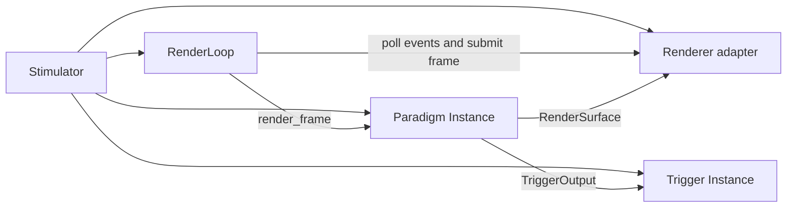

# Stimulation Interface and Rendering Design

Status: S1d/S1f software implementation is complete on `refactor/module-interface`. Required Paradigm methods, narrow capabilities, trigger lifecycle, one async execution path, unified cleanup, opaque graphics handles and explicit constructors/payloads are implemented with their callers. The [execution record](plugin-implementation-plan.md) records regression evidence; real GPU/device timing and other-OS execution remain unverified locally. Section 8 retains the historical batch handoff.

Updated: 2026-11-21. Historical findings describe inspection baseline `0bdd1dd2a296fea4b919d7f1a186a6fb76477b8e`. The branch retains S1a–S1c from `e81f825` and subsequently implements independent S1e Actuation work; lifecycle and graphics software changes are recorded as complete below; physical GPU/device and other-OS checks remain unperformed.

Stimulation needs complete plugin contracts and one owner for renderer, paradigm and trigger resources. Keep the existing rendering adapters and stimulus state machine; complete their boundaries and failure handling without adding a rendering framework or compatibility layer.

This document records the module responsibilities, current defects, target lifecycle, timing semantics and acceptance criteria. The [Plugin API v1 contracts](plugin-api-v1.md) remain authoritative for public signatures and values. The [backend review](backend-interface-review.md) tracks these findings as D07–D09 and R03; the [plugin architecture proposal](plugin-marketplace-design.md) owns packaging and distribution rules.

The implemented display-timing follow-up in [section 9](#9-display-timing-follow-up) separates host presentation timing from plugin content policy. It replaces the earlier diagnostic recommendation to stop a run after any missed refresh. Native macOS tests cover scheduling and submission; measured optical presentation remains a separate acceptance check.

Follow the [canonical plugin terminology and module names](plugin-marketplace-design.md#3-concepts-and-architectural-boundaries). Stimulation Host creates Instances from the selected `paradigm` and `trigger` Contributions, which may come from one or different Plugin Packages. `Paradigm` and `TriggerEmitter` name the role contracts; runtime calls below target their Instances. The renderer is a host adapter, not another Contribution kind or Plugin Management responsibility.

## 1. Scope and constraints

- Replace current interfaces and their callers together under the single pre-launch Plugin API v1. Do not retain old constructor signatures, method aliases or fallback dispatch.
- Preserve cued trials, explicit free-run trials, result feedback, classic target IDs `1..40`, configured no-trigger mode, configuration pause, and local/external output-node behavior.
- Keep configuration identities, command correlation, queues, process supervision and admission decisions in the host. Plugins receive only their own parameters/resources and necessary drawing/trigger capabilities.
- Use the existing main-thread asynchronous execution path. Remove the alternate thread path after auditing its callers; another path needs a concrete platform requirement.
- Keep PyOpenGL and ModernGL adapters. A narrow drawing protocol does not require a proxy, another process or a separately installed SDK.

Frame-pack generation and image storage remain covered by [Building the stimulation frame pack](stimulation-frame-pack.md). Changing the plugin API does not require changing that storage format.

## 2. Responsibilities and current execution

| Component | Responsibility | Boundary |
| --- | --- | --- |
| Stimulation application | Admit trial/result requests, validate host identity, manage queues and receipts, and coordinate pause/stop. | Keep IPC, module revisions and command IDs private. |
| `Stimulator` | Construct selected components and own their preparation, rendering execution and cleanup; the application retains the task. | One resource owner across successful and partial startup. |
| `RenderLoop` | Poll window events, call the paradigm for one frame, and submit that frame. | Drive the loop without independently owning plugin teardown. |
| Renderer adapter | Implement window/context operations, drawing and texture resources. | Host uses lifecycle/submission methods; paradigm uses `RenderSurface`. |
| Paradigm Instance (`Paradigm` contract) | Own cue/stimulus/feedback state, draw its content and request trigger operations. | No window, process or scheduler control. |
| Trigger Instance (`TriggerEmitter` contract) | Implement device-specific setup, send, clear and release. | Paradigm receives only `TriggerOutput.send/clear`; host owns lifecycle. |

These are existing responsibilities to clarify, not six new services or classes.



The [current application](../omnibci/infrastructure/stimulation/application.py:108) creates a task for `Stimulator.start_async()`. Setup and `RenderLoop.run_async()` execute on that event-loop thread. Each iteration polls events and acquires a fresh display opportunity with `begin_frame()`. When one exists, the loop calls `render_frame(frame)` and `end_frame(frame, submit=...)`, then yields to other coroutines. The application also [awaits the rendering task during shutdown](../omnibci/infrastructure/stimulation/application.py:172).

At the inspection baseline, the alternative `Stimulator.start()` created resources on its caller's thread and then started a background render thread. S1d removed that path. Its historical defects below must not be attributed to the current asynchronous application.

## 3. Baseline problems and their effects

### 3.1 Partial preparation and cleanup failures lose resource ownership

[Stimulator._setup](../omnibci/infrastructure/stimulation/stimulator.py:85) loads the trigger/paradigm, initializes a renderer and calls paradigm setup before assigning the render loop. If texture preparation fails after the window opens, `stop()` has no loop to stop and no matching partial-resource cleanup path. The renderer is only a local variable during this setup.

Both [render-loop exit paths](../omnibci/infrastructure/stimulation/render_loop.py:92) call paradigm teardown and renderer shutdown sequentially inside one `finally`. If paradigm teardown raises, renderer shutdown is skipped. Closing IPC in the application does not release those skipped graphics resources.

The target must register ownership before resource acquisition and attempt cleanup for every acquisition that began, including failed setup. One cleanup failure must not skip other safe releases or replace the original failure. This affects the current asynchronous path as well as the alternate thread path.

### 3.2 The declared Paradigm contract is incomplete

[Paradigm](../omnibci/domain/ports/paradigm.py:17) does not declare `render_frame()` or `is_presenting()`, although the loop and trial scheduler require them. A plugin can implement all declared abstract methods and still fail on the first frame.

[Stimulator.is_presenting](../omnibci/infrastructure/stimulation/stimulator.py:139) treats a missing method or an exception as `False`, and coerces other return values with `bool()`. The [application gate](../omnibci/infrastructure/stimulation/application.py:258) interprets false as permission to take the next trial. A failed state query can therefore overwrite an unfinished trial instead of reporting a fault.

Declare both methods as required. Validate a real boolean readiness result; missing methods, invalid returns and exceptions cannot become synthetic readiness. The existing Classic40 implementation already supplies both methods, so this is a public contract gap rather than evidence that the built-in omits them.

### 3.3 The alternate thread path violates ownership and can report a false stop

`Stimulator.start()` performs setup on the caller's thread; `RenderLoop.start()` renders and tears down on another thread. This contradicts the [Renderer owner-thread contract](../omnibci/domain/ports/renderer.py:63). The setup path does not transfer its graphics ownership to the new thread.

[RenderLoop.stop](../omnibci/infrastructure/stimulation/render_loop.py:64) waits up to its timeout and clears `_thread` without confirming termination. `is_running` can then report false while the old worker is still running. Losing that reference also makes reliable shutdown and overlap prevention harder.

Standardize on the existing async path and retain task ownership until termination is confirmed. A stop timeout leaves unresolved ownership; it must not permit another instance to start over live resources. The application's existing wait for its render task is a guarantee to preserve.

### 3.4 The plugin receives more renderer control than it needs

The full [Renderer protocol](../omnibci/domain/ports/renderer.py:55) includes `initialize`, `shutdown`, `poll_events`, `should_close` and `end_frame`, alongside drawing and texture methods. Passing this declared interface to a paradigm lets the plugin participate in window lifecycle and frame submission that the host already controls.

Expose only `RenderSurface` to the paradigm. The existing adapter can directly implement both the host-facing renderer contract and the plugin-facing drawing protocol. This restricts supported API use; it is not a Python security sandbox or a reason to add a runtime wrapper.

### 3.5 Trigger lifecycle and presentation timing are not fully specified

[Curry8Trigger](../omnibci/infrastructure/plugins/acquisition/neuroscan/curry8/trigger.py:22) loads its driver and writes a clear signal in its constructor. The current trigger port has no setup/teardown contract. Its `send` boolean is ignored by the paradigm, while `clear()` performs a synchronous 20 ms wait.

The [trial acknowledgment](../omnibci/infrastructure/stimulation/application.py:295) is sent after `present_trial()` returns. For a cued Classic40 trial this starts the cue state, not the first stimulus image. At the [cue-to-stimulus transition](../omnibci/infrastructure/plugins/paradigms/classic40SSVEP/ssvep.py:169), the current call order is:

```text
draw the final cue frame
clear trigger, then send the event code
submit the cue frame
on the next render iteration, draw and submit the first stimulus frame
```

Thus command acceptance, a driver call, frame submission and physical display onset are different observations. The blocking clear also occurs on the rendering path. Actual alignment needs measurement on the selected display/driver; neither successful return nor VSync configuration establishes measured physical onset.

Move driver acquisition/release into explicit lifecycle methods. Preserve event-code range, zero/clear behavior and current trial modes. Do not silently move trigger calls to another thread or shift their frame position as part of an interface rename. A timing change needs its own acceptance target and device validation; no public frame-phase enum is required for the existing flow.

## 4. Minimal public API v1 boundary

Paradigm and trigger constructors receive only keyword `parameters` and `resource_root`, following the [shared construction contract](plugin-api-v1.md#3-construction-and-allowed-inputs). They do not receive `SignalInfo`, module IDs, revisions, an engine handle, queues or a generic context. Import and construction do not open devices, create windows or start threads.

| Public contract | Required operations | Ownership |
| --- | --- | --- |
| `Paradigm` | `setup`, `present_trial`, `present_result`, `render_frame`, `is_presenting`, `teardown` | Own stimulus state and its textures; receive `renderer` and `trigger` together during setup. |
| `RenderSurface` | `upload_texture`, `release_texture`, `clear`, `draw_texture`, `draw_rect` | Borrow the host's drawing capability; retain only handles needed for the paradigm's lifetime. |
| `TriggerOutput` | `send`, `clear` | Borrow the selected trigger's emission capability. |
| `TriggerEmitter` | `setup`, `send`, `clear`, `teardown` | Own driver resources under the host's lifecycle ordering. |

Use the exact [drawing/trigger signatures](plugin-api-v1.md#55-drawing-and-trigger-capabilities) and [Paradigm signatures](plugin-api-v1.md#56-paradigm). `Color`, `Rect` and opaque `TextureHandle` are the drawing values; `FrameTiming` is the display-timing input in the shared 19-name inventory. Full `Renderer`, `Stimulator`, `RenderLoop`, GPU objects and host receipts remain internal.

Keep the existing NDC coordinate system: the origin is at the center and y increases upward. `Rect.x/y` identifies the rectangle's lower-left corner within those coordinates. Texture layout, ownership and validation follow the shared drawing contract.

Trial and result parameters are plugin-defined JSON objects, validated using the separate `payload_schemas.trial` and `payload_schemas.result` declarations in the [manifest design](plugin-marketplace-design.md#51-package-contents). A constructor schema cannot substitute for either runtime schema. Classic40 defines cued trials as `{"event_id": 1..40}`, free run as `{"event_id": 0}` and feedback as `{"target_id": 1..40}`. No separate mode field or default coercion is needed. REST/IPC require explicit per-trial objects; the existing count and sequence controls construct those objects from their declared `payload_key`. The host retains schemas from the selected descriptor and validates at command boundaries, without per-frame validation. Malformed input cannot silently select free run. Keep correlation and stale-request checks in the host before invoking the plugin.

The host explicitly supplies a no-op trigger capability when no trigger is configured. Failure to initialize a selected hardware trigger remains a failure; it must not silently select no-trigger mode.

## 5. Target lifecycle and failure handling

Follow the [shared resource-ownership contract](plugin-api-v1.md#6-failures-and-resource-ownership), with `Stimulator` as the single owner for the module's component resources.

### Preparation

1. Validate the accepted selection, parameters and required role methods; construct the selected components without external side effects.
2. Register resource ownership before invoking operations that can partially acquire resources.
3. Initialize the renderer on its owner thread.
4. Set up the trigger and establish its clear baseline.
5. Set up the paradigm with `RenderSurface` and `TriggerOutput` together.
6. Start the frame loop and admit work only after successful preparation.

All paradigm and trigger operations use this same owner thread, including trial/result input, readiness queries and texture release. Keep the existing main-thread async execution model. Heavy texture/model preparation belongs before live rendering, not inside a frame callback.

### Rendering and trial admission

Each iteration polls events and acquires the latest usable native display opportunity. Only a new opportunity invokes `render_frame(frame)`. The host submits ready content if its opportunity is still current; unavailable or expired content is discarded. The paradigm owns image selection and playback state. A short asynchronous sleep only allows commands/events to progress; it does not generate display refreshes.

`is_presenting()` returns true while a trial or feedback is active, and false when another trial can be admitted. Query failure faults the instance and stops further admission. Preserve result feedback and serialized trial behavior without passing the host's trial envelope into the plugin.

Async execution does not make a blocking graphics or driver call interruptible. Keep callbacks bounded under the selected adapter/device contract, and do not promise hard real-time scheduling or successful cancellation of an in-flight device operation.

### Stop, pause and partial failure

1. Stop new trial/result admission and settle queued requests with explicit outcomes.
2. Request loop termination and wait for active callbacks to finish. Do not release resources concurrently with a live callback.
3. Tear down the paradigm while its renderer and trigger capabilities are still valid.
4. Clear the trigger if setup completed, then attempt trigger teardown; teardown handles resources from partial setup as well.
5. Shut down the renderer, including partial initialization where applicable.
6. Publish successful settlement only after required operations completed. Retain original and cleanup failures when settlement is incomplete.

The application requests and awaits this one cleanup operation; the loop and application must not each perform independent plugin teardown. A failure in paradigm teardown still allows safe trigger/renderer release. An unsettled render call prevents concurrent destruction or replacement of resources it still owns.

Preserve the [configuration-pause behavior](../omnibci/infrastructure/stimulation/application.py:407): stop admission, cancel queued trials with correlated outcomes, await rendering termination and clear trigger output before acknowledging pause. This is a stop-and-settle boundary, not a promise to resume halfway through the same visual frame sequence. Preserve generation/revision checks and no automatic replay after a lost connection or uncertain execution.

## 6. Acknowledgment and timing semantics

| Observation | What it establishes | What it does not establish |
| --- | --- | --- |
| Trial accepted | Host checks passed and the paradigm accepted its trial payload. | A cue/stimulus frame has already appeared. |
| Frame submitted | The host completed its renderer submission call. | The submitted content was the first stimulus frame, or a measured physical display time. |
| Presentation idle | The required state query reports no active trial/feedback. | Independent verification of every displayed frame or hardware output. |
| Trigger call completed | The driver call returned under its device contract. | Measured electrical delivery or display synchronization. |
| Pause/stop settled | Rendering ended and required cleanup/clear operations completed successfully. | Reversal of already displayed stimuli or emitted triggers. |

Keep these distinctions in host receipts and diagnostics. Do not expand plugin inputs with operation IDs or export a frame-phase type solely for logging. Existing accepted-request behavior remains valid when described accurately; exact stimulus-onset telemetry requires a separately defined observation and measurement contract.

## 7. Concrete refactoring sequence and acceptance

This work is S1d in the [implementation plan](plugin-implementation-plan.md#s1-replace-domain-contracts-and-their-execution-callers). The rows below are one coordinated contract/consumer change, not separately supported APIs or a requirement to add new orchestration layers.

| Change set | Existing locations | Required result |
| --- | --- | --- |
| Complete domain/SDK contracts | Paradigm, renderer and trigger ports; SDK exports | Required frame/readiness methods, narrow capabilities and trigger lifecycle use canonical definitions. No old API dispatch. |
| Unify ownership and execution | Stimulator, RenderLoop and Stimulation application | One async owner; partial setup is cleaned up; cleanup failures do not skip safe releases; unresolved calls retain ownership. |
| Update built-ins and callers | Classic40, trigger drivers, trial/result dispatch, manifests and schemas | Cued/free-run/feedback behavior and driver event semantics survive the coordinated API change. |
| Preserve module coordination | Pause, startup reporting, peer handling and process supervision | Correlated outcomes, stale-request rejection, explicit stop failures and no replay remain intact. |
| Validate on the appropriate target | Existing tests plus display/driver checks | Headless contract checks pass, followed by real rendering/timing checks for advertised platforms. |

The implementation must satisfy the following scenarios:

| Scenario | Expected outcome |
| --- | --- |
| Missing frame/readiness method | Preparation fails before admitting trials. |
| Readiness throws or returns a non-boolean value | Instance faults; the next queued trial is not admitted as if idle. |
| Renderer, trigger or paradigm setup fails partway | Already acquired resources receive safe cleanup; startup does not report ready. |
| Paradigm teardown or trigger clear fails | Remaining safe releases are attempted; stop/pause does not report success. |
| A render callback remains blocked during stop | No false stopped state, concurrent teardown or overlapping restart. |
| Normal lifecycle and trial/result calls | Setup, drawing, driver calls and cleanup use the designated owner thread. |
| Several queued cued trials, free-run and feedback | Existing ordering, target IDs and frame-pack behavior remain correct. |
| Pause, window closure or peer loss | Preserve explicit request outcomes and cleanup; reconnect does not replay old stimuli. |
| No trigger configured versus configured driver failure | Only explicit no-trigger configuration receives a no-op capability. |
| Timing observations | Acceptance, submission and trigger-call records are not mislabeled as measured stimulus onset. |

Use the existing [render-loop tests](../tests/stimulation/test_render_loop.py), [application lifecycle tests](../tests/stimulation/test_application_lifecycle.py), [pause tests](../tests/stimulation/test_pause_stimulation.py), [feedback tests](../tests/stimulation/test_feedback_display.py) and [frame-pack tests](../tests/stimulation/test_frame_pack.py) as the regression foundation. Add focused failure cases where those contracts are not covered, and update SDK/loader examples with the coordinated API change. Do not remove scenario coverage to accommodate a smaller interface.

Headless fakes can verify ordering, ownership and error handling. Display/GPU/driver timing claims require checks on the relevant execution target. The software acceptance scenarios are covered by the implemented S1d/S1f tests and S6 regression checks. The historical first-batch record below does not establish hardware validation.

## 8. Follow-up branch handoff

Historical handoff, now completed on this branch. The user reopened Stimulation, Paradigm and Renderer without creating another branch. S1d completed in `e2ef5a0`, `854ba37` and `b6271c5`; S1f subsequently completed constructors and payload callers. The sections below preserve the batch reasoning and evidence, rather than pending work.

### 8.1 Withdrawn first batch

Commit `e2299db` is the reference implementation, based on `e81f825`. Its production changes are limited to `domain/ports/paradigm.py`, `infrastructure/stimulation/stimulator.py` and `infrastructure/stimulation/application.py`. It requires frame/readiness methods, rejects missing or non-boolean readiness, handles a closed renderer before querying its last busy state, and reports pending-trial failures before exiting after a readiness error. Healthy trial ordering and feedback while busy are preserved.

Its tests are `tests/domain/test_paradigm_contract.py`, `tests/stimulation/test_stimulation.py`, `tests/stimulation/test_pause_stimulation.py` and `tests/infrastructure/test_stimulation_ack.py`. The historical run first reproduced 28 failures, then passed 270 focused tests, 3718 headless tests, 36 integration tests and eight import contracts, with one Windows-only integration skip. These results describe the withdrawn implementation, not the current branch. Original logs and JUnit reports remain in `/private/tmp/omnibci-s1d-batch1-7qvx6tp2`.

The applicable code/tests were restored and reverified in `e2ef5a0`; see the implementation record for that evidence. The withdrawn commit's results are not reused as proof for the restored code.

### 8.2 Second batch: capabilities and lifecycle

This batch is implemented after `e2ef5a0`. The new failure cases and focused checks are recorded in the [execution plan](plugin-implementation-plan.md). Final verification passed 3865 headless tests, 36 integration tests (one Windows-only skip) and eight import contracts. The table records the implemented boundary, with graphics-specific work retained in section 8.3.

| Change boundary | Concrete adjustment and reason |
| --- | --- |
| Domain and SDK capabilities | Extract `RenderSurface` from `domain/ports/renderer.py`; declare `TriggerOutput` alongside the trigger port in `domain/ports/acquisition.py`. Publish those narrow contracts instead of full Renderer. Pass the existing objects directly; add no proxy or generic context. Keep canonical signatures in [Plugin API v1](plugin-api-v1.md#55-drawing-and-trigger-capabilities). |
| Paradigm and built-in consumers | Require `setup(*, renderer, trigger)` and argument-free teardown. Remove `bind_trigger` and Classic40's superseded constructor trigger argument. Update Classic40 and FeedbackDisplay to use RenderSurface. S1f subsequently replaced the shared parameters/context constructor. |
| Trigger implementations | Add setup/teardown to Curry8Trigger, Scan45Trigger and the explicit no-trigger implementation. Move device acquisition out of constructors, make send return None, and report driver/platform failures instead of logging fake success or returning None from initialization. Follow actual driver release capabilities; do not invent a DLL close operation. Preserve event ranges, repeated markers and the 20 ms clear wait. |
| Execution path | Keep Stimulator.start_async and RenderLoop.run_async; remove the alternate background-thread path and migrate its test coverage. Make the stop-request operation explicit. The application keeps its existing render task; do not add another task owner or execution framework. |
| Cleanup ownership | Stimulator records components before partial acquisition and owns the single cleanup path. The loop only polls, draws and submits frames. The application requests termination and awaits settlement, without independently clearing the trigger or tearing down plugins. Follow the exact preparation/cleanup order in section 5. Preserve original and cleanup failures, and reject replacement while a callback or cleanup remains unresolved. |
| Minimal renderer lifecycle support | PyOpenGLRenderer and ModernGLRenderer must tolerate partial initialization during shutdown; one failed release must not skip safe window/context cleanup. UIWindow must raise on initialization failure rather than leave a half-initialized object. These are prerequisites for truthful unified cleanup, not a texture-handle redesign. |
| Pause/stop and caller outcomes | Remove independent clear_trigger calls from the application. Send a successful terminal stop receipt only after cleanup and before closing IPC. Review StimulationAppService identity retention on failed stop and StimulationProcessManager's handling of nonzero/forced exits; a dead process alone does not establish successful cleanup. Reuse existing receipts and failure/quarantine state. |

The completed batches preserve admission behavior and add failing cases before fixes for partial setup, cleanup failures, same-thread execution, stop/cancel races, blocked callbacks, no-trigger mode and receipt ordering. Local/external node software paths are covered. Do not change trigger frame placement or claim measured physical onset as part of this interface work.

### 8.3 Graphics completion and remaining dependencies

The graphics batch is implemented against `854ba37`: 81 initial failures were reproduced, then 649 focused tests and eight import contracts passed. Color/Rect validate finite components and positive sizes. Both adapters use opaque surface-owned handles, reject foreign/released handles, and retain failed upload/release ownership until shutdown. Feedback replacement preserves its previous texture on upload failure and retains concurrent text changes. Both adapters and the frame-pack format remain. See the execution record for evidence and target limitations.

- Graphics behavior is covered by headless fakes; real display/device timing remains a target check.
- Keep trial/result method and payload migration coordinated with their actual consumers; do not add old/new method aliases or payload dispatch. The shared constructor, PluginContext removal, manifest/API-version and payload-schema switch were completed in S1f.
- Do not rewrite Classic40's stimulus state machine, remove unrelated locks or add a general lifecycle manager merely to perform the interface changes.
- S1f completed the seven-kind transition without a compatibility layer. Physical display, trigger and actuator timing remain target-specific acceptance work.

## 9. Display-timing follow-up

Status: implemented, 2026-11-21. Precise image-sequence scheduling is currently a Classic40 SSVEP requirement. Other Paradigm plugins may play video and must not inherit Classic40's image-count or 60 Hz assumptions. No video player or compatibility path is introduced. Platform capabilities and local verification are recorded below.

### 9.1 Required behavior

The image sequence follows the display timeline. If the image assigned to a refresh cannot be presented for that refresh, discard that image's expired opportunity. At the next available refresh, select the image assigned to that refresh. Do not retry expired images, extend the sequence to recover them, or submit a burst of intermediate images. A missed refresh alone does not stop the host or invalidate every subsequent trial.

For a 60 Hz sequence whose first stimulus image is assigned to refresh 100:

| Display refresh | Assigned image | Action |
| --- | --- | --- |
| 100 | 0 | Draw and submit image 0 if ready and within its deadline. |
| 101 | 1 | If unavailable or late, omit its submission; the display may retain its previous content. |
| 102 | 2 | Draw image 2; do not retry image 1. |
| 105, after notifications 103–104 were not serviced | 5 | Draw image 5 once; do not replay images 3–4. |

Normally, 60 refresh slots receive 60 successive images. With missed slots, fewer new images are displayed in that second; keeping the intended timeline does not recover the omitted visual stimulation. Record misses and presentation uncertainty rather than reporting an undisturbed stimulus. An uninterrupted 240-image sequence occupies 240 slots, about four seconds at 60 Hz, whether or not every assigned image is successfully displayed. An explicit feedback/stop transition may end the sequence earlier.

### 9.2 Responsibilities

| Component | Responsibility | Excluded responsibility |
| --- | --- | --- |
| Host renderer and render loop | Observe the selected display clock; expose timing for the next usable refresh; keep notifications bounded; draw and submit on the resource owner thread; discard unsubmitted work whose target has expired; record submission/presentation evidence. | Image indices, cue durations, target IDs, video decoding and SSVEP-specific acceptance policy. |
| Classic40 Paradigm | Load its resources before the trial, verify its required display mode, assign cue/stimulus/feedback intervals, select the image for the current refresh and omit expired images. | Native display callbacks, window/context ownership and buffer swaps. |
| Future video Paradigm | Own media playback position, decoded-frame availability and selection by media presentation timestamp; repeat or omit video frames as the media timeline requires. | Assume that one display refresh must consume one new video frame. |
| Domain/SDK | Define and re-export only the timing value and the Paradigm call contract. | Native clock objects, GPU handles, a playback service, a generic plugin context or a new Contribution kind. |

The timing policy belongs to the plugin; the ability to schedule and observe presentation remains a host responsibility. Giving each plugin its own native display loop would duplicate platform code and compete with the host's window and resource ownership. Keep one Paradigm contract and the existing RenderSurface drawing capability. Do not add ImageParadigm/VideoParadigm base classes or a generic media framework for this change.

### 9.3 Minimal call contract

Replace the current elapsed-time argument with one immutable timing value:

```python
@dataclass(frozen=True, slots=True)
class FrameTiming:
    refresh_index: int
    target_time: float
    refresh_period: float

class Paradigm(ABC):
    def render_frame(self, frame: FrameTiming) -> bool: ...
```

- `refresh_index` identifies the target display refresh within the rendering session. It advances with the display timeline even when callbacks are not serviced. It is not the number of Python callbacks, draws or successful swaps. Derive it from the native display timeline, preserving gaps.
- `target_time` is the predicted presentation time in monotonic seconds relative to a fixed rendering-session origin. It is not callback arrival time, GPU completion or an observation that content appeared. It allows a video plugin to align media timestamps with display time.
- `refresh_period` is the display period in seconds for this timing sample. Classic40 uses it to check that the selected display mode matches its 60 Hz image sequence. Keep this requirement in Classic40; do not make 60 Hz a universal host constant. Do not expose an additional redundant FPS field.

Each field has a separate use: exact slot arithmetic, media-time alignment and display-rate validation. Native clock values and platform handles remain private. The host rejects an invalid/discontinuous clock instead of fabricating a successful display sequence from wall-clock sleeps or callback counts. A display/mode change requires re-establishing the timing session and plugin suitability; do not silently reinterpret an active Classic40 timeline.

Return `True` when this call has drawn content ready for submission; return `False` when this opportunity should receive no new frame. This is the smallest explicit way to avoid submitting a partial or unavailable image without adding a result class, extra readiness query or recoverable-error exception. The host must still check its deadline after drawing. `True` establishes neither actual presentation nor that the deadline was met. Resource/driver failures remain errors, not ordinary `False` results.

This replaces `render_frame(elapsed_seconds) -> None` in the pre-launch API v1 and adds only `FrameTiming` to SDK exports. Actual implementations and callers are updated together. The old signature and `None` result have no compatibility path. RenderSurface and the existing constructor/setup capabilities remain unchanged.

### 9.4 Classic40 implementation location and state

Implement image selection in `infrastructure/plugins/paradigms/classic40SSVEP/ssvep.py`, not in RenderLoop, Plugin Management or the frame-pack reader:

```python
image_index = frame.refresh_index - stimulus_start_refresh
```

The first usable frame after a trial request establishes its cue origin, or its stimulus origin for free run. For a cued trial, assign the stimulus origin from the cue origin plus the cue duration. Once assigned, origins do not move because an image was unavailable or a callback was late. If the first stimulus opportunity is missed, the next opportunity selects image 1, not image 0 with a shifted origin. Classic40 accepts a fixed 60 Hz mode within 0.01 Hz of the native reported rate; 59.94 Hz, 75 Hz and 120 Hz require different stimulus assets and are rejected.

Derive the active cue/stimulus/result interval from the same display timeline, rather than decrementing a counter once per callback. A gap crossing a phase boundary must select the content belonging to the current interval. End the stimulus interval when its assigned slots are exhausted; do not wait until every texture has been successfully submitted. Reuse the existing state machine and pre-uploaded texture list; no sequence-player service is needed.

Keep the current pack's 60 Hz requirement explicit in this plugin. A generic pack-format migration is unnecessary for this fixed built-in asset. Support for externally generated packs with different timing would need explicit asset timing metadata when that feature is implemented.

Trigger operations remain separate from display evidence. A missed image does not repeatedly emit a start marker or rebase the stimulus phase. Normal last-cue-frame marker placement is preserved and still needs hardware alignment validation. If that marker opportunity was missed, emit once at the first serviced stimulus opportunity and log the delay; if the entire stimulus interval elapsed, omit the expired start marker. Neither case establishes measured optical onset or backdates a marker.

### 9.5 Host scheduling and presentation limits

Use the existing host renderer boundary for acquiring a frame opportunity and ending it with submission or discard. Keep these operations private to the host; plugins continue to receive only RenderSurface. Their backend implementation owns any drawable/buffer cleanup on the discard path.

1. The native display source records the latest timing. The render owner samples it while yielding to commands and events. Native callbacks do not call plugin drawing methods or manage plugin teardown.
2. The owner processes window events, then obtains fresh timing for a usable target. Keep the last consumed refresh across iterations; do not reset the baseline after polling and accidentally wait past a notification that already arrived.
3. Invoke the plugin at most once for that target. Coalesce stale notifications into the newest usable target; preserve skipped refresh numbers. Do not build a callback backlog or run catch-up draws.
4. If the plugin returns `False`, or the target expires before submission, discard the pending output. Acquire a new opportunity and let the plugin select that opportunity's content. Do not carry an expired rendered image forward under a new target number.
5. If submitted, retain the target identity in host diagnostics and obtain presentation evidence where the backend supports it. Distinguish a known skipped submission, a known late presentation and an unverified presentation. Waiting must allow the existing async command/stop path to progress.

The preceding macOS experiments found event-poll and swap calls longer than the 16.67 ms budget, including swap outliers around 55–75 ms. Persistent display-clock accounting removed an avoidable wait but did not remove native stalls. These measurements concern API durations and display-clock gaps; they are not optical proof of which image appeared. Content selection and native pacing therefore require separate validation.

An expired unsubmitted frame can be discarded. A frame already queued to the GPU/compositor may not be cancellable; a post-draw deadline check alone cannot guarantee that it never appears late. Do not accumulate a queue of old frames, and do not claim that changing to Metal automatically solves this issue: Apple's [scheduled presentation contract](https://developer.apple.com/documentation/metal/mtldrawable/present(at:)) explicitly allows late GPU work to present as soon as possible. Its [presentedTime](https://developer.apple.com/documentation/metal/mtldrawable/presentedtime) provides presentation observations, not a deadline guarantee. Validate any backend change against the same missed-slot policy and actual workload before integration.

Likewise, [GLFW swap interval](https://www.glfw.org/docs/latest/group__context.html) is not reliable evidence of every image appearing on its assigned refresh. Apple's [display callback](https://developer.apple.com/documentation/corevideo/cvdisplaylinkoutputcallback) distinguishes current time from the frame's target display time; preserve that distinction in FrameTiming.

Normal missed opportunities continue according to plugin content policy. Clock loss, device/context failure and invalid resources retain the existing fault/cleanup behavior. Do not add a universal stop-on-one-miss rule, automatic decoder cancellation, new quality thresholds or a second lifecycle owner as part of this change.

### 9.6 Video fit and review-sized implementation batches

A 30 fps video on a 60 Hz display normally repeats each video frame over two refresh slots. Its plugin selects a decoded frame by `frame.target_time - playback_origin` and the media presentation timestamps, not by incrementing a decoded-frame index on every callback. Decode ahead outside the draw callback, retain a bounded set of frames, and discard media frames that are already obsolete. If no suitable new frame is ready, the plugin can retain the current displayed content. The same timing contract permits this without adding a video decoder to the host now.

| Batch | Specific locations | Verification |
| --- | --- | --- |
| A: timing contract and Classic40 selection | `domain/ports/renderer.py`, `domain/ports/paradigm.py`, SDK export, `classic40SSVEP/ssvep.py` and their direct callers/tests | Fail first for a skipped refresh, an unavailable image, duplicate notification, a phase-boundary gap and a missed first stimulus image. Verify current-slot selection, fixed origins and no extension of the 240-slot interval. |
| B: host opportunity/submission path | `infrastructure/stimulation/render_loop.py`, renderer adapters and their initialization/cleanup | Verify latest-timing consumption after event polling, one draw per target, discard on `False`/expired target, no backlog, and responsive stop/clock-failure cleanup. Preserve one resource owner. |
| C: native acceptance | Real selected display, actual framebuffer dimensions and representative texture workload | Record target refresh, content identity and available presentation evidence. Normal operation must follow the intended image order; injected stalls must omit expired images and recover to the current slot without catch-up. Averages alone do not pass. Optical/trigger checks remain necessary for claims about stimulus onset. |

These are review-sized parts of one coordinated change, not independently supported old/new interfaces. Do not ship batch A wired to a fabricated display counter while batch B is absent. Start with a deterministic timing source in tests; complete the real timing/submission path before presenting the result as a precision fix. No video player, generic scheduling framework, compatibility layer or automatic Metal migration is included.

### 9.7 Implemented platform boundary and verification

The two GL adapters share one private FrameClock. `begin_frame()` is nonblocking and returns `None` until a new usable native sample exists. `end_frame(frame, submit=...)` consumes the acquired opportunity exactly once, refuses expired/superseded output, and reports only whether the swap call completed. Native timing sources close before their window/context. Clock loss for one second faults the existing owner path; ordinary missed opportunities continue. Shutdown logs skipped opportunities, discarded frames and submission attempts without labeling them physical presentations.

| Platform | Native source | Current boundary |
| --- | --- | --- |
| macOS | CoreVideo output video/host timestamps for the monitor containing most of the window | Native tests completed locally. Display/mode changes require restart. |
| Windows | DWM refresh counter and QPC timestamps | Single active display; binding/layout and conversion tested with fakes, native execution not verified locally. |
| Linux/X11 | GLX_OML_sync_control MSC/UST and reported refresh rate | Single active display, extension required, current monotonic-microsecond UST required. Conversion/failure tests use fakes; native execution not verified locally. Wayland timing is unsupported. |

These limits are explicit errors, not silent 60 Hz timer fallbacks. Multi-output Windows/Linux timing and additional native presentation APIs require target-specific work; neither is implied by the shared Python interface. No new runtime dependency is required.

The first regression batches reproduced 30 failures in timing values/Classic40, two render-loop failures, ten host-clock failures, three native-source contract failures and two adapter failures before their corresponding implementations. Existing elapsed-time/countdown fixtures were migrated to the single new contract.

Native static-content checks exercise both adapters, including deliberate stalls of 3.5 display periods. With the real Classic40 state machine, 240 pre-uploaded 1920×990 grey textures and a 1920×1080 window, both target timelines ended after 4.0000212 seconds on this 60 Hz macOS display. PyOpenGL drew 236 stimulus images with four skipped opportunities; ModernGL drew 232 with eight skipped opportunities. Each discarded one in-progress submission. Every selected image matched its display-slot offset; none was replayed and the 240-slot interval was not extended. These counts are drawing/submission observations, not counts of optically verified images. Static textures avoid flashing stimuli during automated native checks.

Final local verification: 811 relevant headless tests passed, all eight distinct native GUI cases passed across the focused runs, and all 11 import-layer contracts passed. The previous PyOpenGL shader-startup regression remains covered. Windows/Linux native execution and electrical/optical timing are not established by these results.
