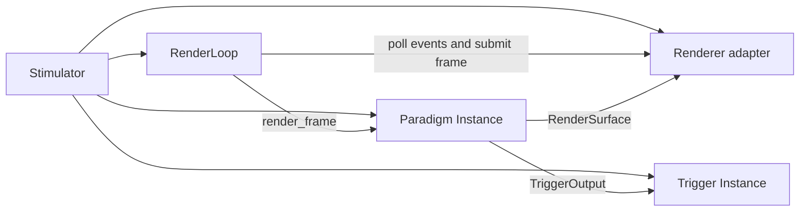

# Stimulation Interface and Rendering Design

Status: deferred to a dedicated follow-up branch. No S1d implementation changes remain on `refactor/module-interface`. The first batch is preserved in Git history at `e2299db`; the second batch was analyzed but not implemented. See the [handoff](#8-follow-up-branch-handoff).

Updated: 2026-11-20. Historical findings describe inspection baseline `0bdd1dd2a296fea4b919d7f1a186a6fb76477b8e`. The current branch retains S1a–S1c from `e81f825`; the APIs and lifecycle below are future Stimulation work.

Stimulation needs complete plugin contracts and one owner for renderer, paradigm and trigger resources. Keep the existing rendering adapters and stimulus state machine; complete their boundaries and failure handling without adding a rendering framework or compatibility layer.

This document records the module responsibilities, current defects, target lifecycle, timing semantics and acceptance criteria. The [Plugin API v1 contracts](plugin-api-v1.md) remain authoritative for public signatures and values. The [backend review](backend-interface-review.md) tracks these findings as D07–D09 and R03; the [plugin architecture proposal](plugin-marketplace-design.md) owns packaging and distribution rules.

Follow the [canonical plugin terminology and module names](plugin-marketplace-design.md#3-concepts-and-architectural-boundaries). Stimulation Host creates Instances from the selected `paradigm` and `trigger` Contributions, which may come from one or different Plugin Packages. `Paradigm` and `TriggerEmitter` name the role contracts; runtime calls below target their Instances. The renderer is a host adapter, not another Contribution kind or Plugin Management responsibility.

## 1. Scope and constraints

- Replace current interfaces and their callers together under the single pre-launch Plugin API v1. Do not retain old constructor signatures, method aliases or fallback dispatch.
- Preserve cued trials, explicit free-run trials, result feedback, classic target IDs `1..40`, configured no-trigger mode, configuration pause, and local/external output-node behavior.
- Keep configuration identities, command correlation, queues, process supervision and admission decisions in the host. Plugins receive only their own parameters/resources and necessary drawing/trigger capabilities.
- Use the existing main-thread asynchronous execution path. Remove the alternate thread path after auditing its callers; another path needs a concrete platform requirement.
- Keep PyOpenGL and ModernGL adapters. A narrow drawing protocol does not require a proxy, another process or a separately installed SDK.

Frame-pack generation and image storage remain covered by [Building the stimulation frame pack](stimulation-frame-pack.md). Changing the plugin API does not require changing that storage format.

## 2. Responsibilities and current execution

| Component | Target responsibility | Boundary |
| --- | --- | --- |
| Stimulation application | Admit trial/result requests, validate host identity, manage queues and receipts, and coordinate pause/stop. | Keep IPC, module revisions and command IDs private. |
| `Stimulator` | Construct selected components and own their preparation, rendering task and cleanup. | One resource owner across successful and partial startup. |
| `RenderLoop` | Poll window events, call the paradigm for one frame, and submit that frame. | Drive the loop without independently owning plugin teardown. |
| Renderer adapter | Implement window/context operations, drawing and texture resources. | Host uses lifecycle/submission methods; paradigm uses `RenderSurface`. |
| Paradigm Instance (`Paradigm` contract) | Own cue/stimulus/feedback state, draw its content and request trigger operations. | No window, process or scheduler control. |
| Trigger Instance (`TriggerEmitter` contract) | Implement device-specific setup, send, clear and release. | Paradigm receives only `TriggerOutput.send/clear`; host owns lifecycle. |

These are existing responsibilities to clarify, not six new services or classes.



The [current application](../omnibci/infrastructure/stimulation/application.py:108) creates a task for `Stimulator.start_async()`. Setup and `RenderLoop.run_async()` execute on that event-loop thread. Each iteration polls events, calls `render_frame(t)`, calls `end_frame()`, then yields to other coroutines. The application also [awaits the rendering task during shutdown](../omnibci/infrastructure/stimulation/application.py:172).

The alternative `Stimulator.start()` creates resources on its caller's thread and then starts a background render thread. Its defects below must not be attributed to every run of the current asynchronous application.

## 3. Current problems and their effects

### 3.1 Partial preparation and cleanup failures lose resource ownership

[Stimulator._setup](../omnibci/infrastructure/stimulation/stimulator.py:85) loads the trigger/paradigm, initializes a renderer and calls paradigm setup before assigning the render loop. If texture preparation fails after the window opens, `stop()` has no loop to stop and no matching partial-resource cleanup path. The renderer is only a local variable during this setup.

Both [render-loop exit paths](../omnibci/infrastructure/stimulation/render_loop.py:92) call paradigm teardown and renderer shutdown sequentially inside one `finally`. If paradigm teardown raises, renderer shutdown is skipped. Closing IPC in the application does not release those skipped graphics resources.

The target must register ownership before resource acquisition and attempt cleanup for every acquisition that began, including failed setup. One cleanup failure must not skip other safe releases or replace the original failure. This affects the current asynchronous path as well as the alternate thread path.

### 3.2 The declared Paradigm contract is incomplete

[Paradigm](../omnibci/domain/ports/paradigm.py:17) does not declare `render_frame()` or `is_presenting()`, although the loop and trial scheduler require them. A plugin can implement all declared abstract methods and still fail on the first frame.

[Stimulator.is_presenting](../omnibci/infrastructure/stimulation/stimulator.py:139) treats a missing method or an exception as `False`, and coerces other return values with `bool()`. The [application gate](../omnibci/infrastructure/stimulation/application.py:258) interprets false as permission to take the next trial. A failed state query can therefore overwrite an unfinished trial instead of reporting a fault.

Declare both methods as required. Validate a real boolean readiness result; missing methods, invalid returns and exceptions cannot become synthetic readiness. The existing Classic40 implementation already supplies both methods, so this is a public contract gap rather than evidence that the built-in omits them.

### 3.3 The alternate thread path violates ownership and can report a false stop

`Stimulator.start()` performs setup on the caller's thread; `RenderLoop.start()` renders and tears down on another thread. This contradicts the [Renderer owner-thread contract](../omnibci/domain/ports/renderer.py:63). The setup path does not transfer its graphics ownership to the new thread.

[RenderLoop.stop](../omnibci/infrastructure/stimulation/render_loop.py:64) waits up to its timeout and clears `_thread` without confirming termination. `is_running` can then report false while the old worker is still running. Losing that reference also makes reliable shutdown and overlap prevention harder.

Standardize on the existing async path and retain task ownership until termination is confirmed. A stop timeout leaves unresolved ownership; it must not permit another instance to start over live resources. The application's existing wait for its render task is a guarantee to preserve.

### 3.4 The plugin receives more renderer control than it needs

The full [Renderer protocol](../omnibci/domain/ports/renderer.py:55) includes `initialize`, `shutdown`, `poll_events`, `should_close` and `end_frame`, alongside drawing and texture methods. Passing this declared interface to a paradigm lets the plugin participate in window lifecycle and frame submission that the host already controls.

Expose only `RenderSurface` to the paradigm. The existing adapter can directly implement both the host-facing renderer contract and the plugin-facing drawing protocol. This restricts supported API use; it is not a Python security sandbox or a reason to add a runtime wrapper.

### 3.5 Trigger lifecycle and presentation timing are not fully specified

[Curry8Trigger](../omnibci/infrastructure/plugins/acquisition/neuroscan/curry8/trigger.py:22) loads its driver and writes a clear signal in its constructor. The current trigger port has no setup/teardown contract. Its `send` boolean is ignored by the paradigm, while `clear()` performs a synchronous 20 ms wait.

The [trial acknowledgment](../omnibci/infrastructure/stimulation/application.py:295) is sent after `present_trial()` returns. For a cued Classic40 trial this starts the cue state, not the first stimulus image. At the [cue-to-stimulus transition](../omnibci/infrastructure/plugins/paradigms/classic40SSVEP/ssvep.py:169), the current call order is:

```text
draw the final cue frame
clear trigger, then send the event code
submit the cue frame
on the next render iteration, draw and submit the first stimulus frame
```

Thus command acceptance, a driver call, frame submission and physical display onset are different observations. The blocking clear also occurs on the rendering path. Actual alignment needs measurement on the selected display/driver; neither successful return nor VSync configuration establishes measured physical onset.

Move driver acquisition/release into explicit lifecycle methods. Preserve event-code range, zero/clear behavior and current trial modes. Do not silently move trigger calls to another thread or shift their frame position as part of an interface rename. A timing change needs its own acceptance target and device validation; no public frame-phase enum is required for the existing flow.

## 4. Minimal public API v1 boundary

Paradigm and trigger constructors receive only keyword `parameters` and `resource_root`, following the [shared construction contract](plugin-api-v1.md#3-construction-and-allowed-inputs). They do not receive `SignalInfo`, module IDs, revisions, an engine handle, queues or a generic context. Import and construction do not open devices, create windows or start threads.

| Public contract | Required operations | Ownership |
| --- | --- | --- |
| `Paradigm` | `setup`, `present_trial`, `present_result`, `render_frame`, `is_presenting`, `teardown` | Own stimulus state and its textures; receive `renderer` and `trigger` together during setup. |
| `RenderSurface` | `upload_texture`, `release_texture`, `clear`, `draw_texture`, `draw_rect` | Borrow the host's drawing capability; retain only handles needed for the paradigm's lifetime. |
| `TriggerOutput` | `send`, `clear` | Borrow the selected trigger's emission capability. |
| `TriggerEmitter` | `setup`, `send`, `clear`, `teardown` | Own driver resources under the host's lifecycle ordering. |

Use the exact [drawing/trigger signatures](plugin-api-v1.md#55-drawing-and-trigger-capabilities) and [Paradigm signatures](plugin-api-v1.md#56-paradigm). `Color`, `Rect` and opaque `TextureHandle` are the necessary drawing values; this module adds no SDK names beyond the shared 18-name inventory. Full `Renderer`, `Stimulator`, `RenderLoop`, GPU objects and host receipts remain internal.

Keep the existing NDC coordinate system: the origin is at the center and y increases upward. `Rect.x/y` identifies the rectangle's lower-left corner within those coordinates. Texture layout, ownership and validation follow the shared drawing contract.

Trial and result parameters are plugin-defined JSON objects, validated using the separate `payload_schemas.trial` and `payload_schemas.result` declarations in the [manifest design](plugin-marketplace-design.md#51-package-contents). A constructor schema cannot substitute for either runtime schema. Define explicit cued/free-run payloads and update all callers; malformed input must not silently select free run. Keep correlation and stale-request checks in the host before invoking the plugin.

The host explicitly supplies a no-op trigger capability when no trigger is configured. Failure to initialize a selected hardware trigger remains a failure; it must not silently select no-trigger mode.

## 5. Target lifecycle and failure handling

Follow the [shared resource-ownership contract](plugin-api-v1.md#6-failures-and-resource-ownership), with `Stimulator` as the single owner for the module's component resources.

### Preparation

1. Validate the accepted selection, parameters and required role methods; construct the selected components without external side effects.
2. Register resource ownership before invoking operations that can partially acquire resources.
3. Initialize the renderer on its owner thread.
4. Set up the trigger and establish its clear baseline.
5. Set up the paradigm with `RenderSurface` and `TriggerOutput` together.
6. Start the frame loop and admit work only after successful preparation.

All paradigm and trigger operations use this same owner thread, including trial/result input, readiness queries and texture release. Keep the existing main-thread async execution model. Heavy texture/model preparation belongs before live rendering, not inside a frame callback.

### Rendering and trial admission

Each iteration polls events, invokes `render_frame(elapsed_seconds)` and submits the frame. Elapsed time is monotonic time since the rendering session began. The host owns submission; the paradigm owns what is drawn.

`is_presenting()` returns true while a trial or feedback is active, and false when another trial can be admitted. Query failure faults the instance and stops further admission. Preserve result feedback and serialized trial behavior without passing the host's trial envelope into the plugin.

Async execution does not make a blocking graphics or driver call interruptible. Keep callbacks bounded under the selected adapter/device contract, and do not promise hard real-time scheduling or successful cancellation of an in-flight device operation.

### Stop, pause and partial failure

1. Stop new trial/result admission and settle queued requests with explicit outcomes.
2. Request loop termination and wait for active callbacks to finish. Do not release resources concurrently with a live callback.
3. Tear down the paradigm while its renderer and trigger capabilities are still valid.
4. Clear the trigger if setup completed, then attempt trigger teardown; teardown handles resources from partial setup as well.
5. Shut down the renderer, including partial initialization where applicable.
6. Publish successful settlement only after required operations completed. Retain original and cleanup failures when settlement is incomplete.

The application requests and awaits this one cleanup operation; the loop and application must not each perform independent plugin teardown. A failure in paradigm teardown still allows safe trigger/renderer release. An unsettled render call prevents concurrent destruction or replacement of resources it still owns.

Preserve the [configuration-pause behavior](../omnibci/infrastructure/stimulation/application.py:407): stop admission, cancel queued trials with correlated outcomes, await rendering termination and clear trigger output before acknowledging pause. This is a stop-and-settle boundary, not a promise to resume halfway through the same visual frame sequence. Preserve generation/revision checks and no automatic replay after a lost connection or uncertain execution.

## 6. Acknowledgment and timing semantics

| Observation | What it establishes | What it does not establish |
| --- | --- | --- |
| Trial accepted | Host checks passed and the paradigm accepted its trial payload. | A cue/stimulus frame has already appeared. |
| Frame submitted | The host completed its renderer submission call. | The submitted content was the first stimulus frame, or a measured physical display time. |
| Presentation idle | The required state query reports no active trial/feedback. | Independent verification of every displayed frame or hardware output. |
| Trigger call completed | The driver call returned under its device contract. | Measured electrical delivery or display synchronization. |
| Pause/stop settled | Rendering ended and required cleanup/clear operations completed successfully. | Reversal of already displayed stimuli or emitted triggers. |

Keep these distinctions in host receipts and diagnostics. Do not expand plugin inputs with operation IDs or export a frame-phase type solely for logging. Existing accepted-request behavior remains valid when described accurately; exact stimulus-onset telemetry requires a separately defined observation and measurement contract.

## 7. Concrete refactoring sequence and acceptance

This work is S1d in the [implementation plan](plugin-implementation-plan.md#s1-replace-domain-contracts-and-their-execution-callers). The rows below are one coordinated contract/consumer change, not separately supported APIs or a requirement to add new orchestration layers.

| Change set | Existing locations | Required result |
| --- | --- | --- |
| Complete domain/SDK contracts | Paradigm, renderer and trigger ports; SDK exports | Required frame/readiness methods, narrow capabilities and trigger lifecycle use canonical definitions. No old API dispatch. |
| Unify ownership and execution | Stimulator, RenderLoop and Stimulation application | One async owner; partial setup is cleaned up; cleanup failures do not skip safe releases; unresolved calls retain ownership. |
| Update built-ins and callers | Classic40, trigger drivers, trial/result dispatch, manifests and schemas | Cued/free-run/feedback behavior and driver event semantics survive the coordinated API change. |
| Preserve module coordination | Pause, startup reporting, peer handling and process supervision | Correlated outcomes, stale-request rejection, explicit stop failures and no replay remain intact. |
| Validate on the appropriate target | Existing tests plus display/driver checks | Headless contract checks pass, followed by real rendering/timing checks for advertised platforms. |

The implementation must satisfy the following scenarios:

| Scenario | Expected outcome |
| --- | --- |
| Missing frame/readiness method | Preparation fails before admitting trials. |
| Readiness throws or returns a non-boolean value | Instance faults; the next queued trial is not admitted as if idle. |
| Renderer, trigger or paradigm setup fails partway | Already acquired resources receive safe cleanup; startup does not report ready. |
| Paradigm teardown or trigger clear fails | Remaining safe releases are attempted; stop/pause does not report success. |
| A render callback remains blocked during stop | No false stopped state, concurrent teardown or overlapping restart. |
| Normal lifecycle and trial/result calls | Setup, drawing, driver calls and cleanup use the designated owner thread. |
| Several queued cued trials, free-run and feedback | Existing ordering, target IDs and frame-pack behavior remain correct. |
| Pause, window closure or peer loss | Preserve explicit request outcomes and cleanup; reconnect does not replay old stimuli. |
| No trigger configured versus configured driver failure | Only explicit no-trigger configuration receives a no-op capability. |
| Timing observations | Acceptance, submission and trigger-call records are not mislabeled as measured stimulus onset. |

Use the existing [render-loop tests](../tests/stimulation/test_render_loop.py), [application lifecycle tests](../tests/stimulation/test_application_lifecycle.py), [pause tests](../tests/stimulation/test_pause_stimulation.py), [feedback tests](../tests/stimulation/test_feedback_display.py) and [frame-pack tests](../tests/stimulation/test_frame_pack.py) as the regression foundation. Add focused failure cases where those contracts are not covered, and update SDK/loader examples with the coordinated API change. Do not remove scenario coverage to accommodate a smaller interface.

Headless fakes can verify ordering, ownership and error handling. Display/GPU/driver timing claims require checks on the relevant execution target. These are planned acceptance criteria; the withdrawn first-batch implementation is recorded below and does not establish hardware validation.

## 8. Follow-up branch handoff

The user deferred all Stimulation/Paradigm implementation on 2026-11-20 to keep `refactor/module-interface` focused. Keep this design as a proposal; do not implement the remaining batches or restore the withdrawn first batch on this branch. No follow-up branch has been created by this scope decision.

### 8.1 Withdrawn first batch

Commit `e2299db` is the reference implementation, based on `e81f825`. Its production changes are limited to `domain/ports/paradigm.py`, `infrastructure/stimulation/stimulator.py` and `infrastructure/stimulation/application.py`. It requires frame/readiness methods, rejects missing or non-boolean readiness, handles a closed renderer before querying its last busy state, and reports pending-trial failures before exiting after a readiness error. Healthy trial ordering and feedback while busy are preserved.

Its tests are `tests/domain/test_paradigm_contract.py`, `tests/stimulation/test_stimulation.py`, `tests/stimulation/test_pause_stimulation.py` and `tests/infrastructure/test_stimulation_ack.py`. The historical run first reproduced 28 failures, then passed 270 focused tests, 3718 headless tests, 36 integration tests and eight import contracts, with one Windows-only integration skip. These results describe the withdrawn implementation, not the current branch. Original logs and JUnit reports remain in `/private/tmp/omnibci-s1d-batch1-7qvx6tp2`.

On the follow-up branch, inspect its actual base and recover the applicable code/tests from that commit. Reconcile documentation status separately; do not blindly restore the old branch scope or assume that historical test results validate the new base.

### 8.2 Proposed second batch: capabilities and lifecycle

This batch has not been implemented or approved for implementation on the current branch. Present its concrete scope again before changing code on the follow-up branch.

| Change boundary | Concrete adjustment and reason |
| --- | --- |
| Domain and SDK capabilities | Extract `RenderSurface` from `domain/ports/renderer.py`; declare `TriggerOutput` alongside the trigger port in `domain/ports/acquisition.py`. Publish those narrow contracts instead of full Renderer. Pass the existing objects directly; add no proxy or generic context. Keep canonical signatures in [Plugin API v1](plugin-api-v1.md#55-drawing-and-trigger-capabilities). |
| Paradigm and built-in consumers | Require `setup(*, renderer, trigger)` and argument-free teardown. Remove `bind_trigger` and Classic40's superseded constructor trigger argument. Update Classic40 and FeedbackDisplay to use RenderSurface. The shared parameters/context constructor replacement remains S1f. |
| Trigger implementations | Add setup/teardown to Curry8Trigger, Scan45Trigger and the explicit no-trigger implementation. Move device acquisition out of constructors, make send return None, and report driver/platform failures instead of logging fake success or returning None from initialization. Follow actual driver release capabilities; do not invent a DLL close operation. Preserve event ranges, repeated markers and the 20 ms clear wait. |
| Execution path | Keep Stimulator.start_async and RenderLoop.run_async; remove the alternate background-thread path and migrate its test coverage. Make the stop-request operation explicit. The application keeps its existing render task; do not add another task owner or execution framework. |
| Cleanup ownership | Stimulator records components before partial acquisition and owns the single cleanup path. The loop only polls, draws and submits frames. The application requests termination and awaits settlement, without independently clearing the trigger or tearing down plugins. Follow the exact preparation/cleanup order in section 5. Preserve original and cleanup failures, and reject replacement while a callback or cleanup remains unresolved. |
| Minimal renderer lifecycle support | PyOpenGLRenderer and ModernGLRenderer must tolerate partial initialization during shutdown; one failed release must not skip safe window/context cleanup. UIWindow must raise on initialization failure rather than leave a half-initialized object. These are prerequisites for truthful unified cleanup, not a texture-handle redesign. |
| Pause/stop and caller outcomes | Remove independent clear_trigger calls from the application. Send a successful terminal stop receipt only after cleanup and before closing IPC. Review StimulationAppService identity retention on failed stop and StimulationProcessManager's handling of nonzero/forced exits; a dead process alone does not establish successful cleanup. Reuse existing receipts and failure/quarantine state. |

Preserve the first-batch admission behavior when it is restored. First add failing cases for partial setup, every cleanup failure, same-thread execution, stop/cancel races, blocked callbacks, no-trigger mode and receipt ordering. Verify real callers and both local/external node paths. Do not change trigger frame placement or claim measured physical onset as part of this interface work.

### 8.3 Remaining scope and dependencies

- Keep Color/Rect validation, opaque handle ownership, stale/foreign handle rejection and feedback texture replacement for the graphics batch. Preserve both adapters and the frame-pack format.
- Keep trial/result method and payload migration coordinated with their actual consumers; do not add old/new method aliases or payload dispatch. The shared constructor, PluginContext, manifest/API-version and payload-schema switch remains S1f.
- Do not rewrite Classic40's stimulus state machine, remove unrelated locks or add a general lifecycle manager merely to perform the interface changes.
- The complete API v1 transition still requires this deferred work. Branch separation does not authorize a compatibility layer or allow S1f's seven-kind completion gate to be marked complete early.
